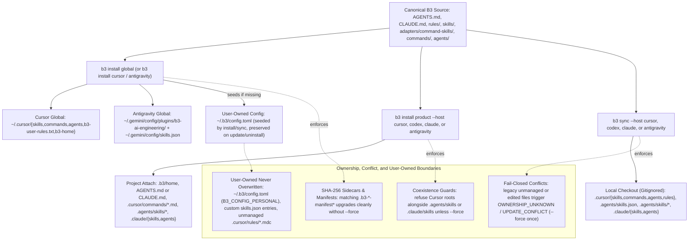

# Adapters

B3 uses a **host-neutral canonical core** (`rules/`, `skills/`, `commands/`, `agents/`, `workflows/`, `review-loop/`) mapped onto **Cursor**, **Codex**, **Claude Code**, and **Antigravity** without duplicating prose.

> **Native CLI & zero-Rust bootstrap:** `b3 sync` and `b3 install <product|cursor|antigravity|global>` execute all sync, product-attach, NTFS junction (`DeviceIoControl`), symlink, manifest, and uninstall flows natively via the zero-dependency `b3` binary (`src/adapters/`). End users only need [`../scripts/bootstrap-b3.ps1`](../scripts/bootstrap-b3.ps1) / [`../scripts/bootstrap-b3.sh`](../scripts/bootstrap-b3.sh) once to download/verify `SHA256SUMS.txt` and install `b3` (with `--rollback` support, requiring zero Rust/Cargo/Node.js/Python/PowerShell/Bash at runtime); contributors can build via `cargo build --release`. Release targets (`.github/workflows/release.yml`): `x86_64-pc-windows-msvc`, `x86_64-unknown-linux-gnu`, `aarch64-apple-darwin`, `x86_64-apple-darwin`.

Do **not** commit duplicate skill, command, or agent trees under `.cursor/`, `.agents/`, `.claude/`, or `.codex/`. Only canonical `AGENTS.md` (plus the minimal `CLAUDE.md` `@AGENTS.md` bridge for Claude Code) lives in the source repo; local discovery links and `.agents/skills.json` are gitignored and generated on demand by `b3 sync` or `b3 install`.

## Multi-host installation & activation

### Diagram B — Multi-Host Installation & Activation



## Host path matrix

| Host | Rules / context | Skills | Commands | Subagents |
| --- | --- | --- | --- | --- |
| **Cursor** | `AGENTS.md` + generated gitignored `.cursor/rules/*.mdc` (`@rules/*.md`, `alwaysApply: true` for hard global rules; or global `~/.cursor/b3-user-rules.txt` via `b3 install cursor`) | Gitignored `.cursor/skills` → `skills/` (or global `~/.cursor/skills/<name>` via `b3 install global --action install --host cursor`) | Gitignored `.cursor/commands` → `commands/` (product: `.cursor/commands/*.md`) | Gitignored `.cursor/agents` → `agents/` |
| **Codex** | `AGENTS.md` | Gitignored flattened `.agents/skills/<name>` (core `skills/` + `adapters/command-skills/`) | `adapters/command-skills/` (`$b3-ship`, `$b3-plan`, …) + prompt routing | Delegated role prompts from `agents/*.md` |
| **Claude Code** | `CLAUDE.md` (`@AGENTS.md`) | Gitignored flattened `.claude/skills/<name>` (core `skills/` + `adapters/command-skills/`) | Unified with skills (`adapters/command-skills/` via `.claude/skills/<name>`) | Gitignored `.claude/agents` → `agents/` |
| **Antigravity** | `AGENTS.md` (or plugin `rules/AGENTS.md`) | Generated gitignored `.agents/skills.json` (`b3 sync --host antigravity`), flattened `.agents/skills/<name>` (`b3 install product`), or plugin `skills/` | `adapters/command-skills/` via `.agents/skills.json` / plugin | Generated plugin `agents/*.md` (`subagent: true`, explicit `tools:`) or dynamic `define_subagent` |

**Host-native fallback:** All 4 hosts inherit [`../workflows/references/dispatch-naming.md`](../workflows/references/dispatch-naming.md); when a host session lacks parallel subagents or required isolation, B3 degrades cleanly to `SEQUENTIAL` (`no_host_isolation` / `sequential_host_fallback`) without altering canonical workflow meaning.

## Per-host docs

| Adapter | File |
| --- | --- |
| Cursor | [`cursor/README.md`](cursor/README.md) |
| Codex | [`codex/README.md`](codex/README.md) |
| Claude Code | [`claude/README.md`](claude/README.md) |
| Antigravity | [`antigravity/README.md`](antigravity/README.md) |

## Local checkout activation (`b3 sync`)

```bash
b3 sync --host cursor
b3 sync --host codex
b3 sync --host claude
b3 sync --host antigravity
```

- On Windows, `b3 sync` creates unprivileged NTFS junctions via native `DeviceIoControl`; on macOS/Linux, it creates POSIX symlinks.
- Supports `--dry-run`, `--verify-only`, `--force`, and `--repo-root <dir>`.
- **Coexistence guards & unmanaged preservation:** `b3 sync` refuses (unless `--force`) to create `.cursor/skills` alongside `.agents/skills` or `.claude/skills` (Cursor cross-loads those roots and duplicates skills), warns when `.agents/skills` coexists with generated `.agents/skills.json` (Antigravity reads both), and never overwrites user-owned `.cursor/rules/*.mdc` or customized `.agents/skills.json` without `--force`. There is intentionally no unguarded `all` target.
- **Migration from previously committed `.cursor/rules/*.mdc` / `.agents/skills.json`:** Pull/update the repo (which removes those committed files and adds them to `.gitignore`), then run `b3 sync --host cursor` or `b3 sync --host antigravity` once per checkout to regenerate gitignored local activation. Files tracked by matching SHA-256 sidecars (`.agents/.b3-skills-manifest.sha256` or `.cursor/rules/.b3-rules-manifest.sha256`) and unmodified generated Cursor rule wrappers upgrade cleanly without `--force`; legacy unmanaged `.agents/skills.json` or `.cursor/rules/*.mdc` without SHA-256 sidecars (as well as locally modified files, and pre-manifest global installs) fail closed (`OWNERSHIP_UNKNOWN`, `OWNERSHIP_MODIFIED`, or `UPDATE_CONFLICT`) and require `--force` once to adopt ownership.
- **Exit `1`** on missing sources, wrong links, or non-empty non-link content. Filesystem success is not runtime host-discovery `PASS`.

## Product repository attach (`b3 install product`)

B3 drives work in a separate product repository without copying `skills/`:

```bash
b3 install product --product-root /path/to/product --host cursor
b3 install product --product-root /path/to/product --host codex
b3 install product --product-root /path/to/product --host claude
b3 install product --product-root /path/to/product --host antigravity
```

Writes `{product}/.b3/home`, `{product}/AGENTS.md` (when missing), and `.b3/ship/`, `.b3/research-ship/`, `.b3/pr-feedback/`, and `.b3/config.toml` in `.gitignore` (track `.b3/home` and `.b3/policy.toml`; supports `--b3-home <dir>`, `--dry-run`, and `--force`). Host specifics:
- **cursor:** refuses existing `.agents/skills` or `.claude/skills` (unless `--force`); writes `.cursor/commands/*.md` (refreshed idempotently when unmodified) and `.cursor/README.md`.
- **codex / antigravity:** writes gitignored flattened `.agents/skills/<name>` (core `skills/` + `adapters/command-skills/`); does not touch `.cursor/`.
- **claude:** writes thin `CLAUDE.md` (`@AGENTS.md`, when missing), gitignored flattened `.claude/skills/<name>`, and gitignored `.claude/agents` → `{B3_HOME}/agents`; does not touch `.cursor/`.

## Machine-global installation (`b3 install global`)

Install, verify, update, or uninstall global B3 integration across **Cursor** (`~/.cursor/`), **Antigravity** (`~/.gemini/config/plugins/b3-ai-engineering/`), or both from one canonical `B3_HOME`:

```bash
b3 install global --action install --host cursor
b3 install global --action install --host antigravity
b3 install global --action install --host all
b3 install global --action verify --host all
```

Host-specific commands (`b3 install cursor` and `b3 install antigravity`) stay independent, share filesystem/hashing/manifest/discovery primitives via `src/adapters/`, support `install`, `verify`, `update`, `uninstall`, `--dry-run`, and `--force`, and are documented in [`cursor/README.md`](cursor/README.md) and [`antigravity/README.md`](antigravity/README.md).

## Opt-in Event Hooks (`b3 hook install`)

B3 supports optional, opt-in native event hooks (`b3 hook install [--dry-run]`, `verify`, `status`, `uninstall`) backed directly by canonical `src/guard/*` primitives and configured via `[hooks]` in `~/.b3/config.toml` / `<project>/.b3/config.toml` (`"enforce"` | `"audit"` | `"off"`).

- **Cursor (`.cursor/hooks.json`), Claude Code (`.claude/settings.json`), Codex (`.codex/hooks.json`), and Antigravity (`.agents/hooks.json` / `~/.gemini/config/hooks.json`):** Support opt-in Tier 0 pre-tool/file/command guards (`<10 ms`, `0` Git calls) and Tier 1 advisory/completion hooks via native host protocols; live IDE runtime execution remains **`NOT_VERIFIED`**.
- **Local Git hooks (`pre-commit`, `pre-push`, `pre-merge-commit`):** Installed in repo-contained local `core.hooksPath` or `<git-common-dir>/hooks/` (never mutating global `core.hooksPath`), chaining user hooks via `<hook>.b3-user` and delegating to `guard::precommit` and `guard::merge_policy`; local hooks do not replace server-side branch protection. Setting `hooks.mode: off` never bypasses mandatory workflow `b3 guard` gates.

Full matrices, threat model, and troubleshooting: [`../docs/hooks.md`](../docs/hooks.md) and [`../workflows/references/hook-integration.md`](../workflows/references/hook-integration.md).

## Retired adapter compatibility wrappers

These 5 adapter wrapper pairs were retired in favor of the single native `b3` contract (zero shell-wrapper overhead; end users only need `bootstrap-b3` once to install `b3`):

| Retired wrapper pair (`.ps1` + `.sh`) | Native `b3` command |
| --- | --- |
| `adapters/sync-skills.{ps1,sh}` | `b3 sync --host <cursor\|codex\|claude\|antigravity> [flags]` |
| `adapters/install-product.{ps1,sh}` | `b3 install product --product-root <dir> --host <host> [flags]` |
| `adapters/install-global.{ps1,sh}` | `b3 install global [install\|verify\|update\|uninstall] --host <cursor\|antigravity\|all> [flags]` |
| `adapters/cursor/install-global.{ps1,sh}` | `b3 install cursor [install\|verify\|update\|uninstall] [flags]` |
| `adapters/antigravity/install-plugin.{ps1,sh}` | `b3 install antigravity [install\|verify\|update\|uninstall] [flags]` |

Layout decision: [`../research/decisions/decision-013-host-neutral-multi-host-layout.md`](../research/decisions/decision-013-host-neutral-multi-host-layout.md) (supersedes `decision-009-cursor-native-layout.md`), global host integration: [`../research/decisions/decision-017-global-cursor-integration.md`](../research/decisions/decision-017-global-cursor-integration.md).
