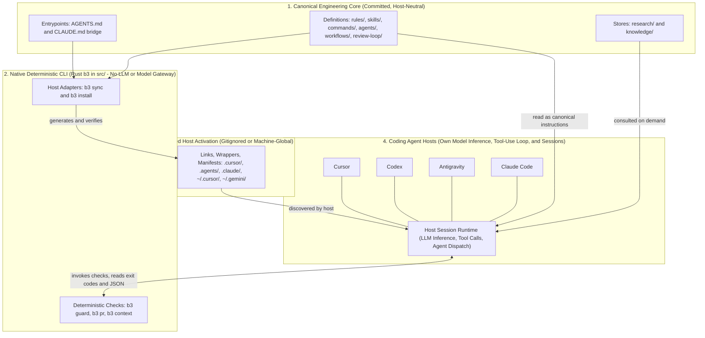

# Architecture and taxonomy

This document defines the building blocks of the system. It is definitional. Operating instructions for agents live in [`AGENTS.md`](../AGENTS.md). Standards for individual types live in the sibling docs.

## Source vs generated vs documentation

| Kind | What | Where |
| --- | --- | --- |
| **Canonical source files** | Committed host-neutral core: rule bodies, skills, commands, agents, review-loop, workflows, evals, knowledge | `rules/`, `skills/`, `commands/`, `agents/`, `review-loop/`, `workflows/`, `evals/`, `knowledge/` |
| **Canonical discovery entrypoints** | Committed universal workspace map and minimal Claude `@AGENTS.md` bridge | `AGENTS.md`, `CLAUDE.md` |
| **Documentation** | Explains the system; not configuration | `docs/`, `README.md` |
| **Research** | Provenance; not production config | `research/` |
| **Generated host activation** | Gitignored local host links/wrappers/manifests or global/product installs created by `b3 sync` / `b3 install` | `.cursor/{skills,commands,agents,rules}`, `.agents/skills.json`, `.agents/skills`, `.claude/{skills,agents}` |
| **User-owned configuration** | Personal preferences or custom host rules/manifests; never silently overwritten without `--force` | `~/.b3/models.md`, `<project>/.b3/models.md`, unmanaged `.cursor/rules/*.mdc`, customized `.agents/skills.json` |

Activation lifecycle:

```text
B3 Source
    |
    v
Native b3 CLI
    |
    +-- b3 install global
    +-- b3 install product
    +-- b3 sync
    |
    v
Host-specific generated activation
```

For per-host paths, install modes, and ownership boundaries, see Diagram B in [`../adapters/README.md`](../adapters/README.md).

B3 uses a **host-neutral canonical core** (`rules/`, `skills/`, `commands/`, `agents/`) mapped onto Cursor, Codex, Claude Code, and Antigravity via thin adapters. Decision: [`../research/decisions/decision-013-host-neutral-multi-host-layout.md`](../research/decisions/decision-013-host-neutral-multi-host-layout.md) (supersedes `decision-009-cursor-native-layout.md`).

The system is evolving. Layers marked **specified** exist as documentation and directories. Layers marked **present** have usable files.

## Harness boundary and runtime portability

B3 is an **engineering harness layer** around existing coding-agent hosts, not a replacement IDE or a standalone model-serving agent runtime. The architecture separates four distinct concerns:

- **Canonical definitions** (`AGENTS.md` + `CLAUDE.md` bridge, `rules/`, `skills/`, `commands/`, `agents/`, `workflows/`, `review-loop/`, `research/`, `knowledge/`): host-neutral specifications of *what* must hold and *how* workflows run.
- **Generated host activation** (`.cursor/`, `.agents/`, `.claude/`, `~/.cursor/`, `~/.gemini/config/plugins/`): gitignored or global links, wrappers, and manifests produced by `b3 sync` and `b3 install`.
- **Native deterministic CLI** (Rust `b3` in `src/`): deterministic adapter management (`b3 sync`, `b3 install`) plus deterministic Git, verification, evidence, context, and PR checks (`b3 guard`, `b3 pr`, `b3 context`). Rust `b3` never runs LLM agents or acts as a model gateway.
- **Host-owned LLM execution** (**Cursor**, **Codex**, **Antigravity**, **Claude Code**): the coding-agent hosts own model inference, tool-use loops, and agent sessions, consuming canonical definitions and generated host activation while invoking native `b3` checks.

Do not mistake a host-executed workflow contract for a B3-managed agent scheduler.

### Diagram A — Overall B3 System Architecture



**Now:** Multi-host everyday use across **Cursor**, **Codex**, **Antigravity**, and supported **Claude Code** backed by one host-neutral canonical core and thin adapters. **Future (conditional):** A coding-agent CLI may integrate through a small capability-oriented adapter (task execution/status/events, optional cancellation/resume and usage), defined only when a concrete need exists. A hypothetical private/custom adapter is not part of the public B3 repository, and its internal details are not required to maintain core functionality. No current adapter is claimed to implement this hypothetical runtime API.

Keep provider/model choices, credentials, proprietary details, and runtime-specific session mechanics out of canonical rules and native guard contracts. The [roadmap](roadmap.md) owns future priorities; the [system lifecycle](system-lifecycle.md) owns current maturity.

## Feedback-loop model

The system is **not** a strict execution pipeline. The diagram is conceptual: it shows how constraints, methods, action, and learning relate. A given task may enter at a command, a skill, or a review — it does not walk every box.

```text
                         ┌──────────────┐
                         │  Knowledge   │
                         └──────┬───────┘
                                │
                                ↓
┌──────────┐              ┌──────────────┐
│  Rules   │─────────────→│   Skills     │
└──────────┘              └──────┬───────┘
                                 │
                                 ↓
                       ┌──────────────────┐
                       │ Commands /       │
                       │ Workflows        │
                       └────────┬─────────┘
                                │
                                ↓
                          ┌───────────┐
                          │  Agents   │
                          └─────┬─────┘
                                │
                                ↓
                    ┌─────────────────────┐
                    │ Verification /      │
                    │ Review Loop         │
                    └────────┬──────────┘
                               │
                               ↓
                       Lessons Learned
                               │
                               └────────────→ Knowledge
```

Around that loop:

| Piece | Role |
| --- | --- |
| **Rules** | Constrain behavior. What must always be true. |
| **Skills** | Specialized knowledge and methods. How this task should be done. |
| **Commands** | Initiate explicit actions. What to do now. |
| **Workflows** | Orchestrate multiple steps. In what order. |
| **Agents** | Specialized roles. Who should handle this. |
| **Verification** | Evidence that a claim is true, false, or unproven. |
| **Review Loop** | Independent iterative validation. Is the implementation actually correct? |
| **Knowledge** | Feeds the system and receives lessons learned. What we know. |
| **Profiles** | Personal engineering context. Not universal truth and not a rule. |
| **Research** | External intake before knowledge or skills are created. Where conclusions came from. |
| **Adapters** | Map canonical core onto Cursor, Codex, Claude Code, and Antigravity without forking meaning. |
| **Evals** | Test whether the system behaves as designed. |

Lessons learned do **not** automatically become rules. Promotion is in [`system-lifecycle.md`](system-lifecycle.md). Conflict resolution is in [`precedence.md`](precedence.md).

## Layer map

```text
Rule          persistent constraint
Skill         reusable method for a focused problem
Command       explicit user-triggered action
Agent         specialized role
Workflow      ordered multi-step orchestration
Review Loop   independent verification and iterative correction
Knowledge     canonical reusable knowledge of this system
Reference     material used to perform a task (usually skill-local)
Research      external intake, findings, comparisons, decisions
Profile       personal engineering context (not a rule)
Adapter       thin host-tool integration
Eval          test of whether the system behaves as designed
```

These types are not interchangeable. In particular:

```text
knowledge  = what the system knows
reference  = material used to perform a task
research   = where conclusions came from
profile    = who the owner is and how they prefer to work
```

## Rule

**Question:** What must always be true?

A rule is a durable constraint on agent behavior. Rules are short, explicit, and preferably testable. They are technology-agnostic unless the constraint is inherently about a technology.

**Present.** Foundation files are in `rules/`.

Example:

> Never claim a test passed unless it was actually executed.

A rule is not a preference, not a tutorial, and not a skill. If the content is a method (“how to review a PR”), it belongs in a skill. If it is optional taste, it belongs in a profile or `knowledge/personal/`.

See [`rule-standard.md`](rule-standard.md).

## Skill

**Question:** How should this task be done?

A skill is a focused, on-demand method. It has a `SKILL.md`, optional `references/`, `scripts/`, and `examples/`, and a description that states when it should and should not trigger.

**Present.** Foundation engineering skills plus domain skills (React, APIs, .NET, Three.js). Catalog: [`../skills/README.md`](../skills/README.md).

Example:

> Skill: code review — produce evidence-based findings for a change, without running the full review loop.

See [`skill-standard.md`](skill-standard.md).

## Command

**Question:** What action should the agent perform now?

A command is an explicit, user-triggered operation. It selects a workflow or skill and runs it now. Commands are not standing constraints and not long-form knowledge.

**Present (thin).** See [`../commands/README.md`](../commands/README.md).

Example:

> Command: review the current change.

## Agent

**Question:** Who should handle this?

An agent is a specialized role with a narrower mandate than the default coding agent. Roles exist so review and research can be independent of implementation.

**Present (reviewer, fixer, security, architecture, performance).** See [`../agents/README.md`](../agents/README.md).

Example:

> Agent: security reviewer.

## Workflow

**Question:** In what order should things happen?

A workflow orchestrates skills, commands, and agents across multiple steps. It does not replace a skill; it sequences them.

**Present (default sequence + full lifecycles).** See [`../workflows/README.md`](../workflows/README.md). Independent review is `review-loop/` + `commands/b3-review-loop.md`, not a separate workflow file.

Example:

> Workflow: feature implementation (`Scope → Plan → Build → Verify → Review → Fix → Verify`).

The default product sequence is `workflows/feature-implementation.md`. One-shot lifecycles are `workflows/ship.md` (`commands/b3-ship.md`) for engineering delivery and `workflows/research-ship.md` (`commands/b3-research-ship.md`) for research-first delivery.

## Review Loop

**Question:** Is the implementation actually correct?

The review loop is independent checking plus iterative correction. It is stricter than a single code-review skill: it has scope, iteration limits, stagnation detection, a finding lifecycle, and a ban on treating tool failure as success.

**Present (orchestration).** Spec: [`../review-loop/spec.md`](../review-loop/spec.md). Procedure: [`../review-loop/strategy.md`](../review-loop/strategy.md). Trigger: `commands/b3-review-loop.md`. This is agent procedure, not a host plugin or eval runner.

Example:

> Size the PR → review → validate → fix → verify → fresh review until the quality gate, non-convergence, or iteration limit.

## Knowledge

**Question:** What have we learned?

Knowledge is the canonical reusable store of this system — not an instruction to execute. It is split into stable, volatile, and personal stores.

**Present (minimal).** Create `stable/` or `volatile/` only when the first real entry exists. Currently: [`../knowledge/personal/engineering-context.md`](../knowledge/personal/engineering-context.md).

Example:

> Known React rendering performance pattern, recorded with source and last-verified date.

See [`knowledge-system.md`](knowledge-system.md).

## Reference

**Question:** What material does this task need right now?

A reference is supporting material consumed by a skill or workflow. Skill-local references live next to `SKILL.md`. Shared task aids may live under `references/`. References are not canonical system knowledge and not research provenance.

Example:

> `skills/frontend/react-performance/references/checklist.md` — opened while applying that skill.

Shared on-demand workflow contracts also live under `workflows/references/` (for example [`../workflows/references/dispatch-naming.md`](../workflows/references/dispatch-naming.md) for wave orchestration and [`../workflows/references/clarification-gate.md`](../workflows/references/clarification-gate.md) for the proportional clarification gate anchored by Rule 1 of [`../rules/engineering-principles.md`](../rules/engineering-principles.md)). `clarification-gate.md` is an on-demand AI reasoning contract whose optional `planning:` preferences are resolved once per invocation by Parent (zero Rust config parser and zero separate scheduler), preventing always-on context bloat while ensuring all commands and workflows inherit one canonical contract.

## Research

**Question:** Where did this conclusion come from?

Research is external intake and synthesis **before** knowledge, skills, or rules are created. Stores: `research/sources`, `findings`, `comparisons`, `decisions`, `rejected`, `validation`.

**Present.** Method: [`research-methodology.md`](research-methodology.md). Layout: [`../research/README.md`](../research/README.md).

## Profile

**Question:** What is the owner’s engineering context?

A profile is personal context (style, preferences, strengths, weaknesses, decision principles). It is not universal engineering truth.

```text
Personal preference  ≠  Engineering rule
```

A profile must never override safety, correctness, explicit project requirements, hard rules, or platform constraints. See [`precedence.md`](precedence.md). Profile vs personal knowledge: [`knowledge-system.md`](knowledge-system.md).

**Specified (not created).** Do not invent `profiles/` for symmetry. Existing background: [`../knowledge/personal/engineering-context.md`](../knowledge/personal/engineering-context.md).

## Adapter

**Question:** How does this work in Cursor, Codex, Claude Code, or Antigravity?

An adapter maps the canonical core (`rules/`, `skills/`, `commands/`, `agents/`) onto a host tool via thin wrappers, manifests, local links, or plugins. Adapters must not fork rules or skills.

**Present (4-host adapters).** See [`../adapters/README.md`](../adapters/README.md).

Example:

> `b3 sync --host <cursor|codex|claude|antigravity>` generates gitignored `.cursor/{skills,commands,agents,rules}`, `.agents/skills/<name>`, `.claude/{skills,agents}`, or `.agents/skills.json`. See [`../adapters/README.md`](../adapters/README.md).

## Eval

**Question:** Does this part of the system actually work?

An eval is a test of the AI system itself: activation, capability, safety, and review-loop convergence. It is not an application test suite for a product under development.

**Present (fixtures).** Runner deferred. See [`evaluation.md`](evaluation.md).

Example:

> Test whether the verification skill triggers on “confirm this works” and does not trigger on “explain HTTP caching”.

## What is not a separate type

| Thing | Treat as |
| --- | --- |
| Prompt snippet | Part of a skill, command, or agent — not a top-level type |
| Checklist | Usually a skill reference, sometimes a review-loop reviewer |
| Preference | Profile or `knowledge/personal/` — never a hard rule by default |
| Copied GitHub skill pack | `research/sources/` input, not a first-class object |
| Lesson learned | Candidate only until evaluated and approved |

## Related docs

- Precedence: [`precedence.md`](precedence.md)
- Evolution: [`system-lifecycle.md`](system-lifecycle.md)
- Roadmap and outcome criteria: [`roadmap.md`](roadmap.md)
