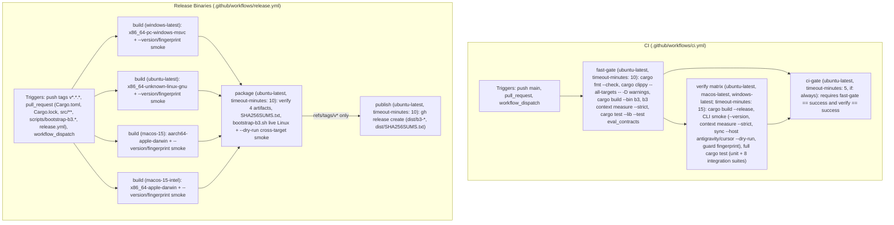

# B3 CI Architecture, Baseline & Test Ownership

> Canonical reference for B3's dependency-aware CI pipeline, test deduplication ownership matrix, and local preflight verification.

## 1. Historical Pre-Rust Baseline (PR #34 / cedf068)

### GitHub Actions Baseline

Measured from PR #34 (`45862631722`, `refactor/system-wide-deduplication`) and `main` (`45865751325`, commit `cedf068`):

| Job / Step | `ubuntu-latest` (`45862631722` / `45865751325`) | `macos-latest` (`45862631722` / `45865751325`) | `windows-latest` (`45862631722` / `45865751325`) |
| --- | --- | --- | --- |
| Checkout + Rust toolchain | 11s / 15s | 13s / 8s | 19s / 19s |
| `cargo fmt` + `cargo clippy` | 3s / 3s | 5s / 3s | 9s / 5s |
| `cargo build --release` | 31s / 32s | 43s / 51s | 57s / 39s |
| `cargo test` | 27s / 28s | 30s / 29s | 116s / 85s |
| Context budget + evals | 0s / 0s | 1s / 0s | 1s / 1s |
| `validate-merge-security.sh` | 83s / 100s | 104s / 104s | 275s / 196s |
| Windows PS behavioral suites (seq) | skipped | skipped | 415s (fail) / 299s (fail) |
| **Total job runtime** | **159s / 183s** | **202s / 201s** | **899s / 648s** |

- **Total CI compute minutes (`45862631722`)**: ~`2.65 + 3.37 + 14.98 = 21.0` min (plus `Release Binaries` running on every PR commit: `4.6` min across 4 runners).
- **Critical path**: `windows-latest` (`899s` execution + `269s` runner queue = `1168s` wall-clock).
- **Time-to-first-actionable-failure**: Up to `15` minutes when a Windows behavioral suite fails at the end of the sequential loop.

### Local Windows Per-Suite Baseline

Measured sequentially in worktree `refactor/native-ci-optimization` (`cedf068`, release `b3.exe` prebuilt):

| Suite | LOC | Measured (s) | Primary Responsibility | Duplication / Opportunity |
| --- | --- | --- | --- | --- |
| `validate-ship-behavior.ps1` | 3356 | 389.23 | `/b3-ship` guard + adapter + doc contracts | ~75% `DUPLICATE_EQUIVALENT` core `b3` checks via PS/Bash wrappers |
| `validate-tshirt-hierarchical.ps1` | 1194 | 350.41 | `diff-scope`, `review-inventory`, `review-ledger` | ~90% `DUPLICATE_EQUIVALENT` deterministic `b3` checks + 25k-LOC synthetic repos |
| `validate-research-ship.ps1` | 1215 | 164.87 | `/b3-research-ship` evidence, merge-policy, isolation | ~70% `DUPLICATE_EQUIVALENT` core `b3` checks |
| `validate-context-routing.ps1` | 702 | 115.71 | `context-cache`, `sync-skills`, routing doc contracts | ~65% `DUPLICATE_EQUIVALENT` `context-cache` state machine checks |
| `cargo test` | — | 97.36 | Rust unit + `native_golden_parity` + `wrapper_forwarding_windows` + `bootstrap_lifecycle` | `wrapper_forwarding_windows.rs` (3158 L) spawns ~70 `powershell` + ~94 `b3.exe` + 17 `git init` |
| `validate-standalone-commands.ps1` | 580 | 52.73 | Standalone command receipts, `verify-run`, doc caps | ~75% `DUPLICATE_EQUIVALENT` core `b3` checks |
| `validate-antigravity-global.ps1` | 1020 | 33.93 | Antigravity plugin + `install-global` lifecycle | ~60% `DUPLICATE_EQUIVALENT` manifest/install logic |
| `validate-pr-feedback.ps1` | 1221 | 31.49 | `b3 pr` lifecycle, locks, pipe, `b3-github-verify` | ~70% `DUPLICATE_EQUIVALENT` `b3 pr` logic (Blocks 1–9) |
| `validate-cursor-global.ps1` | 604 | 23.49 | Cursor global install + junction safety | ~60% `DUPLICATE_EQUIVALENT` manifest/install logic |
| `validate-model-preferences.ps1` | 182 | 7.79 | `models.example.md`, seeding, `.gitignore` dedup | ~60% doc contracts + ~25% wrapper parity |
| `smoke-ship-product.ps1` | 190 | 6.64 | E2E `/b3-ship` product repo smoke | `UNIQUE_REQUIRED` E2E smoke |
| `measure-context.ps1 -Strict` | 42 | 0.17 | Always-on/skill context budget | `UNIQUE_REQUIRED` fast gate |

## 2. Test Coverage Ownership Matrix

| Test Group | Classification | Canonical Owner | Kept in Scripts / Non-Rust? |
| --- | --- | --- | --- |
| `b3` deterministic core (`fingerprint`, `snapshot`, `precommit`, `diff-scope`, `review-inventory`, `review-ledger`, `check-wave`, `check-worktree`, `mechanical-check`, `symbol-check`, `context-cache`, `evidence-check`, `merge-policy-check`, `runs`, `verify-*`) | `UNIQUE_REQUIRED` | `src/` unit tests + `tests/native_core_behaviors.rs` + `tests/guard_security_and_behavior.rs` + `tests/native_golden_parity.rs` | No — all deterministic checks run natively via `cargo test` |
| Legacy baseline 47-case JSON replay (`legacy_baseline_65eaaae.json`) | `INDEPENDENT_LEGACY_PARITY` | `tests/native_golden_parity.rs` | No |
| `b3 pr` protocol, hunk, lock, idempotency, bidi sanitization, large OS pipes | `UNIQUE_REQUIRED` | `src/pr/*` + `tests/pr_feedback_lifecycle.rs` | No — migrated to native Rust |
| Host adapters & typed config (`b3 sync`, `b3 install`, `b3 config`, `B3_HOME` discovery, `config.toml` init/migration, NTFS junctions, manifest tamper guards) | `UNIQUE_REQUIRED` + `PLATFORM_SPECIFIC` | `src/adapters/*` + `src/config.rs` + `tests/adapters_and_hosts.rs` | No — migrated to native Rust |
| `bootstrap-b3.{ps1,sh}` SHA-256, in-use upgrade, rollback, lock, symlink/junction guards | `UNIQUE_REQUIRED` | `tests/bootstrap_lifecycle.rs` | Sole zero-Rust bootstrapper tested end-to-end |
| Markdown/YAML/eval/context-budget contracts (`AGENTS.md`, `rules/`, `workflows/`, `skills/`, [`evals/README.md`](../evals/README.md) `evals/*.yaml`) | `UNIQUE_REQUIRED` | `b3 context measure --strict` + `tests/eval_contracts.rs` | No — native Rust fast gate |
| Adversarial `merge-policy-check` + `b3 pr verify` + mock-`gh` | `UNIQUE_REQUIRED` | `tests/merge_policy_security.rs` | No — migrated to native Rust |

## 3. Current Dependency-Aware CI & Release Pipeline

### Diagram G — CI, Verification & Release Pipeline

### Controls
- `concurrency`: cancels superseded PR/branch runs immediately (`ci.yml`); `release.yml` preserves tag builds (`cancel-in-progress: ${{ !startsWith(github.ref, 'refs/tags/') }}`).
- `actions/cache@v4`: caches Cargo registry/git DB and `target` cleanly per OS and toolchain `1.100.0` in `ci.yml`.
- `timeout-minutes`: explicit per-job timeouts (`ci.yml`: `fast-gate: 10`, `verify: 15`, `ci-gate: 5`; `release.yml`: `build: 15`, `package: 10`, `publish: 10`).
- `release.yml`: runs on tags `v*.*.*`, `workflow_dispatch`, or PRs touching `Cargo.toml`, `Cargo.lock`, `src/**`, `scripts/bootstrap-b3.*`, or `.github/workflows/release.yml` (skipped on docs-only PRs); `publish` runs only on `push` to `refs/tags/v*`.
- **Local Preflight**: Run `.\scripts\ci-preflight.ps1` (Windows) or `./scripts/ci-preflight.sh` (Unix) before pushing (`-Fast`/`--fast` runs `--lib --test eval_contracts`).
- **Verify Receipt Invalidation & CI/Local Parity**: `src/guard/verify.rs` (`is_dependency_or_config_manifest` / `manifest_git_pathspecs`) tracks common project lint, formatter, ignore, workspace, type-checker, and dead-code configs (such as `clippy.toml`, `eslint.config.*`, `.eslintignore`, `biome.json`, `ruff.toml`, `.golangci.yml`, `knip.json`, `tsconfig.*.json`, `pnpm-workspace.yaml`, `Makefile`, `.npmrc`) alongside package manifests as **supplementary protection** (`VERIFY_STALE`). Parent still explicitly passes imported custom configs/scripts in `--relevant-paths` or omits `--relevant-paths` (`ALL`) when full input closure cannot be proven. Project-native static analysis stays `WORKFLOW_ONLY` ([`../workflows/references/static-analysis.md`](../workflows/references/static-analysis.md)), keeping CI/local parity clean with `0` new Cargo or heavy CI dependencies.

## 4. Migration & Consolidation Summary

All `9` legacy compatibility wrapper pairs (`18` files) and `14` legacy `.ps1`/`.sh`/wrapper test harnesses were retired and consolidated into `8` native cross-platform Rust integration test suites (`eval_contracts`, `guard_security_and_behavior`, `merge_policy_security`, `pr_feedback_lifecycle`, `adapters_and_hosts`, `native_core_behaviors`, `native_golden_parity`, `bootstrap_lifecycle`), eliminating duplicate PowerShell/Bash test loops across CI.
