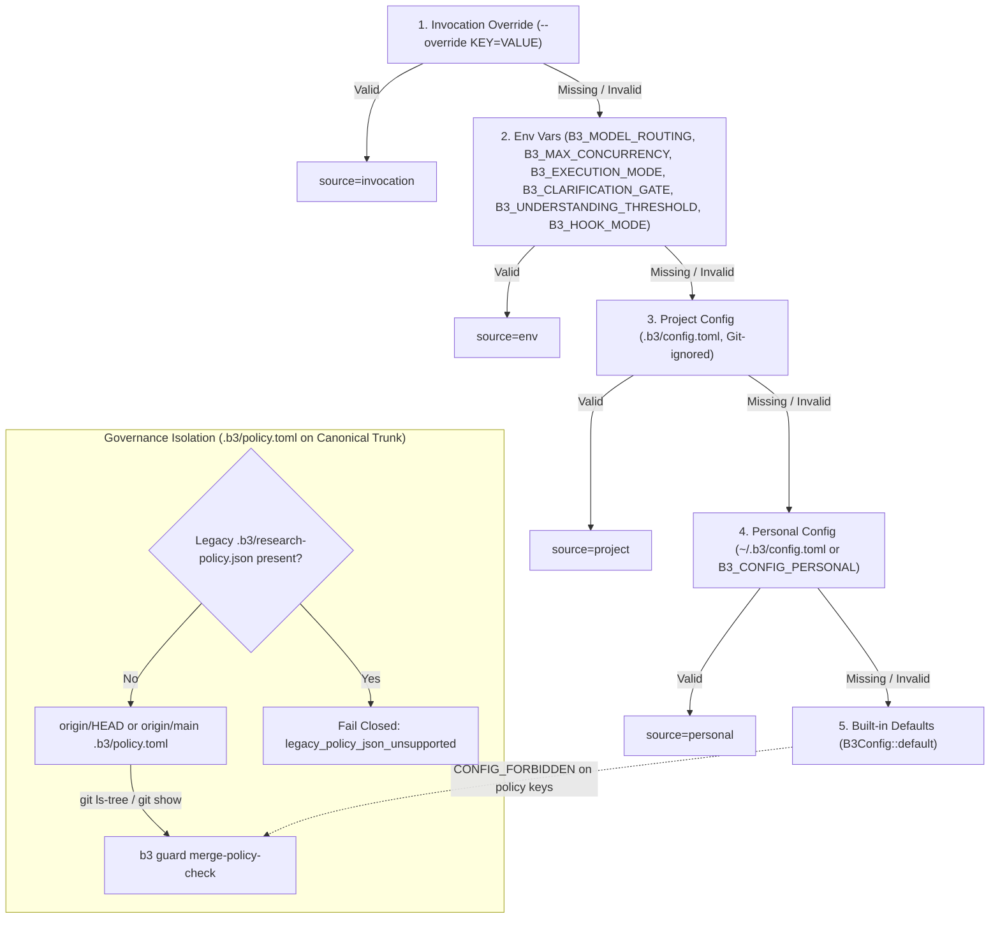
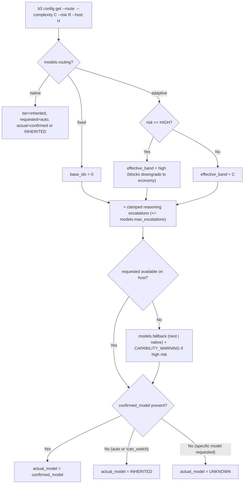

# Unified Configuration & Governance Policy

B3 separates **advisory user/project preferences** (`config.toml`) from **canonical trunk-only governance policy** (`policy.toml`) across two strict trust boundaries. All bounded TOML parsing, single-resolver preference resolution, adaptive model routing, `[hooks]` resolution, and CLI commands (`show|get|set|validate|init`) live natively in [`src/config.rs`](../src/config.rs), [`src/toml_lite.rs`](../src/toml_lite.rs), and [`src/guard/merge_policy.rs`](../src/guard/merge_policy.rs).

---

## 1. Two Strict Trust Boundaries

| Boundary | Canonical Files | Authority & Git Status | What It Controls | Cannot Do |
| --- | --- | --- | --- | --- |
| **Advisory Preferences** | Personal: `~/.b3/config.toml` (or `B3_CONFIG_PERSONAL`)<br>Project: `<project>/.b3/config.toml` (optional) | User- or local-repo-owned; **Git-ignored** per project. Resolved per field once per invocation with safe fallback. | Model routing/tiers/roles, bounded escalation, `planning` clarification heuristic, `parallel` concurrency/mode, `hooks`, `review` sizing & iteration/unit prefs. | Cannot relax `.b3/policy.toml`, disable mandatory security/destructive gates, waive `HIGH`/`CRITICAL` independent review invariants, or mutate governance keys via `b3 config set` (`CONFIG_FORBIDDEN`). |
| **Canonical Governance Policy** | `<project>/.b3/policy.toml` | **Tracked in Git** and resolved strictly from **canonical trunk** (e.g., `origin/HEAD` / `origin/main` / `origin/master`). | `auto_merge`, `auto_merge_max_risk`, `protected_paths`, `allow_protected_paths`, `allowed_target_branches`, `require_ci`, `require_review`. | Cannot be overridden by `config.toml`, env vars, CLI `--override`, or unmerged PR/feature-branch edits (`policy_modified_in_pr` / `policy_not_in_authority`). |

> [!IMPORTANT]
> B3 is **TOML-only**. Existing user-owned `~/.b3/models.md` or `.b3/models.md` files are preserved untouched on disk and ignored. If legacy `.b3/research-policy.json` exists in a repository (with or without `.b3/policy.toml`), `b3 config validate`, `b3 guard merge-policy-check`, and Git hooks **fail closed** (`legacy_policy_json_unsupported`) without deleting user files. Symlinks, NTFS junctions/reparse points, UNC paths (`\\...`, `//...`), and control characters are rejected on all configuration and policy paths.

### Diagram 1 — Configuration 5-Layer Precedence & Trust Boundary



Field-level precedence: project values override personal preferences per valid key; any missing, unreadable, or invalid project key warns and falls back to the next valid layer (`review.sizing` validates `xs < s < m < l < xl` atomically and reverts the whole `[review.sizing]` group on violation).

---

## 2. Bounded TOML Parser & Schema Reference

[`src/toml_lite.rs`](../src/toml_lite.rs) parses a minimal safe TOML subset with zero external crate dependencies and hard resource bounds:

- Maximum document size: **256 KiB** (`MAX_TOML_BYTES`, checked via metadata before reading from disk)
- Maximum string literal: **4096 B**, array items: **256**, flat arrays only (**no nested arrays**), table depth: **6 segments**, max tables: **128**, max keys: **512**
- Rejects floats, dates, inline tables, multi-line strings, array-of-tables (`[[...]]`), duplicate keys/tables, and unescaped control chars.

Canonical templates: [`config/config.example.toml`](../config/config.example.toml) and [`config/policy.example.toml`](../config/policy.example.toml).

### 2.1 Advisory Preferences (`config.toml`)

| Section & Key | Type / Valid Values | Default | Env Var | Consumer |
| --- | --- | --- | --- | --- |
| `models.routing` | `"adaptive"` \| `"fixed"` \| `"native"` | `"adaptive"` | `B3_MODEL_ROUTING` | `route_model` |
| `models.auto_escalate` | `true` \| `false` | `true` | — | `evaluate_escalation` |
| `models.max_escalations` | Integer `0..=2` | `2` | — | `route_model`, `evaluate_escalation` |
| `models.fallback` | `"next"` \| `"native"` | `"next"` | — | `route_model` (`--available-models`) |
| `models.tiers.{economy,balanced,advanced}` | `"auto"` or model ID | `"auto"` | — | `route_model` |
| `models.roles.<role>` (`[models.hosts.<host>]`) | 1–3 tier/ID entries (`model:<id>` escape) | Role-specific (`main`, `planning`, `implementation`, `debugging`, `research`, `reviewer`, `fixer`, `security_reviewer`, `architecture_reviewer`, `performance_reviewer`) | — | `b3 config get --route` |
| `planning.clarification_gate` | `true` \| `false` | `true` | `B3_CLARIFICATION_GATE` | `clarification-gate.md` |
| `planning.understanding_threshold` | Integer `1..=100` | `96` | `B3_UNDERSTANDING_THRESHOLD` | `clarification-gate.md` |
| `parallel.max_concurrency` | `"auto"` (clamped `4..=16`) or `1..=64` | `"auto"` | `B3_MAX_CONCURRENCY` | `b3 guard check-wave` |
| `parallel.execution_mode` | `"auto"` \| `"sequential"` \| `"isolated"` | `"auto"` | `B3_EXECUTION_MODE` | `b3 guard check-wave` |
| `hooks.enabled` | `true` \| `false` | `true` | `B3_HOOK_MODE` | `b3 hook run/status` |
| `hooks.mode` | `"enforce"` \| `"audit"` \| `"off"` | `"enforce"` | `B3_HOOK_MODE` | `b3 hook run/status` |
| `review.max_iterations` | Integer `1..=20` | `5` | — | `b3 guard review-ledger` |
| `review.max_loc_per_unit` / `max_files_per_unit` | `100..=50000` / `5..=1000` | `5000` / `100` | — | `b3 guard review-inventory` |
| `review.sizing.{xs,s,m,l,xl}_max_{loc,files}` | Positive monotonic ints | `100/3, 300/8, 800/20, 1999/49, 5000/100` | — | `b3 guard diff-scope` |

Initialization env vars: `B3_CONFIG_PERSONAL` overrides `~/.b3/config.toml`; `B3_SKIP_CONFIG_INIT=1` skips auto-creating `~/.b3/config.toml` during `b3 install` / `b3 sync`.

### 2.2 Canonical Governance Policy (`.b3/policy.toml`)

Top-level keys only (table headers fail `MERGE_BLOCKED: invalid_policy_toml`):

| Root Key | Type / Valid Values | Default | Notes |
| --- | --- | --- | --- |
| `auto_merge` | `"disabled"` \| `"authorized"` | `"disabled"` | Resolved strictly from canonical trunk; unmerged PR edits block (`policy_modified_in_pr`). |
| `auto_merge_max_risk` | `"LOW"` \| `"MEDIUM"` \| `"HIGH"` \| `"CRITICAL"` | `"LOW"` | Maximum risk tier eligible for auto-merge (`max(ledger_risk, live_risk) <= auto_merge_max_risk`). |
| `protected_paths` | Array of repo-relative literal paths | `[]` | `.b3/policy.toml` (and legacy `.b3/research-policy.json`) are always protected. |
| `allow_protected_paths` | `true` \| `false` | `false` | Permits edits to configured `protected_paths` only (never policy files). |
| `allowed_target_branches` | Array of branch names / `*` globs | `["main"]` | Eligible merge target branches. |
| `require_ci` / `require_review` | `true` \| `false` | `true` / `true` | Mandatory checks and independent review enforcement. |

---

## 3. Adaptive Model Routing & Bounded Escalation



Bounded escalation (`evaluate_escalation`) allows escalation **only** for reasoning/risk triggers (`repeated_reasoning_failure`, `design_contradiction`, `systemic_review_finding`, `complexity_increase`, `risk_increase`, `hypotheses_exhausted`) up to `models.max_escalations` when the role pool has `> 1` entry. Non-reasoning triggers (`ordinary_test_failure`, `missing_dependency`, `environment_setup`, `flaky_infra`, `network_failure`, `baseline_failure`) never escalate.

---

## 4. `b3 config` CLI & Examples

```text
b3 config show [--sources] [--json] [--repo-root <dir>] [--user-home <dir>] [--override KEY=VALUE ...]
b3 config get <key> [--sources] [--json] [--repo-root <dir>] [--user-home <dir>] [--override KEY=VALUE ...]
b3 config get --route <role> [--complexity <low|medium|high>] [--risk <LOW|MEDIUM|HIGH|CRITICAL>] [--host <host>] [--escalations <n>] [--trigger <trigger>] [--available-models <csv>] [--confirmed-model <id>] [--json]
b3 config set <key> <val> [--scope personal|project] [--dry-run] [--repo-root <dir>] [--user-home <dir>]
b3 config validate [--json] [--repo-root <dir>] [--user-home <dir>]
b3 config init [--scope personal|project] [--force] [--dry-run] [--repo-root <dir>] [--user-home <dir>]
```

```toml
# Example ~/.b3/config.toml or <project>/.b3/config.toml (Git-ignored)
[models]
routing = "adaptive"
auto_escalate = true
max_escalations = 1

[models.tiers]
economy = "model-fast-l1"
balanced = "model-std-l2"
advanced = "model-deep-l3"

[models.roles]
main = ["balanced", "advanced"]
implementation = ["economy", "balanced", "advanced"]
security_reviewer = ["advanced"]

[planning]
clarification_gate = false
understanding_threshold = 90
```

## Related Docs

- Precedence authority stack: [`precedence.md`](precedence.md)
- Ship & Review visual guide: [`ship-and-review-guide.md`](ship-and-review-guide.md)
- Native event hooks: [`hooks.md`](hooks.md)
- Architecture & deterministic CLI boundary: [`architecture.md`](architecture.md)
