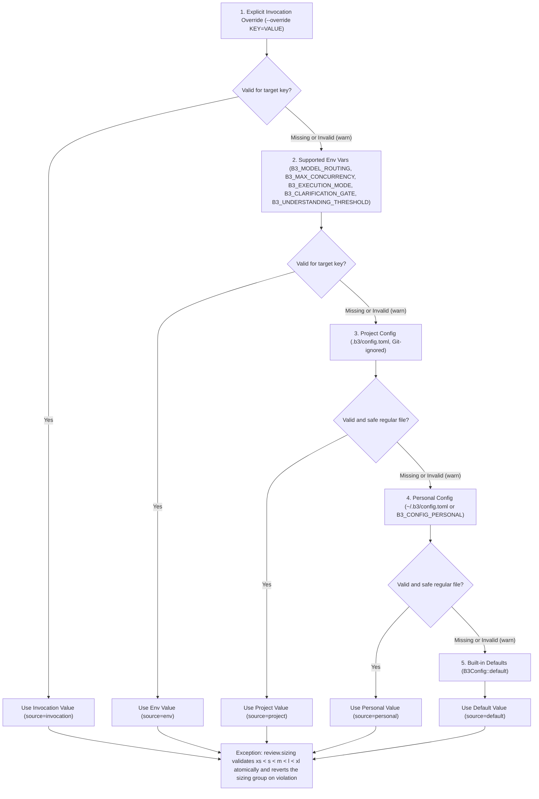
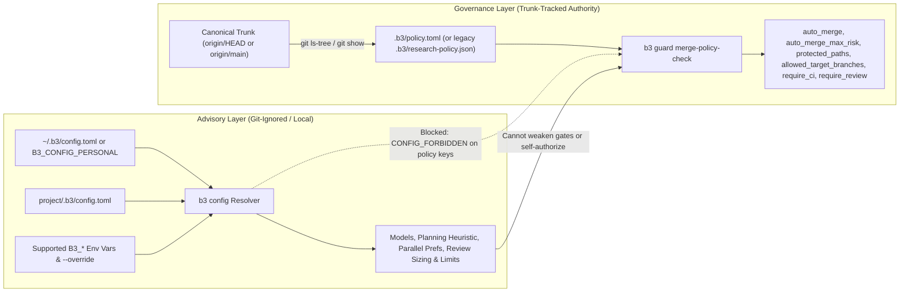
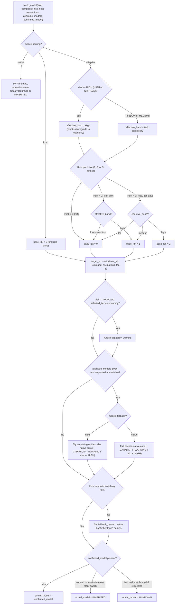
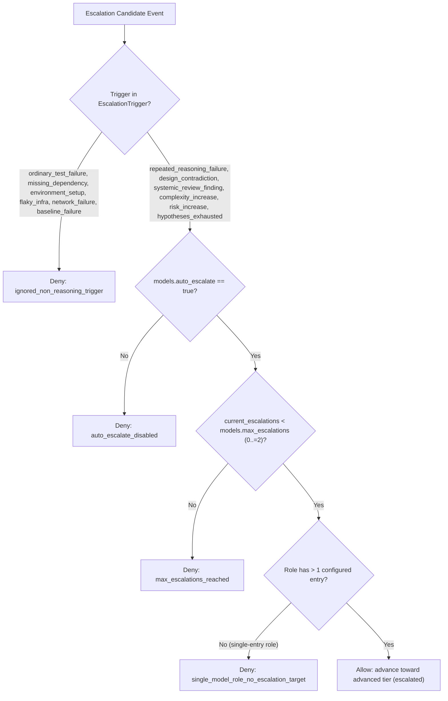
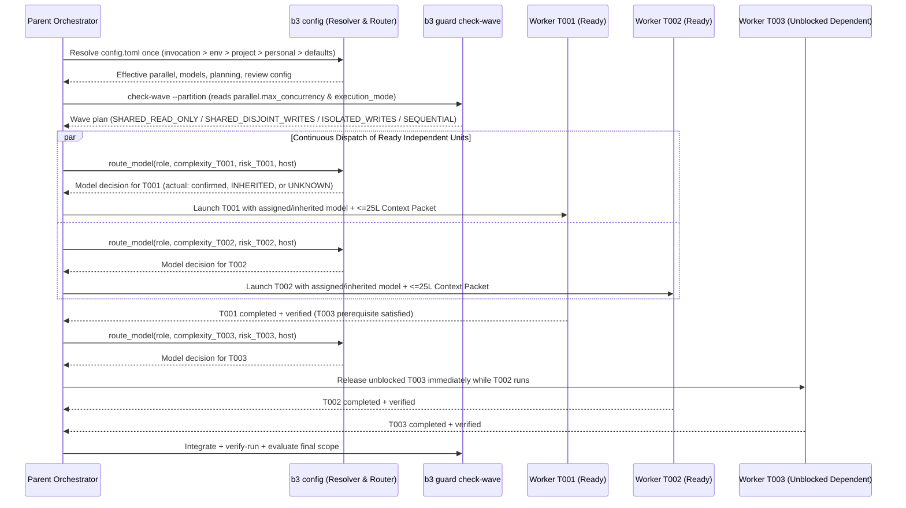
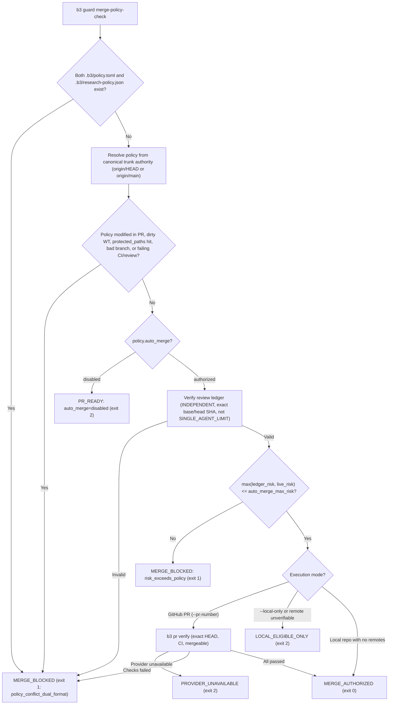
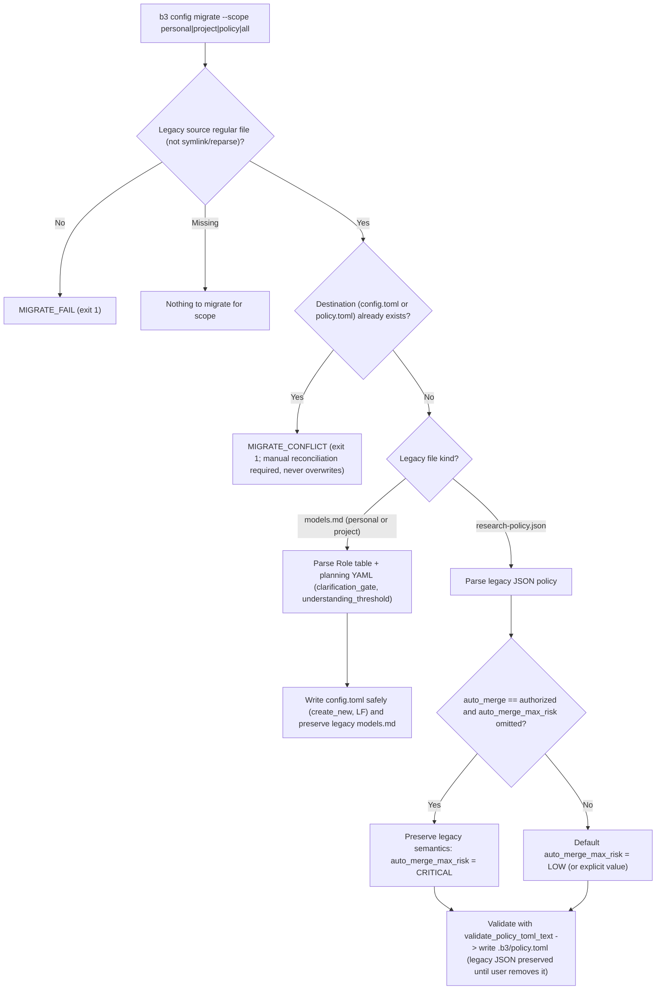

# Unified Configuration & Governance Policy

B3 separates **advisory user/project preferences** (`config.toml`) from **canonical trunk-only governance policy** (`policy.toml`) across two strict trust boundaries. All typed resolution, adaptive model routing, validation, and legacy migration are implemented natively in [`src/config.rs`](../src/config.rs) (`b3 config`) and enforced alongside [`src/guard/merge_policy.rs`](../src/guard/merge_policy.rs).

---

## 1. Two Strict Trust Boundaries

| Boundary | Canonical Files (Legacy) | Authority & Git Status | What It Controls | Cannot Do |
| --- | --- | --- | --- | --- |
| **Advisory Preferences** | Personal: `~/.b3/config.toml` (or `B3_CONFIG_PERSONAL`)<br>Project: `<project>/.b3/config.toml` (optional)<br>*(Legacy: `models.md` / `B3_MODELS_PERSONAL`)* | User- or local-repo-owned; **Git-ignored** per project. Resolved per field once per invocation with safe fallback. | Model routing/tiers/roles, bounded escalation, `planning` clarification heuristic, `parallel` concurrency/mode, `review` sizing & iteration/unit prefs. | Cannot relax `.b3/policy.toml`, disable mandatory security/destructive gates, waive `HIGH`/`CRITICAL` independent review invariants, or mutate governance keys via `b3 config set` (`CONFIG_FORBIDDEN`). |
| **Canonical Governance Policy** | `<project>/.b3/policy.toml`<br>*(Legacy: `<project>/.b3/research-policy.json`)* | **Tracked in Git** and resolved strictly from **canonical trunk** (e.g., `origin/HEAD` / `origin/main` / `origin/master`). | `auto_merge`, `auto_merge_max_risk`, `protected_paths`, `allow_protected_paths`, `allowed_target_branches`, `require_ci`, `require_review`. | Cannot be overridden by `config.toml`, env vars, CLI `--override`, or unmerged PR/feature-branch edits (`policy_modified_in_pr` / `policy_not_in_authority`). |

> [!IMPORTANT]
> If both `.b3/policy.toml` and legacy `.b3/research-policy.json` exist simultaneously, `b3 config validate` and `b3 guard merge-policy-check` fail closed (`policy_conflict_dual_format`). Symlinks, NTFS junctions/reparse points, UNC paths (`\\...`, `//...`), and control characters are rejected on both configuration and policy paths.

### Diagram 1 — Configuration 5-Layer Precedence & Per-Field Fallback



### Diagram 2 — Two-File Trust Boundary Separation



---

## 2. Full TOML Schema Reference

Canonical templates live in [`config/config.example.toml`](../config/config.example.toml) and [`config/policy.example.toml`](../config/policy.example.toml).

### 2.1 Advisory Preferences (`config.toml`)

#### `[models]`

| Key | Type / Valid Values | Default | Env Var Override | Notes |
| --- | --- | --- | --- | --- |
| `models.routing` | `"adaptive"` \| `"fixed"` \| `"native"` | `"adaptive"` | `B3_MODEL_ROUTING` | `adaptive` routes by role, complexity, and risk; `fixed` picks entry 1; `native` inherits host model. |
| `models.auto_escalate` | `true` \| `false` | `true` | — | Enables bounded escalation on confirmed reasoning/risk triggers only. |
| `models.max_escalations` | Integer `0..=2` | `2` | — | Upper bound on escalations per task. |
| `models.fallback` | `"next"` \| `"native"` | `"next"` | — | Strategy when a requested model is unavailable on the host (`--available-models`). |

#### `[models.tiers]`

Tier aliases referenced from `[models.roles]`. Set `"auto"` to inherit the active host's native model, or a host-recognized model ID.

| Key | Valid Values | Default | Intended Workload |
| --- | --- | --- | --- |
| `models.tiers.economy` | Non-empty string (`"auto"` or model ID) | `"auto"` | L1: routine, low-complexity, low-risk work (e.g., docs, routine tests). |
| `models.tiers.balanced` | Non-empty string (`"auto"` or model ID) | `"auto"` | L2: standard engineering and moderate complexity. |
| `models.tiers.advanced` | Non-empty string (`"auto"` or model ID) | `"auto"` | L3: complex reasoning, architecture, and `HIGH`/`CRITICAL` risk work. |

#### `[models.roles]`

Each role accepts a string array of **1–3 ordered entries** (a single string is normalized to a 1-entry list): tier aliases (`"economy"`, `"balanced"`, `"advanced"`), `"auto"`, or direct host-recognized model IDs (prefix `"model:<id>"` to escape a literal tier name). Legacy `b3-*` names (such as `b3-reviewer`) normalize to their canonical key.

- `1` entry: fixed preference `[model]` (subject to capability/risk warnings)
- `2` entries: `[standard, advanced]`
- `3` entries: `[economy, balanced, advanced]`

| Key | Default | Role |
| --- | --- | --- |
| `models.roles.main` | `["balanced", "advanced"]` | Primary orchestrator and workflow coordination. |
| `models.roles.planning` | `["economy", "balanced", "advanced"]` | Requirements analysis and dependency-aware planning. |
| `models.roles.implementation` | `["economy", "balanced", "advanced"]` | Feature implementation and code generation. |
| `models.roles.debugging` | `["balanced", "advanced"]` | Root-cause investigation. |
| `models.roles.research` | `["economy", "balanced", "advanced"]` | Research, source discovery, and evidence analysis. |
| `models.roles.reviewer` | `["economy", "balanced", "advanced"]` | Independent code review (`b3-reviewer` alias). |
| `models.roles.fixer` | `["economy", "balanced", "advanced"]` | Focused fixes for confirmed findings (`b3-fixer` alias). |
| `models.roles.security_reviewer` | `["advanced"]` | Independent security review (`b3-security-reviewer` alias). |
| `models.roles.architecture_reviewer` | `["balanced", "advanced"]` | Architecture and system design review (`b3-architecture-reviewer` alias). |
| `models.roles.performance_reviewer` | `["balanced", "advanced"]` | Performance and resource-usage review (`b3-performance-reviewer` alias). |

#### Optional Host Overrides (`[models.hosts.<host>]` & `[models.hosts.<host>.roles]`)

`src/config.rs` also supports per-host overrides inside `config.toml` (for example `[models.hosts.codex]` with `economy`/`balanced`/`advanced` or `[models.hosts.codex.roles]` with `<role>` arrays). Host-specific role entries take precedence over `[models.roles]` when routing for that host.

#### `[planning]`

| Key | Type / Valid Values | Default | Env Var Override | Notes |
| --- | --- | --- | --- | --- |
| `planning.clarification_gate` | `true` \| `false` | `true` | `B3_CLARIFICATION_GATE` | Relaxes routine ambiguity prompts when `false`; never bypasses security, destructive, or governance gates. |
| `planning.understanding_threshold` | Integer `1..=100` | `96` | `B3_UNDERSTANDING_THRESHOLD` | Heuristic requirement-understanding threshold (`workflows/references/clarification-gate.md`). |

#### `[parallel]`

| Key | Type / Valid Values | Default | Env Var Override | Notes |
| --- | --- | --- | --- | --- |
| `parallel.max_concurrency` | `"auto"` or integer `1..=64` | `"auto"` | `B3_MAX_CONCURRENCY` | Upper bound per run; `"auto"` adapts to host CPU parallelism clamped to `4..=16`. |
| `parallel.execution_mode` | `"auto"` \| `"sequential"` \| `"isolated"` | `"auto"` | `B3_EXECUTION_MODE` | `"sequential"` caps effective concurrency at `1`; `"isolated"` signals `preferred_isolation=ISOLATED_WRITES`; cannot override safety or ownership restrictions. |

#### `[review]` & `[review.sizing]`

| Key | Type / Valid Values | Default | Notes |
| --- | --- | --- | --- |
| `review.max_iterations` | Integer `1..=20` | `5` | Maximum review/fix iterations per standard review loop; unresolved findings at limit never produce `PASS`. |
| `review.max_loc_per_unit` | Integer `100..=50000` | `5000` | Maximum added + deleted LOC per hierarchical review unit (bounds units, not total PR size). |
| `review.max_files_per_unit` | Integer `5..=1000` | `100` | Maximum changed files per review unit. |
| `review.sizing.xs_max_loc` / `xs_max_files` | Positive integers | `100` / `3` | Extra-small PR threshold. |
| `review.sizing.s_max_loc` / `s_max_files` | Positive integers | `300` / `8` | Small PR threshold. |
| `review.sizing.m_max_loc` / `m_max_files` | Positive integers | `800` / `20` | Medium PR threshold. |
| `review.sizing.l_max_loc` / `l_max_files` | Positive integers | `1999` / `49` | Large PR threshold. |
| `review.sizing.xl_max_loc` / `xl_max_files` | Positive integers | `5000` / `100` | Extra-large PR threshold (`XXL` has no upper PR cap). |

`[review.sizing]` enforces strict monotonicity (`xs < s < m < l < xl` for both `*_max_loc` and `*_max_files`). Any invalid or non-monotonic `[review.sizing]` update reverts the whole `[review.sizing]` struct to the previous valid layer with a warning.

#### Path & Initialization Environment Variables

- `B3_CONFIG_PERSONAL`: Explicit personal `config.toml` file path (overrides `~/.b3/config.toml`; UNC/`//` paths and control characters are rejected).
- `B3_SKIP_CONFIG_INIT=1` (and legacy `B3_SKIP_MODEL_INIT=1`): Prevents `b3 install` and `b3 sync` from auto-creating `~/.b3/config.toml`.
- `B3_MODELS_PERSONAL`: Legacy personal `models.md` path override consulted by `b3 config migrate` and legacy detection during adapter init.

---

### 2.2 Canonical Governance Policy (`.b3/policy.toml`)

`.b3/policy.toml` **must** declare top-level root keys only — `[table]` headers are rejected by `validate_policy_toml_text` (`MERGE_BLOCKED: invalid_policy_toml`).

| Root Key | Type / Valid Values | Default (`policy.example.toml`) | Notes |
| --- | --- | --- | --- |
| `auto_merge` | `"disabled"` \| `"authorized"` | `"disabled"` | `"disabled"` stops at `PR_READY`; `"authorized"` permits `MERGE_AUTHORIZED` only when all gates pass. |
| `auto_merge_max_risk` | `"LOW"` \| `"MEDIUM"` \| `"HIGH"` \| `"CRITICAL"` | `"LOW"` *(new TOML)* | Maximum risk tier eligible for automatic merge. Legacy `.b3/research-policy.json` without this field defaults to `"CRITICAL"` to preserve prior semantics. |
| `protected_paths` | Array of repo-relative literal paths | `[]` | Paths requiring governance protection. `.b3/policy.toml` and `.b3/research-policy.json` are always protected. |
| `allow_protected_paths` | `true` \| `false` | `false` | Allows changes to configured `protected_paths` (never permits policy self-authorization). |
| `allowed_target_branches` | Array of branch names / `*` globs | `["main"]` | Target branches eligible for automatic merge (e.g., `["main", "release/*"]`). |
| `require_ci` | `true` \| `false` | `true` | Requires valid CI or canonical `b3-verify-v1` receipt bound to exact PR HEAD. |
| `require_review` | `true` \| `false` | `true` | Requires verified review; never waives mandatory independent review invariants on `HIGH`/`CRITICAL` changes. |

---

## 3. Adaptive Model Routing & Bounded Escalation

### Diagram 3 — Adaptive Model Routing & Risk Floor Selection



### Diagram 4 — Bounded Escalation & Non-Escalation Flow



---

## 4. `b3 config` CLI Reference

```text
b3 config show [--sources] [--json] [--repo-root <dir>] [--user-home <dir>] [--override KEY=VALUE ...]
b3 config get <key> [--sources] [--json] [--repo-root <dir>] [--user-home <dir>] [--override KEY=VALUE ...]
b3 config get --route <role> [--complexity <low|medium|high>] [--risk <LOW|MEDIUM|HIGH|CRITICAL>] [--host <host>] [--escalations <n>] [--trigger <trigger>] [--available-models <csv>] [--confirmed-model <id>] [--json]
b3 config set <key> <val> [--scope personal|project] [--dry-run] [--repo-root <dir>] [--user-home <dir>]
b3 config validate [--json] [--repo-root <dir>] [--user-home <dir>]
b3 config init [--scope personal|project] [--force] [--dry-run] [--repo-root <dir>] [--user-home <dir>]
b3 config migrate [--scope personal|project|policy|all] [--dry-run] [--repo-root <dir>] [--user-home <dir>]
```

| Subcommand | Behavior & Safety Guarantees |
| --- | --- |
| `show` | Resolves effective config across all 5 layers and prints every canonical dotted key (`--sources` annotates each key's winning layer; `--json` emits structured output with `warnings` and `files_read`). |
| `get <key>` | Returns the effective value for a single canonical key (supports `--sources`, `--json`, and `--override`). |
| `get --route <role>` | Runs deterministic `route_model` (+ optional `evaluate_escalation` via `--trigger`) and prints `selected_tier`, `requested_model`, `actual_model`, `selection_reason`, `fallback_reason`, `escalation_count`, and `capability_warning`. |
| `set <key> <val>` | Updates `~/.b3/config.toml` (`--scope personal`, default) or `<project>/.b3/config.toml` (`--scope project`) atomically with LF line endings while preserving comments. Rejects governance keys (`CONFIG_FORBIDDEN`), `--scope policy`, symlinks/reparse points, and invalid `[review.sizing]` ordering before writing. |
| `validate` | Validates personal `config.toml`, project `config.toml`, and repo `.b3/policy.toml` (rejects dual `.b3/policy.toml` + `.b3/research-policy.json` conflict). Exits `1` on errors (`CONFIG_INVALID` or JSON `valid: false`). |
| `init` | Creates missing `config.toml` from `config/config.example.toml` using `create_new` safety; never overwrites an existing file unless `--force` is passed. |
| `migrate` | Non-destructively converts legacy `models.md` -> `config.toml` and `.b3/research-policy.json` -> `.b3/policy.toml` (see Section 7). Fails with `MIGRATE_CONFLICT` if destination already exists. |

---

## 5. Host Capability Matrix & Identity Honesty

Capability flags below match `host_capabilities()` in [`src/config.rs`](../src/config.rs) verbatim:

| Host (`--host`) | `main_select` | `subagent_select` | Runtime Honesty Behavior |
| --- | --- | --- | --- |
| `cursor` | `true` | `true` | UI picker owns `main`; user-level `~/.cursor/agents/*.md` can hold advisory `model:`, but host does not confirm per-task runtime identity (`actual_model = UNKNOWN` unless `--confirmed-model` is passed, or `INHERITED`). |
| `cursor_cli` (`cursor-cli`) | `true` | `false` | CLI can pass main model selection; subagents inherit session model (`INHERITED`). |
| `codex` | `true` | `true` | Supports main and per-subagent assignment when available; never switches models mid-task (`actual_model = UNKNOWN` unless `--confirmed-model` is passed, or `INHERITED`). |
| `claude_code` (`claude-code`, `claude`) | `true` | `true` | Supports main and per-subagent role overrides; falls back to native session/parent model (`inherit`). |
| `antigravity` | `true` | `true` | Passes compatible `Model` parameters on delegation when supported; reports `UNKNOWN` unless explicitly confirmed, or `INHERITED`. |
| `generic` (unknown / Generic CLI) | `true` | `false` | Conservative fallback: only `main` selection assumed; subagents report `INHERITED`. |

> [!NOTE]
> B3 never claims a model switch occurred without runtime confirmation. When `route_model` receives no `confirmed_model`, it reports `INHERITED` (when `requested_model == "auto"` or the host cannot switch that role) or `UNKNOWN` (when a specific model was requested without confirmation).

---

## 6. Continuous Parallel Dispatch & Merge Eligibility Flows

### Diagram 5 — Continuous Parallel Dispatch & Per-Task Model Assignment



### Diagram 6 — Unified Merge Eligibility & `auto_merge_max_risk` Enforcement



---

## 7. Non-Destructive Legacy Migration

### Diagram 7 — Legacy Migration Flow (`b3 config migrate`)



---

## 8. Practical Examples

### 8.1 Single / Dual / Triple-Model Personal Pools (`~/.b3/config.toml`)

```toml
[models]
routing = "adaptive"
auto_escalate = true
max_escalations = 2
fallback = "next"

[models.tiers]
economy = "model-fast-l1"      # 1-tier setup: set all three to the same ID or "auto"
balanced = "model-std-l2"
advanced = "model-deep-l3"

[models.roles]
main = ["balanced", "advanced"]                   # 2-model pool: [standard, advanced]
planning = ["economy", "balanced", "advanced"]    # 3-model pool: [economy, balanced, advanced]
implementation = ["economy", "balanced", "advanced"]
reviewer = ["economy", "balanced", "advanced"]
security_reviewer = ["advanced"]                  # 1-entry pool for security
# Direct model ID escape example when a model name collides with a tier name:
# research = ["model:economy-preview-1"]
```

### 8.2 Low-Cost Solo Setup (`~/.b3/config.toml` or `<project>/.b3/config.toml`)

```toml
[models]
routing = "adaptive"
auto_escalate = true
max_escalations = 1

[models.roles]
planning = ["economy", "balanced"]
implementation = ["economy", "balanced", "advanced"]
reviewer = ["economy", "balanced"]

[planning]
clarification_gate = false
understanding_threshold = 90
```

### 8.3 Strict CI & High-Risk Team Policy (`<project>/.b3/policy.toml`, Git-Tracked)

```toml
auto_merge = "authorized"
auto_merge_max_risk = "LOW"
protected_paths = [".github/workflows", "src/guard", "migrations"]
allow_protected_paths = false
allowed_target_branches = ["main"]
require_ci = true
require_review = true
```

### 8.4 Migration & Validation Commands

```bash
# Preview non-destructive migration of personal, project, and policy files
b3 config migrate --scope all --dry-run

# Apply migration (preserves legacy models.md and research-policy.json)
b3 config migrate --scope all

# Validate all active config and policy files (fails on dual policy conflict)
b3 config validate --json

# Inspect effective values with winning layer annotations
b3 config show --sources

# Simulate adaptive model routing for a HIGH-risk implementation task on codex
b3 config get --route implementation --complexity low --risk HIGH --host codex
```

---

## Related Docs

- Legacy preference compatibility & migration bridge: [`model-preferences.md`](model-preferences.md)
- Precedence authority stack: [`precedence.md`](precedence.md)
- Ship & Review visual guide: [`ship-and-review-guide.md`](ship-and-review-guide.md)
- Architecture & deterministic CLI boundary: [`architecture.md`](architecture.md)
