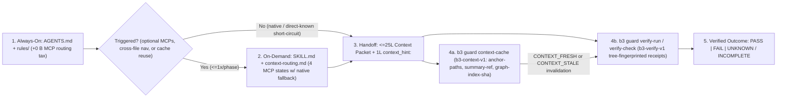

# MCP-Aware Context Routing

Human-facing guide (`0 B` runtime tokens — never loaded by `AGENTS.md`, `rules/*.md`, or workflows).

## Architecture & Single-Source Contract

- **Canonical runtime contract:** [`workflows/references/context-routing.md`](../workflows/references/context-routing.md) (`<= 3000 B` LF cap), loaded **on demand** at most once per phase across the 6 scoped workflows (`/b3-ship`, `/b3-research-ship`, `/b3-review`, `/b3-review-loop`, `/b3-debug`, and `/b3-implement` / `feature-implementation`) **only when triggered** (optional MCPs active, cross-file symbol/impact navigation, or multi-iter `context-cache` reuse) and skipped on native-only / direct-known diffs.
- **Zero always-on overhead:** `AGENTS.md` and `rules/*.md` do not load or reference context routing or MCP servers (`+0 B` MCP routing tax).
- **Hint-only subagents:** Orchestrators never paste `context-routing.md` into subagents. `agents/b3-reviewer.md` and `agents/b3-fixer.md` consume only a 1-line `context_hint: tools=<both|codebase-memory|serena|native> cache=<ref|none> delta=<files|none>` and explicitly never reload `context-routing.md`.
- **Bounded disclosure & short-circuit:** Prefer bounded slices, symbol bodies, and compact summaries — never dump entire repositories, raw graphs, or full files. When target files/symbols are already known (**direct-known short-circuit**), read directly (or apply surgical `serena` edit) and skip graph scans and absent-MCP probing.

## Diagram H — Context & Evidence Lifecycle

## Canonical Routing, Staleness, Cache & Boundaries

The normative runtime rules live in [`workflows/references/context-routing.md`](../workflows/references/context-routing.md) rather than being duplicated here:

- **4 MCP states (`both`, `codebase-memory` only, `serena` only, `neither`), 1 primary tool per need & graceful failure:** See `## Detection & 4 MCP states` and `## Routing matrix (1 primary per need)` in [`workflows/references/context-routing.md`](../workflows/references/context-routing.md).
- **Commit-indexed graph vs live-workspace LSP staleness & `b3 guard context-cache` (`b3-context-v1`):** See `## Staleness, disclosure, cache & trust` in [`workflows/references/context-routing.md`](../workflows/references/context-routing.md) and [`scripts/README.md`](../scripts/README.md) for CLI exit codes and flags (`CONTEXT_FRESH`, `CONTEXT_STALE`, `graph_index_mismatch`, `live_lsp_eligible=true`).
- **Review-loop reuse & Research Ship `repo-evidence` boundary:** See `## Review Loop, Research Ship & failure` in [`workflows/references/context-routing.md`](../workflows/references/context-routing.md) (plus [`review-loop/strategy.md`](../review-loop/strategy.md), [`review-loop/hierarchical.md`](../review-loop/hierarchical.md), and [`workflows/research-ship.md`](../workflows/research-ship.md)).

## 4-Host Compatibility

| Host | Canonical Consumption | MCP & Config Handling |
| --- | --- | --- |
| **Cursor** | `AGENTS.md` + `b3 sync --host cursor` | Detects active host MCP tools once/phase; never edits Cursor MCP config. |
| **Antigravity** | `AGENTS.md` + generated `.agents/skills.json` / plugin (`b3 sync --host antigravity`) | Detects active host MCP tools once/phase; never edits `~/.gemini` config. |
| **Codex** | `AGENTS.md` + `b3 sync --host codex` | Detects active host MCP tools once/phase; never edits `~/.codex/config.toml`. |
| **Claude Code** | `CLAUDE.md` (`@AGENTS.md`) + `b3 sync --host claude` | Detects active host MCP tools once/phase; never edits `~/.claude/settings.json`. |

## Measured Static Context Overhead

Live exact LF byte counts, `(bytes + 2) / 4` token estimates, and strict cap checks are owned by `b3 context measure --strict`:
- Enforce `0` warnings across all static LF byte caps via `b3 context measure --strict` (canonical thresholds live in [`src/context.rs`](../src/context.rs)).
- `AGENTS.md` and `rules/*.md` impose `+0 B` MCP routing tax (`context-routing.md` loads strictly on demand).

Validation: run `cargo test`.

## Not Verified / Known Limits (`UNKNOWN / INCOMPLETE`)

- **Live external MCP server execution:** Local CLI tests validate deterministic `b3 guard context-cache`, `diff-scope`, contract hooks, and static budgets; they do **not** run live Codebase Memory or Serena MCP servers.
- **Live host IDE UI discovery:** Adapter checks verify local symlinks/junctions and `.agents/skills.json`, not live MCP tool registration or UI discovery inside Cursor, Antigravity, Codex, or Claude Code.
- **Runtime token / cost savings:** Actual runtime token, latency, and cost impact depend on host implementation, MCP server indexing, and repository workload; no synthetic or unmeasured runtime savings are claimed here. Paired host-with/without-B3 measurement is specified in [evaluation.md](evaluation.md); see [roadmap.md](roadmap.md) for priorities.
