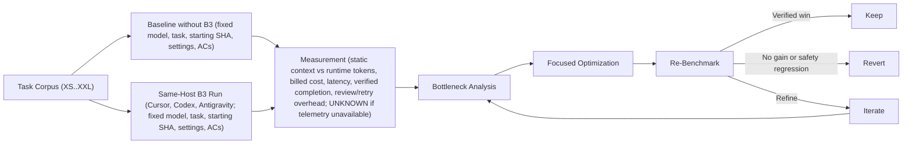

# Evaluation

This repository evaluates **itself**: whether the right artifact activates, whether the result is good, whether failure is honest, and whether the review loop actually improves the work. Deterministic YAML and contract suites run today; semantic LLM and capability benchmarks remain deferred.

Application test suites for product work live in those products. Evals for B3 itself live under `evals/`.

**Status:** YAML schema, activation, boundary, rule, command, review-loop, and workflow fixtures live under `evals/` and run deterministically in CI (`.github/workflows/ci.yml`) via `cargo test --test eval_contracts`. Automated LLM eval runner, LLM-eval CI, and capability benchmarks remain **deferred** (decision-005). See [`evals/README.md`](../evals/README.md) for current fixture counts/layout and [`ci-architecture.md`](ci-architecture.md) for the test ownership matrix.

## What to test

Evaluation covers four questions. A green “it wrote something” is not enough.

### Capability

Does the system produce a **good result** when the right skill/rule/agent is used? Correctness, clarity, portability, token efficiency, progressive disclosure, verification, failure handling.

### Activation

Did the **correct** skill, rule, or agent activate?

For skills, cases in three buckets:

```text
should-trigger
should-not-trigger
near-miss
```

| Bucket | Meaning |
| --- | --- |
| Should trigger | A realistic request where this skill is the right method |
| Should not trigger | A request outside the skill, including unrelated work |
| Near miss | Related wording that should activate a *different* skill or no skill |

A skill fails activation evals if it is silent on should-trigger cases, greedy on should-not-trigger cases, or consistently wins near-misses that belong elsewhere.

Trigger evals read the skill `description` and `SKILL.md` “when not to use” text. If those texts cannot separate the buckets, the skill is not ready.

Rules and agents use analogous comply / violate / wrong-role cases (`evals/rules/`, `evals/agents/`).

### Safety

Does the system **fail safely**? Tool failure, missing diff, incomplete evidence → `UNKNOWN / INCOMPLETE` (or FAIL with remaining confirmed issues) — never a fake PASS. Preferences must not override security or hard rules ([`precedence.md`](precedence.md)).

### Convergence

Does the review loop **actually improve** the implementation? Fixes map to findings; verification runs; lifecycle moves `CONFIRMED` → `FIXED` → `VERIFIED`; the loop does not declare PASS on stagnation, identical reviews, or iteration exhaustion.

## Skill quality (capability detail)

When a skill is applied to a fixture (or a recorded real task), score at least:

| Dimension | Ask |
| --- | --- |
| Correctness | Does following it produce a sound engineering result? |
| Clarity | Can an agent execute it without improvising the method? |
| Portability | Does it avoid host-specific coupling? |
| Token efficiency | Is the main file small, with details deferred? |
| Progressive disclosure | Are references opened only when needed? |
| Verification | Does it demand evidence and forbid fake PASS? |
| Failure handling | Does it degrade to UNKNOWN / INCOMPLETE instead of guessing? |

Quality evals need fixtures with a known good outcome, not only prompt sniff tests.

## Fixture coverage & native contract suites

Live folder inventory and fixture counts across `skills/`, `rules/`, `agents/`, `commands/`, `workflows/`, and `review-loop/` are maintained in [`../evals/README.md`](../evals/README.md) (and [`../evals/review-loop/README.md`](../evals/review-loop/README.md)); the native Rust integration test ownership matrix (`cargo test --test eval_contracts` and sibling suites) lives in [`ci-architecture.md`](ci-architecture.md). A loop that always reports success is a failed loop; a loop that always reports dozens of speculative issues is also a failed loop. Native tests verify CLI, Git, and filesystem contracts — not live slash-command or skill discovery across Cursor, Codex, Claude Code, and Antigravity.

## Honesty metrics

- False PASS rate (claimed success without evidence)
- False FAIL rate (noise presented as confirmed issues)
- Stagnation escapes (loop stops with PASS while findings are unchanged)
- Skip-without-reason rate (review dimensions silently omitted)

## Adding evals later

Each case records: intent, input, expected bucket or outcome, and the artifact under test. Add a new case whenever a behavior or regression is worth protecting.

## What evaluation is not

- Not a substitute for verifying a product change
- Not a leaderboard for prompt cleverness
- Not an excuse to freeze the system; evals should make change safer

## Optimization measurement (proposed methodology)

**Priority:** Establish a paired **same-host, same-model** benchmark centered on **total execution cost per verified completed task** before claiming B3 reduces token usage or costs. This is the acceptance method for the [roadmap](roadmap.md); it is not implemented telemetry or an observed result.

> **Status: proposed, not verified.** The runtime metrics and formulas below are evaluation methodology specifications aligned with [`engineering-philosophy.md`](engineering-philosophy.md). Zero runtime telemetry infrastructure is implemented or wired by this document, and zero benchmark results or cost savings are claimed here.

### Diagram F — Efficiency Optimization & Benchmark Lifecycle



Optimization claims (context reduction, model routing, or parallel dispatch) must be evaluated end-to-end across **total execution cost per verified completed task** and its underlying signals:

| # | Signal / Dimension | Proposed definition (not verified) |
| --- | --- | --- |
| 1 | Verified completion & regressions | Count of tasks/ACs reaching verified completion (`PASS` with receipts) without post-change regressions |
| 2 | Total execution cost | Sum of worker, parent orchestrator, subagent, retry, verification, review/fixer, and integration costs (including failed attempts) |
| 3 | Runtime tokens (when available) | Actual input, output, and cached tokens across parent orchestrator, subagents, reviewers, and fixers (`UNKNOWN` if host does not expose) |
| 4 | Billed cost (when available) | Actual host/provider-reported spend (`UNKNOWN` if unavailable; never derived by converting static prompt bytes) |
| 5 | Parent orchestrator & subagent overhead | Parent planning, wave-check, `Context Packet` construction, subagent spawn/handoff, and aggregation cost |
| 6 | Review/fixer & retry overhead | Review-loop iterations, `b3-fixer` hops, failed attempts/retries, and re-verification triggered by defects or wave conflicts |
| 7 | Verification overhead | Cost and wall-clock time spent running deterministic `b3` checks, test suites, and build gates |
| 8 | Wall-clock duration | End-to-end run latency from start to verified commit (including sequential integration) |
| 9 | Human interventions | Manual corrections, prompt nudges, conflict resolutions, or recovery steps required from the operator |
| 10 | Parallel utilization & blocked waves | Eligible independent tasks run concurrently vs. waves serialized/aborted (`WAVE_CONFLICT`, dirty worktrees) |
| 11 | False `PASS` rate | Unverified or unsound completions escaping gates (must remain `0`; safety non-negotiable) |

### Proposed composite efficiency lens (not verified)

```text
Total execution cost per verified completed task (proposed)
  = Total run cost (parent + subagents + review/fixer iterations + failed attempts/retries + verification + integration)
  / Verified completed tasks (without regressions)
```

Equivalently, `Efficiency (proposed) = Verified useful results / Total execution cost`, subject to hard constraints: false `PASS` rate `= 0` and all precedence/verification invariants satisfied.

### Paired harness-efficiency baseline (not yet run)

1. **Corpus:** Use representative real-world tasks grouped XS/S/M/L/XL/XXL, each with a frozen starting Git SHA, acceptance criteria, allowed scope, and independent verification. Separate bugfix, feature, refactor, and review-heavy cases where practical.
2. **Arms:** Compare the active coding-agent host without B3 against the *same host, same model, same effort/settings, same starting SHA, same task* with B3 (across Cursor, Codex, and Antigravity). Repeat enough runs to expose variance and record failures. Different model/provider comparisons are separate experiments; do not attribute their price or quality differences to the harness.
3. **Metering:** Record actual tokens and billed cost when reported by the host alongside parent orchestrator overhead, subagent counts, review/fixer iterations, failed attempts/retries, verification overhead, wall-clock duration, human interventions, and verified completion/regression outcomes.
4. **Missing data:** Mark runtime token usage or billed cost `UNKNOWN` when telemetry is unavailable. Keep static context bytes and runtime token counts in separate columns; do not convert static byte estimates to billed cost.
5. **Decision:** Compare distributions by task size using **total execution cost per verified completed task**. Reject any apparent saving that weakens safety, review independence, or evidence quality. Keep verified wins, revert regressions, and iterate on remaining bottlenecks.
6. **Portability later:** When an additional coding-agent CLI is available in an authorized environment, validate the identical acceptance/evidence contracts through its adapter. Never require proprietary logs, API specs, or credentials in public fixtures.

**Artifact:** A reproducible results table with task IDs, host/model/settings, starting SHAs, evidence refs, telemetry availability, observed metrics, and explicit `PASS`/`FAIL`/`UNKNOWN` labels. Zero percentage improvements or cost savings are claimed before this benchmark exists.

### Structural comparison: Sequential vs. Parallel scenarios

| Scenario | Recommended mode | Structural rationale |
| --- | --- | --- |
| Tiny, overhead-dominated tasks (e.g., 1–2 small edits or single-file fix) | Sequential | Orchestration, wave checks, and Context Packet overhead exceed any concurrency gain |
| 2+ disjoint medium/large modules with worktree/path isolation | Bounded parallel wave | Independent writes/reads amortize coordination overhead and reduce wall-clock latency |
| Partially conflicting tasks (shared contracts, ledgers, or overlapping `watched_paths`) | Partitioned sub-waves + single-writer integration | Independent slices run concurrently; shared-state updates serialize to avoid rework and `WAVE_CONFLICT` |
