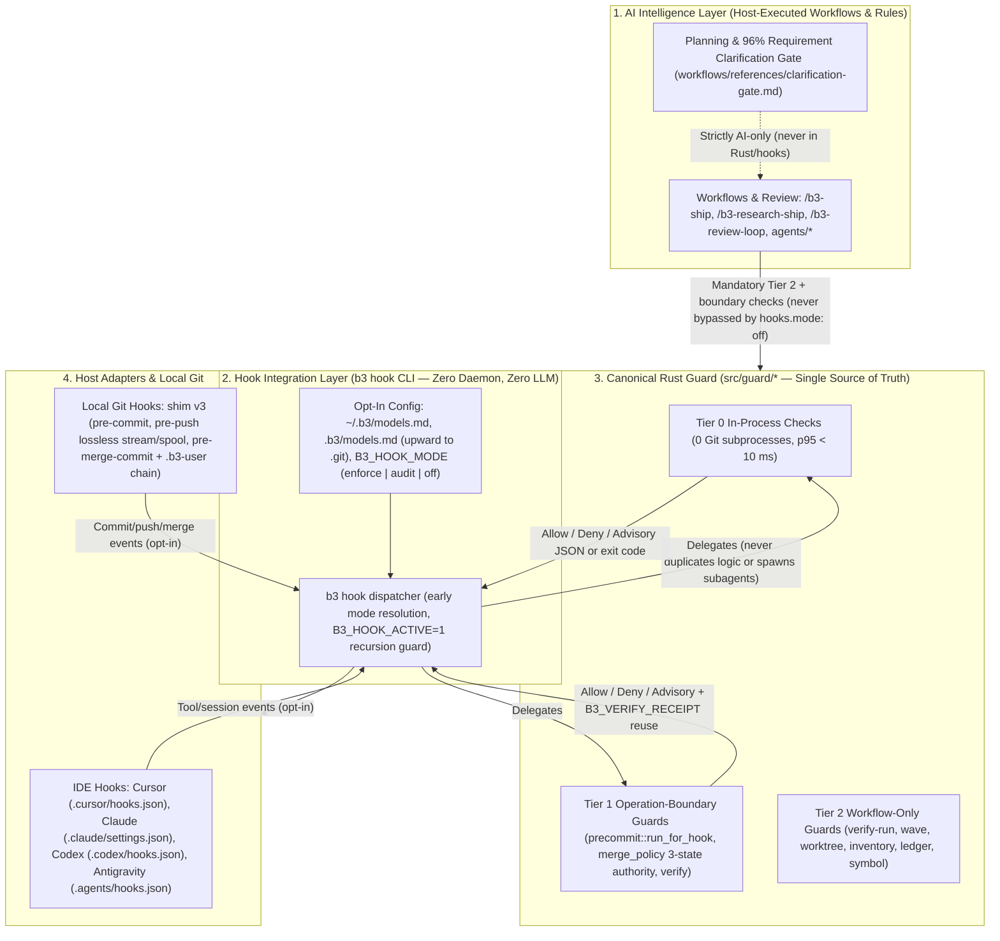
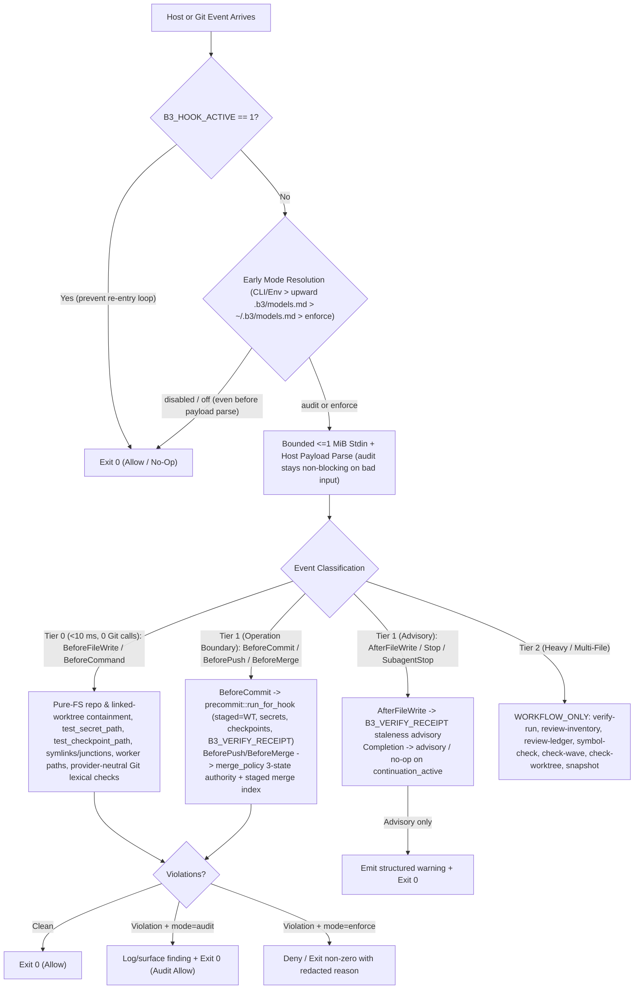

# Native Guard Event Hooks (`b3 hook`)

> [!NOTE]
> Human-facing architecture, classification, authority/env matrices, verification status, security model, and 4-way benchmark reference (`0 B` runtime LLM tokens). The compact runtime contract lives in [`../workflows/references/hook-integration.md`](../workflows/references/hook-integration.md). Local Git CLI hooks are `LIVE_CLI_VERIFIED`; live IDE runtime execution across **Cursor**, **Claude Code**, **Codex**, and **Antigravity** remains **`NOT_VERIFIED`**.

`b3 hook` connects host lifecycle events and local Git hooks directly to B3's canonical deterministic Rust Guard (`src/guard/*`) with **`0` LLM tokens**, **no background daemon**, and **no duplicate guard engine**.

---

## 1. Architecture & Execution Flow

### Diagram A — Four-Layer Ownership & Hook Boundary



### Diagram B — Guard-to-Event & Tier 0 / Tier 1 / Tier 2 Flow



---

## 2. Guard Classification, Consolidation & Policy Authority

### Guard Module Classification (`src/guard/*` — `16` modules)

| Guard Module | Protected Operation | Subprocess / Cost Profile | Classification | Remaining Workflow-Only Checks |
| --- | --- | --- | --- | --- |
| `precommit` | `git commit` via `run_for_hook` (mid-op state, staged index, `staged == WT`, secret/checkpoint exclusion, receipt) | `2` Git calls (no receipt) / `13` Git calls (with `B3_VERIFY_RECEIPT`) | `EVENT_BLOCKING` (`BeforeCommit`) | Workflow `--allowed-paths` & `--expected-cmd` binding |
| `merge_policy` | `git push` / `pre-merge-commit` via canonical helpers + 3-state authority (`EstablishedPolicy`, `LocalAbsentOnly`, `UnknownRemoteAuthority`) | `0` network calls; `4–17` local Git calls | `EVENT_BLOCKING` / `EVENT_ADVISORY` | Server PR verification (`gh pr` API), `--post-merge` ancestry & release approval |
| `verify` | `verify_run` executes test/build; `verify_check` validates `b3-verify-v1` tree fingerprint | `verify_run`: arbitrary build/test; `verify_check`: bounded Git + SHA-256 | `verify_check`: `EVENT_BLOCKING` / `EVENT_ADVISORY`; `verify_run`: `WORKFLOW_ONLY` | Executing test/build suites (`verify-run`), baseline attribution |
| `mechanical`, `scope`, `freshness`, `wave`, `worktree`, `inventory`, `ledger`, `symbol`, `snapshot`, `evidence` | Diff safety sweep, sizing, drift, wave partitioning, linked worktrees, L0–L4 review, symbol scan, snapshots, provenance | Medium–high (diff/repo/build-scoped checks) | `WORKFLOW_ONLY` (Tier 2) | Full multi-file & wave-level workflow gates |
| `fingerprint`, `runs`, `cache` | Scope readiness hash, `.b3/{ship,research-ship}` run pointers, `b3-context-v1` freshness | Negligible–low (`0–8` Git/FS ops) | `ON_DEMAND` | Run lifecycle & context-cache checks |

### Policy Authority & Trust Boundaries (`merge_policy::check_git_hook_operation`)

Local Git hooks never treat missing local tracking refs as proof of remote policy absence and never issue extra network calls during normal feature pushes:

1. **`EstablishedPolicy`:** Triggered when the remote's tracking trunk (`refs/remotes/<rem>/*` via `HEAD`, `main`/`master`, or unique policy blob), an already-fetched `remote_oid`, local `HEAD`/candidate commits, staged merge index, or working-tree `.b3/research-policy.json` establishes governance. Blocks policy tampering/deletions (including orphan drops), protected paths, governed branch deletion, stale/unfetched target `remote_oid`, direct push when `auto_merge != "authorized"`, and octopus merges onto governed branches.
2. **`LocalAbsentOnly`:** Triggered when destination URLs match fetch URL and remote tracking trunk exists locally with no policy found locally. Still blocks pushes to trunk when `remote_oid` is non-zero and unfetched or mismatched against local tracking trunk (catching remotely added policy after the last `git fetch`).
3. **`UnknownRemoteAuthority(reason)`:** Triggered on direct URL pushes (`direct_url_push`), mismatched fetch vs push URLs (`push_url_differs_from_fetch_url`), empty `git remote` tracking cache (`missing_remote_tracking_refs`), or unset `<remote>/HEAD` without `main`/`master`/unique policy (`unconfigured_remote_head`). Blocks `main`/`master` deletion or pushes to existing remote `main`/`master`; emits non-blocking `HOOK_ADVISORY` on feature branch pushes and defers authoritative remote checks to `b3 guard merge-policy-check`.
4. **`pre-merge-commit` Scope:** Validates `HEAD`, every `MERGE_HEAD` parent (including multi-parent merges), AND the **actual staged merge result** (`git ls-files --stage` + `git diff --cached <trunk.sha>`). **Explicit non-coverage:** fast-forward merges (`git merge --ff-only` / ff default) never fire `pre-merge-commit`; conflicted merges resolved and finalized with `git commit` run `pre-commit` rather than `pre-merge-commit`; `git rebase`, `git cherry-pick`, `--no-verify`, and server-side PR merges are outside `pre-merge-commit`.

### Consolidation & Removal Summary

| Action | Components | Rationale |
| --- | --- | --- |
| **KEEP** | `src/hook/{config,event,dispatch,install,response}`, Tier 0 `<10 ms`/`0` Git checks, `precommit::run_for_hook`, `merge_policy` 3-state authority, upward early mode resolution, Git shim `v3` | Minimal, sound surface with zero daemon/LLM overhead |
| **CONSOLIDATE** | `enforce_policy_and_protected_paths`, `assert_target_branch_preserved_policy`, `is_governed_target_branch` in `merge_policy.rs`; `precommit::run_inner` (`ExplicitCli` / `HookExplicit` / `HookImplicit`); `JsonHost` table | Eliminated 4 duplicated policy/protected-path loops and duplicate `git diff --cached` invocation |
| **SIMPLIFY** | `eval_before_command` Git lexical tripwire; Antigravity flat `Stop`; Codex `"hooks"` wrapper; `pub(crate)` visibility across `src/hook/{event,install,response,dispatch}` and hook-only helpers | Tightens internal crate API surface and matches live host schemas |
| **REMOVE** | 25 speculative env vars (bypass/tree-cache/merge-auth, `B3_HOOK_REQUIRE_REPO`, `B3_EXPECTED_CMD`, `B3_RELEVANT_PATHS`, 17 PR/CI/HEAD vars, and 2 redundant Tier 0/hook path-list env overrides), `check_policy_absent_batch`, `run_with_pre_staged`, `NormalizedEvent.host`, `HostId::as_str`, `HookHostTarget::as_str`, dead Git JSON `paths`/`staged_files` extraction | Removed unsafe absence assumptions and speculative/unreferenced code (`-441` prod LOC in `src/hook/*.rs` vs `29462c9`) |

---

## 3. Host Capability & 8-Status Runtime Verification Matrix

### Host Protocol & Capability Summary

| Host / Runtime | Events & Config Path | Blocking vs Advisory | Adapter & Response Protocol |
| --- | --- | --- | --- |
| **Cursor** | `preToolUse`, `beforeShellExecution`, `afterFileEdit`, `subagentStop`, `stop` (`[~/.cursor \| .cursor]/hooks.json`) | `NATIVE_BLOCKING` + `NATIVE_ADVISORY` | Stdin JSON; stdout `{"permission":"allow\|deny",...}` + exit `0`/`2` |
| **Claude Code** | `PreToolUse`, `PostToolUse`, `SubagentStop`, `Stop` (`[~/.claude \| .claude]/settings.json`) | `NATIVE_BLOCKING` (`PreToolUse`) + `NATIVE_ADVISORY` | Stdin JSON; exit `0` allow, exit `2` blocking stderr |
| **Codex** | `PreToolUse` (`apply_patch\|Write\|Edit\|Bash\|shell`), `PostToolUse`, `Stop` (`[~/.codex \| .codex]/hooks.json`, top-level `"hooks"` wrapper) | `NATIVE_BLOCKING` (`PreToolUse`) + `NATIVE_ADVISORY` | Stdin JSON; exit `0` allow, exit `2` blocking stderr (requires `/hooks` trust) |
| **Antigravity** | Grouped `PreToolUse`/`PostToolUse` + flat `Stop` (`b3-native-guard` key in `.agents/hooks.json` or `~/.gemini/config/hooks.json`) | `NATIVE_BLOCKING` (`PreToolUse`) + `NATIVE_ADVISORY` (`PostToolUse`, `Stop`) | Strips `CORTEX_STEP_TYPE_*`; stdout `{"decision":"allow\|deny\|continue","reason":"..."}` + exit `0` |
| **Git (Local)** | `pre-commit`, `pre-push`, `pre-merge-commit` (`core.hooksPath` or `<git-common-dir>/hooks/`) | `NATIVE_BLOCKING` / `EVENT_ADVISORY` (`precommit` / `merge_policy`) | Shim `v3`: `</dev/null` on commit/merge; lossless stream (or `mktemp` `O_EXCL` temp file when chained) on `pre-push`; preserves `.b3-user` perms |

### 8-Status Host Runtime Verification Matrix

Statuses: `LIVE_RUNTIME_VERIFIED` · `LIVE_CLI_VERIFIED` · `CONFIG_SCHEMA_VERIFIED` · `PROTOCOL_FIXTURE_VERIFIED` · `UNIT_TEST_ONLY` · `NOT_INSTALLED_IN_ENV` · `UNSUPPORTED_BY_HOST` · `NOT_VERIFIED`.

| Host / Runtime | Current Evidence Status | What Was Executed | Live Reproduction Commands (Per Host) |
| --- | --- | --- | --- |
| **Git (Local `git` CLI)** | **`LIVE_CLI_VERIFIED`** | Real `git commit`, `git push` (local bare remotes, multi-remote, pushUrl mismatch, direct URL, stale fetch, non-`main` `trunk`), `git merge`, linked worktrees, lossless `pre-push` stdin, `.b3-user` chaining & perm preservation | `b3 hook install --host git --scope project && b3 hook verify --host git --scope project` → run `git commit` / `git push` |
| **Cursor** | **`CONFIG_SCHEMA_VERIFIED`** + **`PROTOCOL_FIXTURE_VERIFIED`** + **`NOT_VERIFIED`** / **`NOT_INSTALLED_IN_ENV`** | `b3 hook install/verify` JSON roundtrip + stdin/stdout fixture tests; no live IDE loop | `b3 hook install --host cursor --scope project && b3 hook verify --host cursor --scope project` → trigger `.env` write in Cursor Chat |
| **Claude Code** | **`CONFIG_SCHEMA_VERIFIED`** + **`PROTOCOL_FIXTURE_VERIFIED`** + **`NOT_VERIFIED`** / **`NOT_INSTALLED_IN_ENV`** | `settings.json` grouped matcher roundtrip + exit `0`/`2` fixture tests; no live CLI session | `b3 hook install --host claude --scope project && b3 hook verify --host claude --scope project` → run Claude Code tool call on `.env` |
| **Codex** | **`CONFIG_SCHEMA_VERIFIED`** + **`PROTOCOL_FIXTURE_VERIFIED`** + **`NOT_VERIFIED`** / **`NOT_INSTALLED_IN_ENV`** | `.codex/hooks.json` `"hooks"` wrapper + `apply_patch`/`Bash` fixture tests; no live Codex `/hooks` session | `b3 hook install --host codex --scope project && b3 hook verify --host codex --scope project` → enable `/hooks` in Codex & edit `.env` |
| **Antigravity** | **`CONFIG_SCHEMA_VERIFIED`** + **`PROTOCOL_FIXTURE_VERIFIED`** + **`NOT_VERIFIED`** / **`NOT_INSTALLED_IN_ENV`** | `.agents/hooks.json` `b3-native-guard` flat `Stop` + `CORTEX_STEP_TYPE_*` & `allow\|deny\|continue` fixtures; no live IDE loop | `b3 hook install --host antigravity --scope project && b3 hook verify --host antigravity --scope project` → trigger `write_to_file` on `.env` |

---

## 4. Configuration & 7-Variable Environment Contract Matrix

```bash
b3 hook install --host all --scope project --dry-run
b3 hook install --host <cursor|claude|codex|antigravity|git|all> [--scope <project|global>] [--repo-root <path>]
b3 hook verify  --host <cursor|claude|codex|antigravity|git|all> [--scope <project|global>] [--repo-root <path>]
b3 hook status  [--repo-root <path>] [--user-home <path>]
b3 hook uninstall --host <cursor|claude|codex|antigravity|git|all> [--scope <project|global>] [--repo-root <path>]
```

**Environment Contract Audit (`7` remaining active `B3_*` hook variables):**

| Variable | Producer | Consumer | Status & Binding | Host Propagation & Fallback |
| --- | --- | --- | --- | --- |
| `B3_HOOK_MODE` | User shell / CLI wrapper | `config.rs`, `dispatch.rs` | Optional; overridden by `--mode`; applies session/shell-wide | Env inheritance; invalid values warn and fall back to `models.md` / `enforce` (**Production-integrated**) |
| `B3_HOOK_ACTIVE` | `dispatch.rs`, Git shim `v3` | `dispatch.rs`, Git shim `v3` | Internal recursion guard (`1`/`true`); shell commands setting `B3_HOOK_ACTIVE=` blocked in Tier 0; never disables direct `b3 guard` | Inherited by child `.b3-user` and internal Git calls; defaults unset (**Production-integrated**) |
| `B3_MODELS_PERSONAL` | User shell / CI config | `config.rs` | Optional override for `~/.b3/models.md`; global | Env inheritance; falls back to `<user_home>/.b3/models.md` (**Optional explicit input**) |
| `B3_WORKER_ALLOWED_PATHS` | Caller / worker wrapper | `dispatch.rs` (`BeforeFileWrite`) | Optional explicit worker CSV; checks normalized relative paths in repo & linked worktrees | **Not auto-propagated by IDE workflows** (`FIXTURE_TESTED_ONLY` / `NOT_VERIFIED` live); omitted = repo-wide containment; workflow `check-wave`/`mechanical-check` stay authoritative |
| `B3_ALLOWED_PATHS` | Caller / workflow shell | `dispatch.rs` (`BeforeCommit`), `precommit::run_for_hook` | Optional commit scope CSV; **never** allowed to whitelist secrets | Env inheritance if explicitly exported; omitted = `HookImplicit` (no CSV round-trip) (**Optional explicit input**) |
| `B3_VERIFY_RECEIPT` | Caller / workflow shell | `dispatch.rs` (`BeforeCommit`/`AfterFileWrite`/`Stop`, `BeforePush`/`BeforeMerge`) | Optional receipt path bound to `HEAD`, staged=WT, and scope | Env inheritance if exported; omitted = skip receipt binding in `BeforeCommit`, `Ok` in advisories (**Optional explicit input**) |
| `B3_LEDGER_PATH` | Caller / workflow shell | `dispatch.rs` (`BeforePush`/`BeforeMerge`) | Optional review ledger path for governed branch `auto_merge=authorized` pushes | Env inheritance if exported; omitted = fail closed (`missing_ledger_path`) when pushing governed `authorized` target (**Optional explicit input**) |

**Honest Ambiguity Note (Early Mode Resolution):** When `--repo-root` is omitted and `cwd` is inside a repository subdirectory (`<repo>/sub/dir`), pure-FS upward discovery finds `<repo>/.b3/models.md` (stopping at user home, system temp, symlinks/junctions, or first `.git` boundary). However, if `--repo-root` is omitted, `cwd` is outside any repository, AND stdin JSON is malformed before `project_root`/`cwd` can be parsed, project-level `audit`/`off` settings cannot be discovered and defaults/global/`B3_HOOK_MODE` apply.

---

## 5. Security Threat Model & Limitations

1. **Tier 0 Command Limits:** `BeforeCommand` is a fast lexical tripwire for Git subcommands (`git push --force`/`-f`, `git reset --hard`, `git commit --no-verify`/`-n`, `git add -A`/`.`/`.b3*`) and `B3_HOOK_ACTIVE=` / `B3_HOOK_MODE=` shell assignments; it cannot resolve shell aliases, `$CMD` indirection, or `eval`.
2. **Untrusted Payloads & Symlinks:** Bounded `<=1 MiB` stdin, strict JSON parsing, `has_control_chars` checks, `resolve_safe_repo_write_path`, and reparse/junction segment guards prevent traversal while keeping `audit`/`off` non-blocking when mode is known.
3. **Local Git Hook & Worker Ownership Limits:** `--no-verify` or `.git/hooks/*` edits bypass local Git hooks, and B3 IDE workflows do not automatically inject `B3_WORKER_ALLOWED_PATHS` across IDE subagent runtimes. Server-side branch protection, required CI, and mandatory workflow `b3 guard` gates remain authoritative.

---

## 6. Performance Benchmarks (4-Way Comparison: A vs B vs C vs D)

Measured back-to-back on Windows (`target/release/b3.exe`, 1 warmup + `n = 20` timed runs; `n = 10` for 4-worker parallel wave; `PATH` set to an empty dir on Tier 0 cases proving `0` Git calls; Git subprocess counts measured via a compiled `rustc` `git.exe` counter shim). **A** = `origin/main` after PR #47 (`d98369a`, `3,340,288 B`); **B** = original PR #46 (`29462c9`, `3,613,696 B`); **C** = previous hardened PR (`0c79113`, `3,622,400 B`); **D** = final corrected PR #46 (`3,653,632 B`).

| Benchmark Case | A (`d98369a`) `p50` | B (`29462c9`) `p50` / `p95` | C (`0c79113`) `p50` / `p95` | D (Final) `p50` / `p95` / `max` (Git) | Notes |
| --- | --- | --- | --- | --- | --- |
| `b3 --version` | `4.57 ms` | `4.26` / `12.84 ms` | `3.99` / `9.09 ms` | `4.97` / `12.85` / `16.26 ms` (`0`) | Comparable startup, zero daemon |
| `b3 context measure --strict` | `7.25 ms` | `8.20` / `16.53 ms` | `7.47` / `12.17 ms` | `12.20` / `25.38` / `33.51 ms` (`0`) | `always_on_total = 15,579 B`, `warnings = 0` (`+0 B` vs A) |
| Tier 0 `BeforeFileWrite` allow | — | `4.93` / `14.52 ms` | `5.43` / `15.73 ms` | `6.94` / `13.00` / `13.02 ms` (`0`) | Empty `PATH`; `0` Git calls |
| Tier 0 `BeforeFileWrite` deny `.env` | — | `5.16` / `10.97 ms` | `5.93` / `13.63 ms` | `7.04` / `14.09` / `35.87 ms` (`0`) | Empty `PATH`; `rc=2`, `0` Git calls |
| Tier 0 `BeforeCommand` allow / deny | — | `6.32` / `5.77 ms` | `4.01` / `3.96 ms` | `6.00` (`p95 7.74`) / `6.00` (`p95 6.67`) ms (`0`) | Empty `PATH`; `0` Git calls |
| 4-worker parallel Tier 0 write | — | `8.32` / `20.47 ms` | `8.96` / `19.09 ms` | `9.37` / `35.51` / `35.51 ms` (`0`) | Wall time across 4 concurrent processes |
| Tier 1 `BeforeCommit` (no receipt) | — | `108.03` / `130.07 ms` (`3`) | `73.28` / `94.99 ms` (`2`) | `75.09` / `109.70` / `113.30 ms` (`2`) | **`-30.5%` p50** vs B; single `git diff --cached` in `run_for_hook` |
| Tier 1 `BeforeCommit` (`B3_VERIFY_RECEIPT`) | — | `455.97` / `508.21 ms` (`14`) | `411.51` / `465.18 ms` (`13`) | `454.22` / `536.28` / `577.22 ms` (`13`) | Canonical `run_for_hook` + `verify_check` |
| Tier 1 `BeforePush` (non-governed) | — | `4.14 ms` (`0`, `rc=1` broken) | `41.58 ms` (`1`, unsafe R02) | `300.56` / `380.65` / `425.84 ms` (`9`) | Inspects destination URLs, tracking trunk & `remote_oid` (`0` network calls) |
| Tier 1 `BeforePush` (governed feat / `main`) | — | N/A | `409.24` / `413.13 ms` (`13`) | `494.00` (`15`) / `558.53 ms` (`17`) | Real `pre-push` stdin (`rc=0` allow / `rc=1` block) |
| Tier 1 `BeforePush` (`UnknownRemoteAuthority`) | — | N/A | N/A | `336.83` / `441.55` / `500.90 ms` (`10`) | Direct URL feature push + local policy floor (`rc=0`, `178 B` advisory stderr) |
| `audit` / `off` malformed `{not-json` (`p50`) | — | `4.94 (rc=2)` / `4.10 (rc=2)` | `5.59 (rc=0)` / `4.40 (rc=0)` | `6.38` / `5.61 ms` (`rc=0`, `0`) | Non-blocking across malformed inputs & subdirs |

> Raw benchmark JSON: `.b3/ship/runs/20261128-1742-pr46-final-hardening/benchmarks-abcd.json`. Context budget: `always_on_total = 15,579 B` (`~3,895 tok`, `+0 B` vs `origin/main` `d98369a`, `warnings = 0`).
