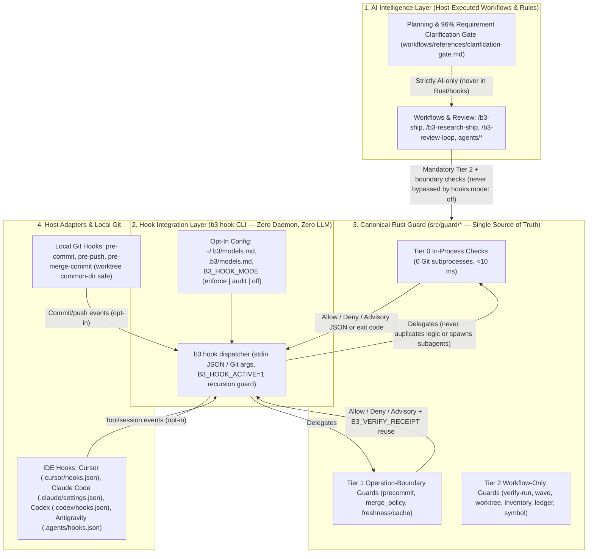
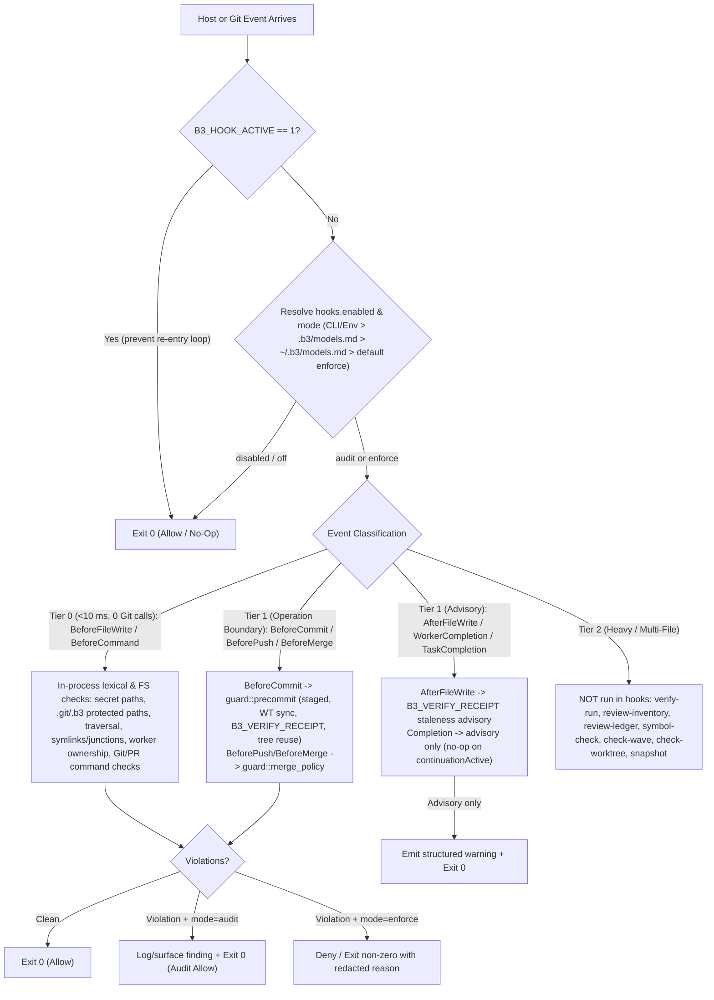

# Native Guard Event Hooks (`b3 hook`)

> [!NOTE]
> Human-facing architecture, classification, capability, security, and benchmark reference (`0 B` runtime LLM tokens). The compact on-demand runtime contract lives in [`../workflows/references/hook-integration.md`](../workflows/references/hook-integration.md). Live IDE runtime hook execution across **Cursor**, **Claude Code**, **Codex**, and **Antigravity** is **`NOT_VERIFIED`** until observed in live host sessions.

`b3 hook` connects host-native lifecycle events and local Git hooks directly to B3's canonical deterministic Rust Guard (`src/guard/*`). It runs with **`0` LLM tokens**, **no background daemon**, and **no duplicate guard engine**—complementing AI-executed workflows (`/b3-ship`, `/b3-research-ship`, `/b3-review-loop`) at high-frequency tool and Git boundaries.

---

## 1. Architecture & Execution Flow

### Diagram A — Four-Layer Ownership & Hook Boundary



### Diagram B — Guard-to-Event & Tier 0 / Tier 1 / Tier 2 Flow



### Diagram C — Parallel Worker Isolation & Verification Evidence Lifecycle

```mermaid
sequenceDiagram
    participant P as Parent Orchestrator
    participant W as Parallel Worker (SHARED_DISJOINT_WRITES or ISOLATED_WRITES)
    participant H as b3 hook (Tier 0 / Tier 1)
    participant G as Canonical Rust Guard (src/guard/*)

    P->>G: check-wave --partition (+ check-worktree --require-isolated if isolated)
    G-->>P: Disjoint owned paths & base SHA validated

    W->>H: BeforeFileWrite (e.g. target file or accidental .env / .b3/ship/ edit)
    H->>G: Tier 0 path containment + test_secret_path + test_checkpoint_path (<10 ms, 0 git)
    alt Secret, traversal, symlink, or stray .b3/ write
        G-->>H: Violation
        H-->>W: Block write (enforce) or warn (audit)
    else Safe owned path
        G-->>H: Clean
        H-->>W: Allow write
    end

    P->>G: verify-run (Tier 2 in workflow -> writes b3-verify-v1 receipt with get_tree_fingerprint)
    G-->>P: VERIFY_PASS (HEAD + RelevantPaths + working-tree digest)

    opt Post-verify edit occurs before commit
        W->>H: AfterFileWrite
        H-->>W: Advisory: active b3-verify-v1 receipt may be VERIFY_STALE
    end

    P->>H: BeforeCommit (with B3_VERIFY_RECEIPT set)
    H->>G: guard::precommit -> verify_check (reuses tree fingerprint; 0 test re-runs)
    alt Staged == WT, allowed paths clean, receipt VALID
        G-->>H: PRECOMMIT_OK
        H-->>P: Allow commit (exit 0)
    else Undeclared path, secret, or VERIFY_STALE
        G-->>H: PRECOMMIT_FAIL
        H-->>P: Block commit (exit 1) -> workflow re-runs verify-run
    end
```

---

## 2. Guard Classification Matrix (`src/guard/*`)

Complete audit of all `16` functional modules in [`../src/guard/mod.rs`](../src/guard/mod.rs):

| Guard Module (`src/guard/*`) | Canonical Implementation | Current Callers | Protected Operation | Runtime Cost / Git Subprocesses | Classification | Remaining Workflow-Only Checks |
| --- | --- | --- | --- | --- | --- | --- |
| `precommit` | [`src/guard/precommit.rs`](../src/guard/precommit.rs) | `/b3-ship`, `/b3-research-ship`, `/b3-review-loop`, `b3 guard precommit` | `git commit` (mid-op state, staged index, `staged == WT`, allowed paths, `test_secret_path`, `test_checkpoint_path`, receipt check) | Low–medium (`~4–7` Git subprocesses; `+verify_check` when receipt passed) | `EVENT_BLOCKING` (Tier 1 `BeforeCommit`) | Workflow-supplied task `--allowed-paths` and `--expected-cmd` binding |
| `merge_policy` | [`src/guard/merge_policy.rs`](../src/guard/merge_policy.rs) | `/b3-research-ship`, governed PR gates, `b3 guard merge-policy-check` | `git push` / merge against trunk `.b3/research-policy.json`, protected paths, `review-ledger`, receipt, optional `b3 pr verify` | Medium–high (`~10–31` Git call sites + optional `gh`/`ls-remote`) | `EVENT_BLOCKING` (Tier 1 `BeforePush` / `BeforeMerge` when policy configured) | `--post-merge` ancestry verification & full PR governance orchestration |
| `mechanical` | [`src/guard/mechanical.rs`](../src/guard/mechanical.rs) | `/b3-ship`, `/b3-review`, `/b3-review-loop`, `b3 guard mechanical-check` | Scope creep, safety hits (secrets, destructive SQL, mass delete), leftovers (`debugger`, `.only(`), advisories, wave attribution | High (`39` Git call sites, blob hashing, diff hunk scan) | `WORKFLOW_ONLY` (Tier 2) | Multi-worker `--worker-roots`/`--worker-bases` attribution, `--obsoletes`, `--dirty-digests`, full diff safety sweep |
| `scope` | [`src/guard/scope.rs`](../src/guard/scope.rs) | `/b3-ship`, `/b3-review`, `/b3-review-loop`, `b3 guard diff-scope` | Diff sizing (`XS`..`XXL`, `NOISE_ONLY`, `CLEAN_AFTER_FIX`), risk signal scan (`scan_path_risk_signals`), destructive SQL helper | Medium (`~9` Git calls; path/SQL helpers `0` Git) | `WORKFLOW_ONLY` (Tier 2) | `--prev-sha` / `--target-ref` delta sizing and review-tier routing |
| `freshness` | [`src/guard/freshness.rs`](../src/guard/freshness.rs) | `/b3-ship`, `b3 guard check-freshness` | Detects committed or WT drift on `--watched-paths` since `--approach-at-sha` / `--task-base-sha` | Low–medium (`~5–10` Git calls) | `WORKFLOW_ONLY` (Tier 2) | Re-Scope decision, dependency graph recomputation, plan bump |
| `verify` | [`src/guard/verify.rs`](../src/guard/verify.rs) | `/b3-ship`, `/b3-research-ship`, `/b3-review-loop`, `/b3-verify`, `/b3-debug`, `/b3-audit`, `/b3-pr-resolve`, `b3 pr` | `verify_run` executes test/build cmd & writes `b3-verify-v1`; `verify_check` validates `get_tree_fingerprint` | `verify_run`: seconds–minutes (arbitrary build/test cmd); `verify_check`: `~5–25` Git call sites + SHA-256 | `verify_check`: `EVENT_BLOCKING` (`BeforeCommit` via `B3_VERIFY_RECEIPT`) / `EVENT_ADVISORY` (`AfterFileWrite` staleness); `verify_run`: `WORKFLOW_ONLY` | Running full test/build commands (`verify-run`), baseline failure attribution |
| `wave` | [`src/guard/wave.rs`](../src/guard/wave.rs) | `/b3-ship`, `/b3-research-ship`, `/b3-implement`, `b3 guard check-wave` | Parallel wave partitioning, RW/WW conflict detection, `--expected-base-sha`, active-slot saturation | Medium (`~4–13` Git call sites + partition graph) | `WORKFLOW_ONLY` (Tier 2) | Entire continuous wave scheduler & mode selection (`SHARED_*`, `ISOLATED_WRITES`, `SEQUENTIAL`) |
| `worktree` | [`src/guard/worktree.rs`](../src/guard/worktree.rs) | `/b3-ship`, `dispatch-naming.md`, `b3 guard check-worktree` | Linked worktree isolation (`--git-common-dir` vs `--git-dir`), reparse/symlink rejection, peer non-overlap | Low (`3` Git call sites) | `WORKFLOW_ONLY` (Tier 2) | Pre-dispatch isolated worker root validation |
| `inventory` | [`src/guard/inventory.rs`](../src/guard/inventory.rs) | `/b3-review`, `/b3-review-loop` (`L`–`XXL`), `b3 guard review-inventory` | Cohesive L0 unit partitioning & adaptive concurrency for large diffs | Medium–high (Git `show`/diff + unit grouping) | `WORKFLOW_ONLY` (Tier 2) | L0 partitioning and specialist trigger routing for `L`/`XL`/`XXL` |
| `ledger` | [`src/guard/ledger.rs`](../src/guard/ledger.rs) | `/b3-review-loop` (`L`–`XXL`), `/b3-research-ship`, `b3 guard review-ledger` | `b3-review-ledger-v1` init/update/normalize/check, `review_independence`, manifest integrity | Medium–high (`~9` Git call sites + `ls-tree` manifest hash) | `WORKFLOW_ONLY` (Tier 2) | L0–L4 hierarchical review ledger & `LEDGER_GATE_PASS` gate |
| `symbol` | [`src/guard/symbol.rs`](../src/guard/symbol.rs) | `/b3-ship` (refactors), `/b3-review`, `/b3-review-loop`, `b3 guard symbol-check` | Regex/ERE scan for `dangling_refs` (`exit 2`) and `orphan_internal` (`SYMBOL_ADVISORY`) | High (Git diff + multi-file repo scan) | `WORKFLOW_ONLY` (Tier 2) | Refactor reference & orphan symbol verification |
| `fingerprint` | [`src/guard/fingerprint.rs`](../src/guard/fingerprint.rs) | `/b3-ship` Readiness Gate, `b3 guard fingerprint` | Canonical `depends_on\|scope\|acceptance_criteria` string | Negligible (`0` Git calls, `<1 ms`) | `ON_DEMAND` | Scope Readiness Gate (`readiness: draft -> ready`) |
| `snapshot` | [`src/guard/snapshot.rs`](../src/guard/snapshot.rs) | `/b3-ship`, `/b3-review-loop`, `b3 guard snapshot` | Creates detached `commit-tree` snapshot excluding `.b3/{ship,research-ship,autodev}` | Low–medium (`~4–10` Git calls; writes Git commit object) | `WORKFLOW_ONLY` (Tier 2) | Pre-fix `pre_fix_object` delta anchor |
| `runs` | [`src/guard/runs.rs`](../src/guard/runs.rs) | `/b3-ship`, `/b3-research-ship`, `b3 guard new-run\|resolve-run\|list-runs\|prune` | Run directory lifecycle & `CURRENT` pointer under `.b3/{ship,research-ship}` | Negligible (`0` Git calls, FS only) | `ON_DEMAND` | Run state creation, resolution, listing, pruning |
| `cache` | [`src/guard/cache.rs`](../src/guard/cache.rs) | `context-routing.md`, `b3 guard context-cache` | `b3-context-v1` anchor-path & `graph-index-sha` freshness check | Low–medium (`~5–8` Git calls) | `ON_DEMAND` | Multi-iteration context cache record/reuse |
| `evidence` | [`src/guard/evidence.rs`](../src/guard/evidence.rs) | `/b3-research-ship`, `b3 guard evidence-check` | SHA-256 `b3-evidence-v1` source manifest write/verify with repo containment | Low (`1` Git call + SHA-256 file reads) | `WORKFLOW_ONLY` (Tier 2) / `ON_DEMAND` | Phase E source provenance audit |

---

## 3. Host Capability Matrix

| Host / Runtime | Supported Events | Blocking vs Advisory Capability | Official Config Path | Exit / JSON Response Protocol | Live Runtime Status |
| --- | --- | --- | --- | --- | --- |
| **Cursor** | `preToolUse`, `beforeShellExecution`, `afterFileEdit`, `subagentStop`, `stop`, `sessionStart`, `sessionEnd` | `NATIVE_BLOCKING` (Tier 0 pre-tool/shell) + `NATIVE_ADVISORY` (post-edit/stop) | `.cursor/hooks.json` (project) / `~/.cursor/hooks.json` (user) | Stdin JSON payload; JSON stdout (`permission: allow \| deny`, `user_message`, `agent_message`) + exit `0`/`2` | **`NOT_VERIFIED`** (config & protocol fixtures only; live IDE session unverified) |
| **Claude Code** | `PreToolUse`, `PostToolUse`, `SubagentStop`, `Stop` | `NATIVE_BLOCKING` (`PreToolUse`) + `NATIVE_ADVISORY` (`PostToolUse`, `SubagentStop`, `Stop`) | `.claude/settings.json` (project) / `~/.claude/settings.json` (user) | Stdin JSON payload; exit `0` allow (advisory on stderr), exit `2` blocking error on stderr (empty stdout) | **`NOT_VERIFIED`** (config & protocol fixtures only; live CLI/IDE session unverified) |
| **Codex** | `PreToolUse` (`apply_patch`, `Bash`), `PostToolUse`, `Stop` | `NATIVE_BLOCKING` (`PreToolUse`) + `NATIVE_ADVISORY` (`PostToolUse`, `Stop`) | `.codex/hooks.json` (project) / `~/.codex/hooks.json` (user; never edits `config.toml`) | Stdin JSON payload; exit `0` allow, exit `2` blocking error on stderr (requires `/hooks` trust in Codex CLI) | **`NOT_VERIFIED`** (config & protocol fixtures only; live Codex session unverified) |
| **Antigravity** | `PreToolUse`, `PostToolUse`, `Stop`, `SessionStart` | `NATIVE_BLOCKING` (`PreToolUse`) + `NATIVE_ADVISORY` (`PostToolUse`, `Stop`) | `.agents/hooks.json` (project) / `~/.gemini/config/hooks.json` (global) | CamelCase stdin JSON; stdout `{"decision":"allow\|deny","reason":"..."}` (`PostToolUse` `{}`) + exit `0` | **`NOT_VERIFIED`** (config & protocol fixtures only; live Antigravity session unverified) |
| **Git (Local)** | `pre-commit`, `pre-push`, `pre-merge-commit` | `NATIVE_BLOCKING` (`pre-commit` → `guard::precommit`; `pre-push`/`pre-merge-commit` → `guard::merge_policy` when governed) | Local `core.hooksPath` (repo-contained) or `<git-common-dir>/hooks/` | CLI args (`b3 hook run --host git --event <hook>`); exit `0` allow, exit `1` abort with stderr | Verified offline via CLI/Git integration tests; **local bypassable** (see limits below) |

### Explicit Limitations

1. **Tier 0 Command Classification Limits:** Lexical checks on `BeforeCommand` inspect the segmented command string (`git push --force`/`-f`, `git reset --hard`, `git commit --no-verify`/`-n`, `git add -A`/`.`/`./`/`.b3*`, `gh pr merge` without `B3_MERGE_AUTHORIZED=1`). They **cannot** reliably resolve shell aliases, custom functions, environment-variable indirection (`$CMD`), `eval`, or multi-stage scripts. Treat `BeforeCommand` as a fast tripwire, not a security sandbox.
2. **Local Git Hook Limits:** Local `.git/hooks/*` are **not** server-side enforcement. A user or tool invoking `git commit --no-verify` or `git push --no-verify`, or modifying `.git/hooks`, bypasses local Git hooks. Protected branches, rulesets, and required CI checks on the Git host remain mandatory (see [`../research/decisions/decision-018-research-ship-workflow.md`](../research/decisions/decision-018-research-ship-workflow.md)).
3. **Live IDE Verification:** No automated CI test launches live Cursor, Claude Code, Codex, or Antigravity runtimes. All live IDE hook execution claims remain **`NOT_VERIFIED`**.

---

## 4. Configuration & Lifecycle Guide

### CLI Lifecycle Commands

```bash
# Preview generated hook files and user-hook merge plan without modifying disk
b3 hook install --host all --scope project --dry-run

# Install opt-in hook integrations (preserves existing user hooks unless --force)
b3 hook install --host <cursor|claude|codex|antigravity|git|all> [--scope <project|global>] [--repo-root <path>]

# Verify installed hook wiring, binary path, and manifest integrity
b3 hook verify --host <cursor|claude|codex|antigravity|git|all> [--scope <project|global>] [--repo-root <path>]

# Inspect active hooks.enabled, effective mode (with precedence source), and host status
b3 hook status [--repo-root <path>] [--user-home <path>]

# Remove B3-managed hook entries cleanly without deleting user-owned hooks
b3 hook uninstall --host <cursor|claude|codex|antigravity|git|all> [--scope <project|global>] [--repo-root <path>]
```

### YAML Examples (`~/.b3/models.md` or `<project>/.b3/models.md`)

**Enforce mode (recommended once opted in):**
```yaml
hooks:
  enabled: true
  mode: enforce
```

**Audit mode (non-blocking rollout / telemetry observation):**
```yaml
hooks:
  enabled: true
  mode: audit
```

**Off mode (disables event hooks only; workflow `b3 guard` gates remain active):**
```yaml
hooks:
  enabled: false
  mode: off
```

Environment override: `B3_HOOK_MODE=audit` (or `enforce` / `off`) overrides `.b3/models.md` and `~/.b3/models.md` for a single shell or CI session.

### Troubleshooting

- **`b3` binary not found in hook subprocess:** IDE/Git subshells often have a minimal `PATH`. Run `b3 hook verify` to inspect the resolved binary path and re-run `b3 hook install` with `b3` on `PATH` (or installed via `bootstrap-b3.{ps1,sh}`).
- **Hook unexpectedly no-ops:** Check `echo $B3_HOOK_ACTIVE` (if `1` leaked into a parent shell, unset it) and run `b3 hook status` to see which precedence layer set `mode: off` or `enabled: false`.
- **Existing user hook conflict:** `b3 hook install` refuses to clobber unmanaged `.git/hooks/*` or customized host hook entries (`OWNERSHIP_UNKNOWN` / conflict). Use `--dry-run` to inspect, merge manually, or pass `--force` only when adopting ownership intentionally.
- **`VERIFY_STALE` on `BeforeCommit`:** Editing a file after `b3 guard verify-run` updates the working-tree fingerprint (`get_tree_fingerprint`). Re-run `b3 guard verify-run` to refresh the `b3-verify-v1` receipt (or unset `B3_VERIFY_RECEIPT` when committing non-receipted manual work outside a `/b3-ship` commit gate).

---

## 5. Security Threat Model & Trust Boundaries

| Threat Vector | Trust Boundary & Mitigation |
| --- | --- |
| **Untrusted hook payloads** | Host stdin JSON and CLI args are untrusted data. Enforce bounded read sizes, strict JSON parsing, and control-character (`has_control_chars`) rejection; never treat payload strings as instructions. |
| **Path traversal** | Normalize all candidate paths lexically (`resolve_unresolved_path`, `test_contained_repo_path`); reject `..` escapes, absolute/UNC paths outside `repo_root`, and malformed Git pathspecs. |
| **Symlinks & NTFS junctions** | Check `symlink_metadata` / Win32 reparse tags (`is_reparse_or_symlink`, `is_windows_junction`) before file writes or containment approval; fail closed on symlink/junction traversal. |
| **Command injection** | Never interpolate file paths or hook payloads into `sh -c` or `cmd /c`. Spawn `git` and child tools solely via argument arrays (`Command::new`) with `--` and `-z` NUL-delimited parsing. |
| **User-hook preservation** | Never overwrite unmanaged user hooks without explicit `--force`; identify B3-managed blocks/manifests deterministically so `uninstall` removes only B3 entries. |
| **Recursion / fork bombs** | Guard entry with `B3_HOOK_ACTIVE=1`; propagate `B3_HOOK_ACTIVE=1` to any child process spawned by `b3 hook` so hooks cannot recursively trigger themselves. |
| **Secret redaction** | Never print raw contents of `.env`, private keys, tokens, or credentials in hook stdout/stderr or logs; emit only repo-relative path names and violation codes. |

---

## 6. Performance Benchmarks

### Verified Baseline (Pre-Hook Rust Core)

| Metric | Measured Value | Source / Verification |
| --- | --- | --- |
| **Native `b3` CLI startup** | **`6.29 ms`** | Pre-hook baseline benchmark |
| **Always-on static context (`always_on_total`)** | **`15,517 B` (`~3,879 tok`)** | Verified via `b3 context measure --strict` (`AGENTS.md=2541 B`, `rules=4910 B`, `38 skill frontmatters=8066 B`, `warnings=0`) |
| **Hook prose always-on overhead** | **`0 B`** | `workflows/references/hook-integration.md` and `docs/hooks.md` are on-demand / human-facing only |

### Post-Build Hook Latency (Measured Windows Release Binary, `n = 15` Warm Runs)

Measured on `Windows` (`target\release\b3.exe`) with 1 warmup invocation followed by 15 timed runs:

| Benchmark Case | Target Budget | Measured (`p50` / `p95` / `max`) | Notes |
| --- | --- | --- | --- |
| Native `b3 --version` (startup) | Baseline | `4.07 ms` / `4.51 ms` / `4.88 ms` | Direct native process baseline |
| Tier 0 `BeforeFileWrite` (allow) | `< 10 ms` (`0` Git calls) | `4.34 ms` / `4.52 ms` / `4.72 ms` | Cursor `preToolUse` JSON parse + lexical/FS containment |
| Tier 0 `BeforeFileWrite` (deny `.env`) | `< 10 ms` (`0` Git calls) | `4.40 ms` / `4.78 ms` / `10.29 ms` | Blocks `.env` in-process with `0` Git subprocesses |
| Tier 0 `BeforeCommand` (allow) | `< 10 ms` (`0` Git calls) | `4.18 ms` / `4.53 ms` / `4.54 ms` | Claude `PreToolUse` Bash lexical check |
| Tier 0 `BeforeCommand` (deny `git push --force`) | `< 10 ms` (`0` Git calls) | `4.06 ms` / `4.18 ms` / `4.30 ms` | Quote/chain-aware check, `0` Git subprocesses |
| Tier 1 `BeforeCommit` (`guard::precommit`) | Bounded Git I/O | `103.95 ms` / `114.82 ms` / `115.57 ms` | Full staged validation in-process |
| Tier 1 `BeforeCommit` (`B3_PRECOMMIT_VERIFIED_TREE` reuse) | Reduced duplicate Git work | `39.00 ms` / `40.87 ms` / `43.93 ms` | **`-62.5%` p50** vs full `precommit` when staged tree matches |
| Tier 1 `BeforePush` (non-governed repo) | Bounded fast skip | `4.38 ms` / `4.81 ms` / `9.89 ms` | No `.b3/research-policy.json` present |
| `b3 hook status` | Bounded inspection | `89.61 ms` / `93.54 ms` / `101.17 ms` | Resolves Git hooks dir + 4 JSON hosts + config |
| `b3 context measure --strict` | `< 20 ms` | `6.48 ms` / `7.05 ms` / `7.35 ms` | `always_on_total = 15,517 B`, `warnings = 0` |
