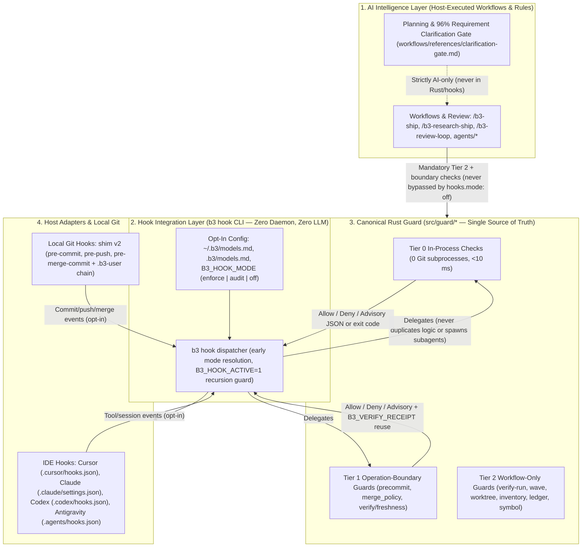
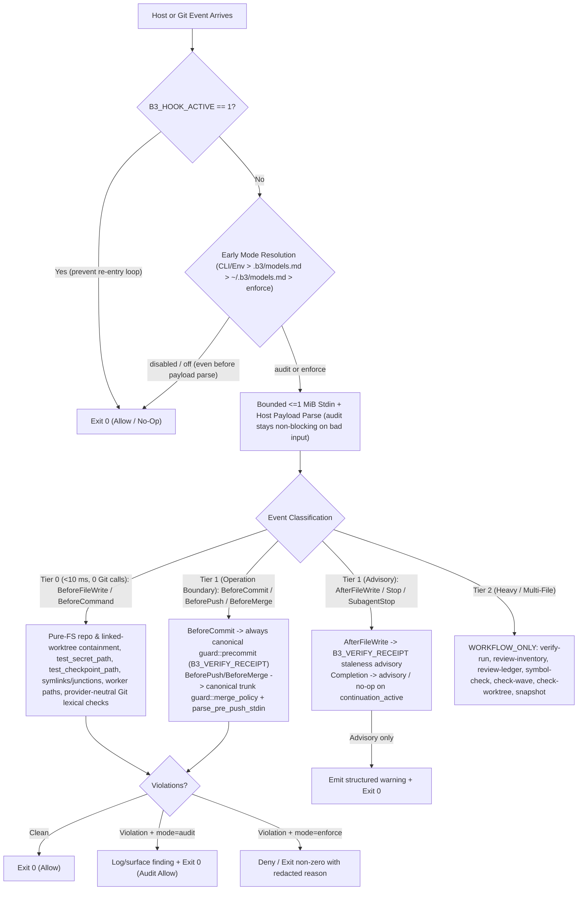

# Native Guard Event Hooks (`b3 hook`)

> [!NOTE]
> Human-facing architecture, classification, verification matrix, security model, and benchmark reference (`0 B` runtime LLM tokens). The compact runtime contract lives in [`../workflows/references/hook-integration.md`](../workflows/references/hook-integration.md). Local Git CLI hooks are `LIVE_CLI_VERIFIED`; live IDE runtime execution across **Cursor**, **Claude Code**, **Codex**, and **Antigravity** remains **`NOT_VERIFIED`**.

`b3 hook` connects host lifecycle events and local Git hooks directly to B3's canonical deterministic Rust Guard (`src/guard/*`) with **`0` LLM tokens**, **no background daemon**, and **no duplicate guard engine**.

---

## 1. Architecture & Execution Flow

### Diagram A — Four-Layer Ownership & Hook Boundary



### Diagram B — Guard-to-Event & Tier 0 / Tier 1 / Tier 2 Flow



---

## 2. Guard Classification & Anti-Over-Engineering Design

### Guard Module Classification (`src/guard/*` — `16` modules)

| Guard Module | Protected Operation | Subprocess / Cost Profile | Classification | Remaining Workflow-Only Checks |
| --- | --- | --- | --- | --- |
| `precommit` | `git commit` (mid-op state, staged index, `staged == WT`, allowed/secret/checkpoint paths, receipt) | Low–medium (`~4–7` Git calls + `verify_check`) | `EVENT_BLOCKING` (`BeforeCommit`) | Workflow `--allowed-paths` & `--expected-cmd` binding |
| `merge_policy` | `git push` / merge vs trunk `.b3/research-policy.json`, protected paths, remote trunk & `parse_pre_push_stdin` | Fast skip if non-governed; `~10–31` Git calls if governed | `EVENT_BLOCKING` (`BeforePush` / `BeforeMerge`) | `--post-merge` ancestry check & PR governance orchestration |
| `verify` | `verify_run` executes test/build; `verify_check` validates `b3-verify-v1` tree fingerprint | `verify_run`: arbitrary build/test; `verify_check`: bounded Git + SHA-256 | `verify_check`: `EVENT_BLOCKING` / `EVENT_ADVISORY`; `verify_run`: `WORKFLOW_ONLY` | Executing test/build suites (`verify-run`), baseline attribution |
| `mechanical`, `scope`, `freshness`, `wave`, `worktree`, `inventory`, `ledger`, `symbol`, `snapshot`, `evidence` | Diff safety sweep, sizing, drift, wave partitioning, linked worktrees, L0–L4 review, symbol scan, snapshots, provenance | Medium–high (diff/repo/build-scoped checks) | `WORKFLOW_ONLY` (Tier 2) | Full multi-file & wave-level workflow gates |
| `fingerprint`, `runs`, `cache` | Scope readiness hash, `.b3/{ship,research-ship}` run pointers, `b3-context-v1` freshness | Negligible–low (`0–8` Git/FS ops) | `ON_DEMAND` | Run lifecycle & context-cache checks |

### Anti-Over-Engineering Component Classification

| Action | Components | Rationale |
| --- | --- | --- |
| **KEEP** | `src/hook/{config,event,dispatch,install,response}`, 9 active `B3_*` env vars, Tier 0 `<10 ms`/`0` Git checks, Tier 1 `precommit` & `merge_policy`, early mode resolution, pure-FS linked-worktree containment, Git shim `v2` | Minimal, deterministic surface with zero daemon/LLM overhead |
| **REMOVE** | 23 speculative env vars + 6 unused `NormalizedEvent` fields (29 items: bypass/tree-cache/merge-auth vars, `B3_HOOK_REQUIRE_REPO`, `B3_EXPECTED_CMD`, `B3_RELEVANT_PATHS`, 17 `B3_PR_*`/`B3_CI_*`/`B3_HEAD_SHA` vars, 6 fields), provider-specific PR CLI lexical checks in Tier 0 | Eliminated dead/bypass-prone state and restored provider neutrality |
| **MERGE** | `BeforePush` + `BeforeMerge` via single `merge_policy::check_git_hook_operation`; all 4 JSON hosts via shared `JsonHost` table | Prevents drift between push/merge trunk authority and host installers |
| **SIMPLIFY** | Single-pass `eval_before_command` Git lexical tripwire; Antigravity flat `Stop` (`b3-native-guard`); Codex `"hooks"` wrapper normalization | Avoids fragile shell emulation and matches real host schemas |
| **REUSE** | `src/guard/{precommit,merge_policy,verify}`, `src/fs.rs` (`test_secret_path`, `test_checkpoint_path`, `resolve_safe_repo_write_path`, reparse checks), `models.md` (`hooks:`) | Single canonical guard and preference source of truth |
| **MOVE** | Multi-file diff sweeps, test runners, wave/worktree/ledger gates stay in workflows (`WORKFLOW_ONLY`, Tier 2) | Keeps event hooks fast and prevents duplicate orchestration |

---

## 3. Host Capability & 8-Status Runtime Verification Matrix

### Host Protocol & Capability Summary

| Host / Runtime | Events & Config Path | Blocking vs Advisory | Adapter & Response Protocol |
| --- | --- | --- | --- |
| **Cursor** | `preToolUse`, `beforeShellExecution`, `afterFileEdit`, `subagentStop`, `stop` (`[~/.cursor \| .cursor]/hooks.json`) | `NATIVE_BLOCKING` + `NATIVE_ADVISORY` | Stdin JSON; stdout `{"permission":"allow\|deny",...}` + exit `0`/`2` |
| **Claude Code** | `PreToolUse`, `PostToolUse`, `SubagentStop`, `Stop` (`[~/.claude \| .claude]/settings.json`) | `NATIVE_BLOCKING` (`PreToolUse`) + `NATIVE_ADVISORY` | Stdin JSON; exit `0` allow, exit `2` blocking stderr |
| **Codex** | `PreToolUse` (`apply_patch\|Write\|Edit\|Bash\|shell`), `PostToolUse`, `Stop` (`[~/.codex \| .codex]/hooks.json`, top-level `"hooks"` wrapper) | `NATIVE_BLOCKING` (`PreToolUse`) + `NATIVE_ADVISORY` | Stdin JSON; exit `0` allow, exit `2` blocking stderr (requires `/hooks` trust) |
| **Antigravity** | Grouped `PreToolUse`/`PostToolUse` + flat `Stop` (`b3-native-guard` key in `.agents/hooks.json` or `~/.gemini/config/hooks.json`) | `NATIVE_BLOCKING` (`PreToolUse`) + `NATIVE_ADVISORY` (`PostToolUse`, `Stop`) | Strips `CORTEX_STEP_TYPE_*`; stdout `{"decision":"allow\|deny\|continue","reason":"..."}` + exit `0` |
| **Git (Local)** | `pre-commit`, `pre-push`, `pre-merge-commit` (`core.hooksPath` or `<git-common-dir>/hooks/`) | `NATIVE_BLOCKING` (`guard::precommit` / `guard::merge_policy`) | Shim `v2`: forwards stdin + `-- "$@"` (`env B3_HOOK_ACTIVE=1 "$USER_HOOK" "$@"`), preserves `.b3-user` perms; exit `0`/`1` |

### 8-Status Host Runtime Verification Matrix

Statuses: `LIVE_RUNTIME_VERIFIED` · `LIVE_CLI_VERIFIED` · `CONFIG_SCHEMA_VERIFIED` · `PROTOCOL_FIXTURE_VERIFIED` · `UNIT_TEST_ONLY` · `NOT_INSTALLED_IN_ENV` · `UNSUPPORTED_BY_HOST` · `NOT_VERIFIED`.

| Host / Runtime | Current Evidence Status | What Was Executed | Live Reproduction Commands (Per Host) |
| --- | --- | --- | --- |
| **Git (Local `git` CLI)** | **`LIVE_CLI_VERIFIED`** | Real `git commit`, `git push` (local bare remote), `git merge`, linked worktrees, `.b3-user` chaining & perm preservation | `b3 hook install --host git --scope project && b3 hook verify --host git --scope project` → run `git commit` / `git push` |
| **Cursor** | **`CONFIG_SCHEMA_VERIFIED`** + **`PROTOCOL_FIXTURE_VERIFIED`** + **`NOT_VERIFIED`** / **`NOT_INSTALLED_IN_ENV`** | `b3 hook install/verify` JSON roundtrip + stdin/stdout fixture tests; no live IDE loop in test env | `b3 hook install --host cursor --scope project && b3 hook verify --host cursor --scope project` → trigger `.env` write in Cursor Chat |
| **Claude Code** | **`CONFIG_SCHEMA_VERIFIED`** + **`PROTOCOL_FIXTURE_VERIFIED`** + **`NOT_VERIFIED`** / **`NOT_INSTALLED_IN_ENV`** | `settings.json` grouped matcher roundtrip + exit `0`/`2` fixture tests; no live CLI session in test env | `b3 hook install --host claude --scope project && b3 hook verify --host claude --scope project` → run Claude Code tool call on `.env` |
| **Codex** | **`CONFIG_SCHEMA_VERIFIED`** + **`PROTOCOL_FIXTURE_VERIFIED`** + **`NOT_VERIFIED`** / **`NOT_INSTALLED_IN_ENV`** | `.codex/hooks.json` `"hooks"` wrapper + `apply_patch`/`Bash` fixture tests; no live Codex `/hooks` session | `b3 hook install --host codex --scope project && b3 hook verify --host codex --scope project` → enable `/hooks` in Codex & edit `.env` |
| **Antigravity** | **`CONFIG_SCHEMA_VERIFIED`** + **`PROTOCOL_FIXTURE_VERIFIED`** + **`NOT_VERIFIED`** / **`NOT_INSTALLED_IN_ENV`** | `.agents/hooks.json` `b3-native-guard` flat `Stop` + `CORTEX_STEP_TYPE_*` & `allow\|deny\|continue` fixtures; no live IDE loop | `b3 hook install --host antigravity --scope project && b3 hook verify --host antigravity --scope project` → trigger `write_to_file` on `.env` |

### Explicit Limitations

1. **Tier 0 Command Limits:** `BeforeCommand` is a fast lexical tripwire for Git subcommands (`git push --force`/`-f`, `git reset --hard`, `git commit --no-verify`/`-n`, `git add -A`/`.`/`.b3*`). It cannot resolve shell aliases, `$CMD` indirection, or `eval`, and stays provider-neutral (no PR CLI checks).
2. **Local Git Hook Limits:** `--no-verify` or modifying `.git/hooks` bypasses local Git hooks; server-side branch protection and required CI remain mandatory ([`decision-018`](../research/decisions/decision-018-research-ship-workflow.md)).
3. **Live IDE Verification:** No automated test launches live Cursor, Claude Code, Codex, or Antigravity agent loops; live IDE execution stays **`NOT_VERIFIED`** until exercised manually.

---

## 4. Configuration, Minimal Env Contract & Lifecycle

```bash
b3 hook install --host all --scope project --dry-run
b3 hook install --host <cursor|claude|codex|antigravity|git|all> [--scope <project|global>] [--repo-root <path>]
b3 hook verify  --host <cursor|claude|codex|antigravity|git|all> [--scope <project|global>] [--repo-root <path>]
b3 hook status  [--repo-root <path>] [--user-home <path>]
b3 hook uninstall --host <cursor|claude|codex|antigravity|git|all> [--scope <project|global>] [--repo-root <path>]
```

- **Minimal `B3_*` hook env vars (9):** `B3_HOOK_MODE` (`enforce|audit|off`), `B3_HOOK_ACTIVE` (`1` recursion guard), `B3_MODELS_PERSONAL`, `B3_PROTECTED_PATHS`, `B3_WORKER_ALLOWED_PATHS`, `B3_ALLOWED_PATHS`, `B3_VERIFY_RECEIPT`, `B3_IGNORE_DIRTY_PATHS`, `B3_LEDGER_PATH`.
- **Troubleshooting:** If `b3` is missing in minimal IDE/Git `PATH`, run `b3 hook verify` and reinstall with `b3` on `PATH`. If hooks unexpectedly no-op, check `$B3_HOOK_ACTIVE` and `b3 hook status`. If `VERIFY_STALE` blocks `BeforeCommit`, re-run `b3 guard verify-run` (or unset `B3_VERIFY_RECEIPT` outside `/b3-ship` commit gates).

---

## 5. Security Threat Model & Trust Boundaries

| Threat Vector | Trust Boundary & Hardening |
| --- | --- |
| **Untrusted payloads** | Bounded `<=1 MiB` stdin, strict JSON parsing, `has_control_chars` rejection; early mode resolution keeps `off`/`audit` non-blocking. |
| **Path traversal & worktrees** | Lexical containment (`resolve_safe_repo_write_path`) + pure-FS sibling linked-worktree `.git` `gitdir:` resolution (`0` Git subprocesses). |
| **Symlinks & NTFS junctions** | `is_reparse_or_symlink` & hierarchy checks block symlink/junction traversal before file writes or root acceptance. |
| **Deleted WT policy bypass** | `BeforePush`/`BeforeMerge` resolve canonical trunk `.b3/research-policy.json` (plus remote trunk & `parse_pre_push_stdin`), rejecting deleted/tampered policy. |
| **User-hook & perm integrity** | Git shim `v2` chains `<hook>.b3-user` via `env B3_HOOK_ACTIVE=1 "$USER_HOOK" "$@"` (never `sh "$USER_HOOK"`) and preserves original `.b3-user` mode (never `chmod 0755`). |
| **Recursion & secrets** | `B3_HOOK_ACTIVE=1` prevents re-entry loops; secret file contents are never echoed (repo-relative paths and codes only). |

---

## 6. Performance Benchmarks (3-Way Comparison: A vs B vs C)

Measured back-to-back on Windows (`target/release/b3.exe`, 1 warmup + `n = 20` timed runs; 10 runs for 4-worker parallel wave; `PATH` set to an empty dir on Tier 0 cases to prove `0` Git subprocesses). **A** = `main` (`df8075f`, `3,340,288 B`); **B** = original PR #46 (`29462c9`, `3,613,696 B`); **C** = hardened/simplified PR #46 (`3,622,400 B`).

| Benchmark Case | A (`main` `df8075f`) `p50` | B (`29462c9`) `p50` / `p95` | C (Hardened PR) `p50` / `p95` / `max` | Notes |
| --- | --- | --- | --- | --- |
| `b3 --version` (startup) | `11.43 ms` | `10.44` / `11.75 ms` | `10.38` / `12.09` / `13.56 ms` | Neutral vs `main`/B (`0` daemon) |
| `b3 context measure --strict` | `13.16 ms` | `13.27` / `16.53 ms` | `13.41` / `16.84` / `20.26 ms` | `always_on_total = 15,517 B` (`warnings = 0`) across A, B, C |
| Tier 0 `BeforeFileWrite` allow (empty `PATH`) | — | `10.99` / `11.38 ms` | `11.88` / `13.14` / `14.74 ms` | `0` Git calls; `rc=0`, stdout `23 B` |
| Tier 0 `BeforeFileWrite` deny `.env` (empty `PATH`) | — | `11.00` / `12.16 ms` | `11.80` / `12.42` / `12.52 ms` | `0` Git calls; `rc=2`, stdout `141 B`, stderr `42 B` |
| Tier 0 `BeforeCommand` allow / deny (empty `PATH`) | — | `10.87` / `10.77 ms` | `10.93` / `10.90 ms` (`p50`) | `0` Git calls; deny `git push --force` `rc=2`, stderr `91 B` |
| 4-worker parallel Tier 0 `BeforeFileWrite` wall time | — | `16.20` / `22.36 ms` | `16.49` / `22.99` / `22.99 ms` | Concurrent workers (`0` lock contention) |
| Tier 1 `BeforeCommit` (no receipt / with `B3_VERIFY_RECEIPT`) | — | `98.65` / `394.30 ms` | `74.43` / `395.55 ms` (`p50`) | **`-24.6%` p50** vs B (`run_with_pre_staged` removes duplicate `git diff --cached`) |
| Tier 1 `BeforePush` (non-governed repo) | — | `10.58` / `11.75 ms` | `42.37` / `59.60` / `61.30 ms` | B had insecure WT-only check (F03); C checks canonical refs in 1 `cat-file --batch-check` |
| Tier 1 `BeforePush` (governed feat allow / `main` block) | — | N/A (broken F02/F03) | `361.31` / `355.43 ms` (`p50`) | Real `pre-push` stdin (`rc=0` allow / `rc=1` `63 B` stderr block) |
| `audit` / `off` mode deny write (`p50`) | — | `11.33` / `10.88 ms` | `11.76` / `10.48 ms` | Non-blocking `rc=0`; `audit` emits `50 B` stderr warning |
| `audit` / `off` malformed `{not-json` (`p50`) | — | `10.63` (`rc=2`) / `10.57` (`rc=2`) | `10.83` (`rc=0`) / `10.61` (`rc=0`) | **F05 fix:** B erroneously blocked (`rc=2`); C stays non-blocking (`rc=0`) |

> Raw benchmark JSON: `.b3/ship/runs/20261128-1604-pr46-hook-hardening/benchmarks-abc.json`. Context budget remains unchanged at `always_on_total = 15,517 B` (`~3,879 tok`) with **`0 B` always-on hook overhead**.
