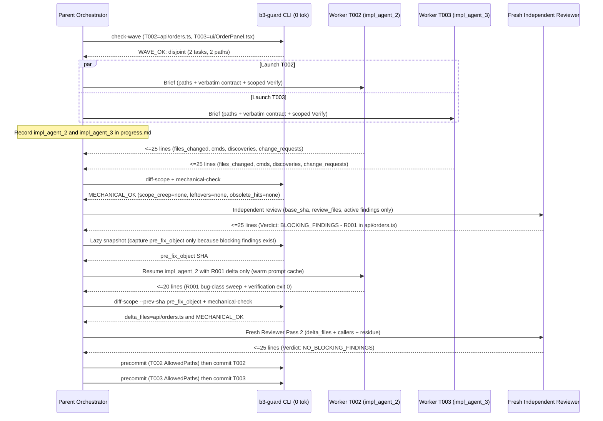
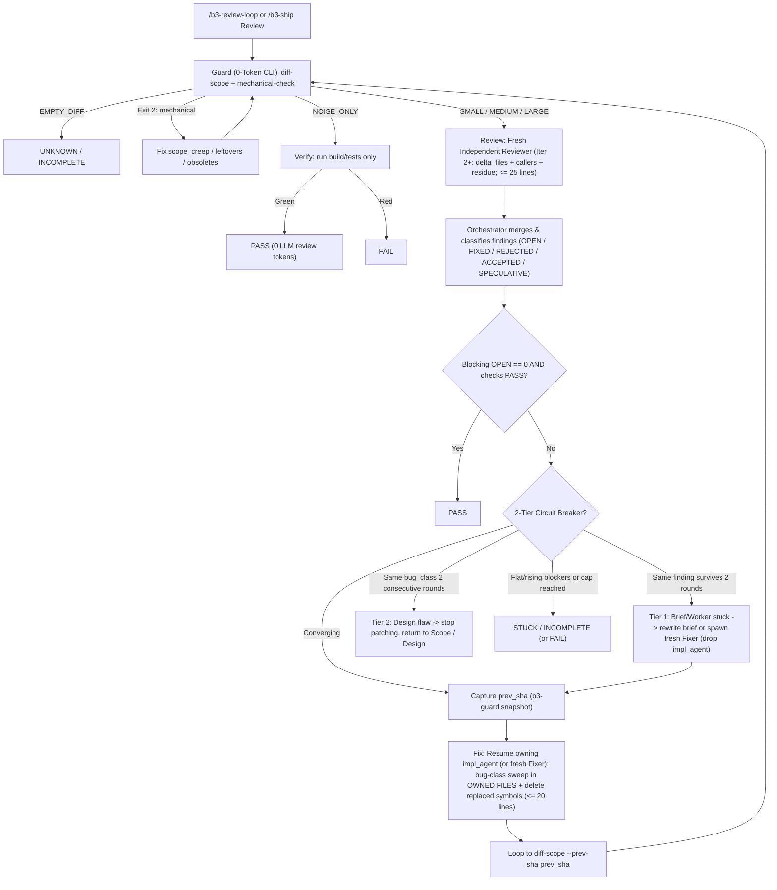
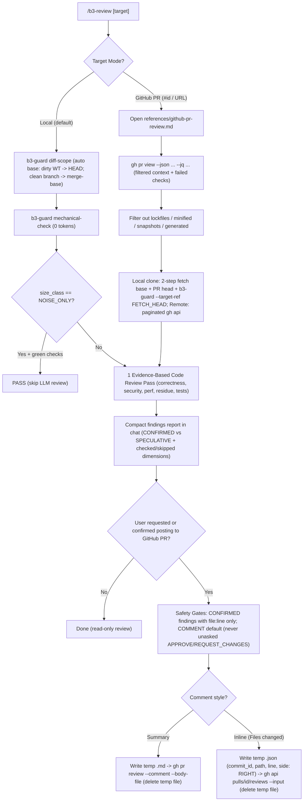
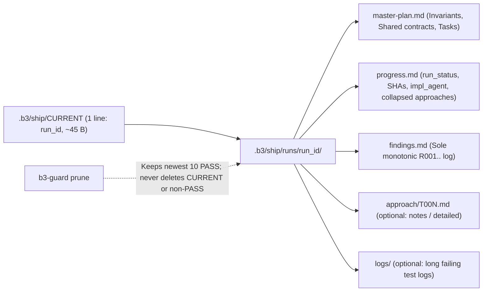

# Ship & Review Visual Guide

Architecture, execution flow, and context-optimization reference for `/b3-ship`, `/b3-review-loop`, and standalone `/b3-review`.

> [!NOTE]
> This guide is human-facing documentation (`0` runtime LLM tokens). Canonical agent procedures stay in [`../workflows/ship.md`](../workflows/ship.md), [`../review-loop/strategy.md`](../review-loop/strategy.md), and [`../skills/engineering/code-review/SKILL.md`](../skills/engineering/code-review/SKILL.md).

---

## 1. `/b3-ship` End-to-End Lifecycle

Core 7-step flow: `Preflight → Plan → [Scope → Build → Verify → Review → Commit] → Finalize`.

```mermaid
flowchart TD
    Entry["Host Entrypoint (1-hop): Cursor / Codex / Claude / Antigravity"] --> Resolve{"Mode?"}
    Resolve -->|"status / --all"| StatusOut["b3-guard resolve-run or list-runs (report only)"]
    Resolve -->|"resume / unfinished run"| Resume["Scenario C: ship-resume.md (reconcile checkpoints vs Git)"]
    Resolve -->|"New requirement / plan"| NewRun["b3-guard new-run (.b3/ship/runs/run_id + CURRENT)"]

    NewRun --> PreFlight["Preflight: initial_dirty_paths + checks (baseline non-blocking or on-demand)"]
    PreFlight --> Plan["Plan (master-plan.md): Invariants, AC1..ACn, Verbatim Shared Contracts"]
    Plan --> ReadyCheck["Select Ready Tasks (pending + all depends_on completed)"]
    Resume --> ReadyCheck

    ReadyCheck --> Scope["Scope (JIT per task): files vs read_only_deps + Readiness Gate"]
    Scope --> PreReview{"depth == detailed?"}
    PreReview -->|"Yes"| DesignRev["1-Pass Pre-code Review (design-only): architecture (contrarian) + security"]
    DesignRev -->|"CONFIRMED flaw"| Scope
    DesignRev -->|"Clean"| WaveCheck
    PreReview -->|"No (inline / notes)"| WaveCheck

    WaveCheck{"2+ ready tasks?"}
    WaveCheck -->|"Yes"| GuardWave["b3-guard check-wave (verify disjoint OWNED FILES)"]
    GuardWave -->|"WAVE_OK"| Parallel["Build Parallel Wave (2-3 workers; save impl_agent in progress.md)"]
    GuardWave -->|"WAVE_CONFLICT"| SeqImpl["Build Single Task"]
    WaveCheck -->|"No"| SeqImpl

    Parallel --> Hub["Parent Hub Relay: merge discoveries & change_requests + scoped Verify"]
    SeqImpl --> TaskVerify["Verify: run scoped tests (probe baseline on-demand only if red)"]
    Hub --> TaskVerify

    TaskVerify --> Mech["Review step - 0-Token Guard: diff-scope + mechanical-check"]
    Mech -->|"Exit 2: Findings"| FixMech["Fix mechanical findings first"]
    FixMech --> Mech
    Mech -->|"MECHANICAL_OK"| ReviewTier["Review pass (inline+SMALL: 1 reviewer; else review-loop/strategy.md)"]
    ReviewTier -->|"Blocking CONFIRMED"| LazySnap["Lazy b3-guard snapshot (pre_fix_object) -> Fix -> delta Review"]
    LazySnap --> ReviewTier
    ReviewTier -->|"Pass"| PreCommit["Commit (sequential b3-guard precommit + git commit + collapse approach to 1 line)"]

    PreCommit --> MoreTasks{"More ready tasks?"}
    MoreTasks -->|"Yes"| ReadyCheck
    MoreTasks -->|"No"| MultiTask{"2+ completed tasks?"}
    MultiTask -->|"Yes"| FinalVer["Finalize: full checks + Cross-Cutting review (run_base_sha..HEAD)"]
    MultiTask -->|"No (1 task)"| FinalChecksOnly["Finalize: full checks only (skip duplicate review)"]
    FinalVer --> Outcome["Set run_status: PASS | FAIL | INCOMPLETE | BLOCKED"]
    FinalChecksOnly --> Outcome
```

---

## 2. Parallel Disjoint Wave, Hub-and-Spoke & Prompt-Cache Resume

Workers never talk directly to each other and never edit `read_only_deps` or shared contracts. Parent acts as the sole Hub, records `impl_agent` IDs in `progress.md`, keeps Reviewers strictly independent, captures `snapshot` lazily only when fixes are needed, and **resumes the owning `impl_agent`** with delta findings to preserve worker prompt cache.

---

## 3. `/b3-review-loop` Convergence & 2-Tier Circuit Breaker

[`../review-loop/strategy.md`](../review-loop/strategy.md) is self-sufficient at runtime (skipping `spec.md`, `sizing.md`, and `models.md` on normal runs to save ~13 KB per invocation).

---

## 4. Standalone `/b3-review` — 3-Mode Flow (Local, GitHub PR & Safe Posting)

Standalone `/b3-review` ([`../commands/b3-review.md`](../commands/b3-review.md), [`../skills/engineering/code-review/SKILL.md`](../skills/engineering/code-review/SKILL.md)) routes into 3 explicit modes and only loads [`../skills/engineering/code-review/references/github-pr-review.md`](../skills/engineering/code-review/references/github-pr-review.md) when a GitHub PR or PR comment is involved (`0` extra bytes on local reviews).

---

## 5. Run-Scoped Checkpoints & Context Budget Architecture

Checkpoints are isolated per run under `.b3/ship/runs/<run_id>/` (gitignored) and addressed via a 1-line plain-text `.b3/ship/CURRENT` pointer, so normal runs never scan sibling history.

### Static Context Budgets (`scripts/measure-context.{ps1,sh} -Strict`)

All byte caps are measured in **canonical LF UTF-8 bytes** (identical across Windows PowerShell and Git Bash / macOS / Linux):

| Budget metric | Strict cap | What it guards |
| --- | --- | --- |
| `AGENTS.md` | `<= 3,600 B` | Always-on universal repository map |
| Individual `SKILL.md` | `<= 4,000 B` | Keeps every skill compact and focused |
| Individual skill frontmatter | `<= 280 B` | Prevents always-on skill-index bloat |
| `workflows/ship.md` | `<= 9,500 B` | Core `/b3-ship` orchestrator prompt |
| `ship_refs_load` (`templates` + `resume`) | `<= 6,000 B` | On-demand `/b3-ship` progressive-disclosure refs |
| `review-loop/strategy.md` | `<= 5,400 B` | Self-sufficient runtime `/b3-review-loop` prompt |
| `agents_roles_total` (5 runtime roles) | `<= 8,500 B` | Compact subagent role specs with strict reply caps |

---

## 6. Phân tầng Model tối ưu chi phí (Cost-Preserving Model Tiering)

Hệ thống tách biệt tầng **suy luận sâu (Deep / high-reasoning)** và tầng **thực thi phẫu thuật (Fast / surgical coding)** theo hướng host-neutral (chi tiết contract tại [`../review-loop/models.md`](../review-loop/models.md)):

| Tầng | Vai trò trong `/b3-ship` & `/b3-review-loop` | Lý do & Bảo vệ chất lượng |
| --- | --- | --- |
| **Deep / high-reasoning** | `Orchestrator` (`Plan`, `Scope`), `b3-reviewer`, `b3-architecture-reviewer`, `b3-security-reviewer`, `b3-performance-reviewer` | Giữ nguyên chất lượng thiết kế, invariant, hợp đồng API và phát hiện bug độc lập |
| **Fast / surgical coding** | `Build` worker (`impl_agent` sau `Gate`), `b3-fixer` (nhận `file:line` + `bug_class`) | Giảm chi phí/latency khi sửa code có phạm vi rõ ràng; được bảo vệ bởi `0`-token CLI `mechanical-check`, test thực thi (`Verify`) và **Deep** `b3-reviewer` độc lập |

---

## Related canonical documents

- Core `/b3-ship` procedure: [`../workflows/ship.md`](../workflows/ship.md)
- Core `/b3-review-loop` procedure: [`../review-loop/strategy.md`](../review-loop/strategy.md)
- Core `/b3-review` skill & GitHub PR ref: [`../skills/engineering/code-review/SKILL.md`](../skills/engineering/code-review/SKILL.md), [`../skills/engineering/code-review/references/github-pr-review.md`](../skills/engineering/code-review/references/github-pr-review.md)
- Deterministic CLI reference: [`../scripts/README.md`](../scripts/README.md)
- Architecture decisions: [`../research/decisions/decision-012-autodev-v2-hardening.md`](../research/decisions/decision-012-autodev-v2-hardening.md), [`../research/decisions/decision-013-host-neutral-multi-host-layout.md`](../research/decisions/decision-013-host-neutral-multi-host-layout.md), [`../research/decisions/decision-014-autodev-parallel-waves-and-mechanical-pass.md`](../research/decisions/decision-014-autodev-parallel-waves-and-mechanical-pass.md)
