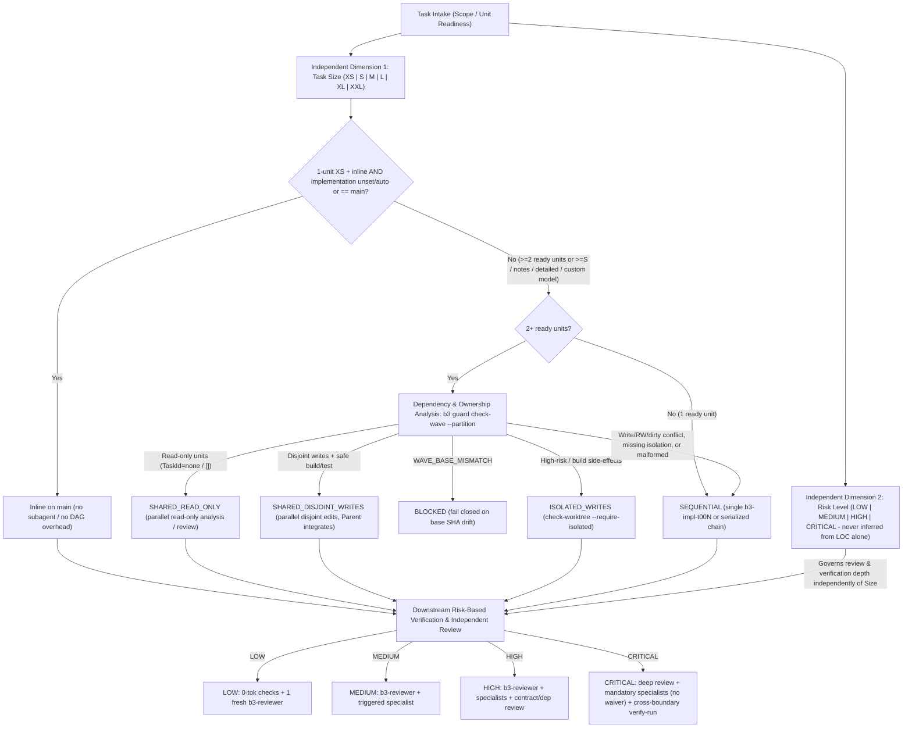
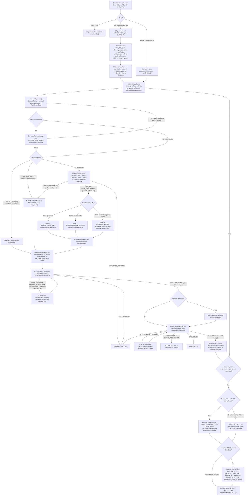
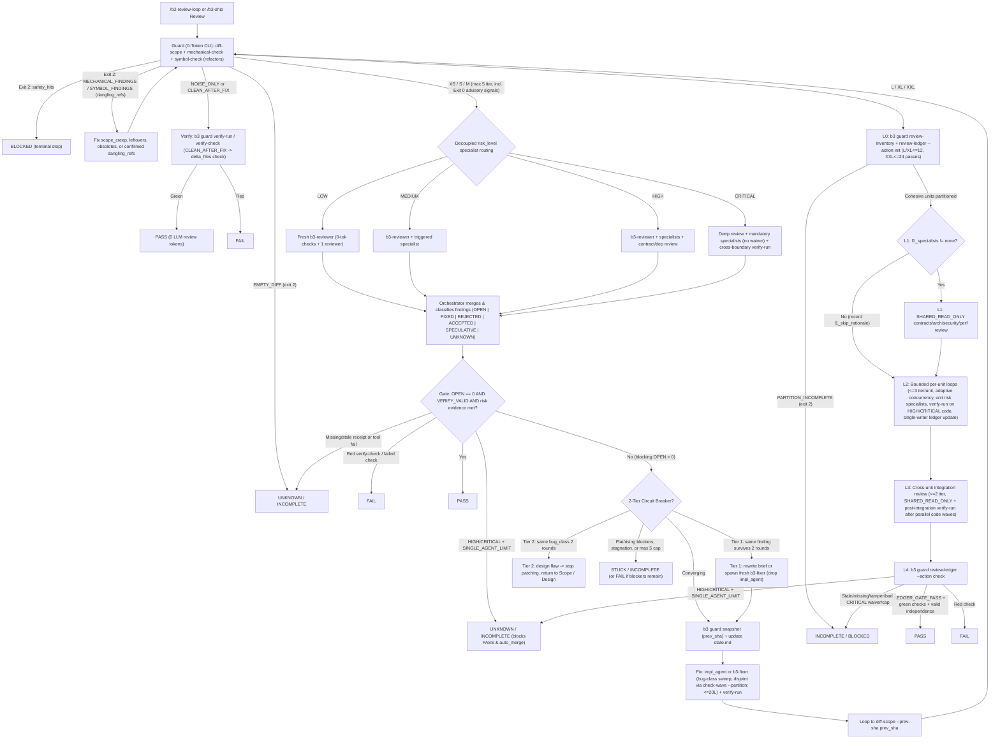
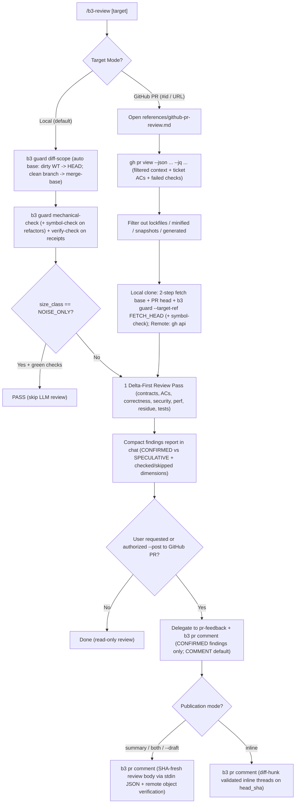
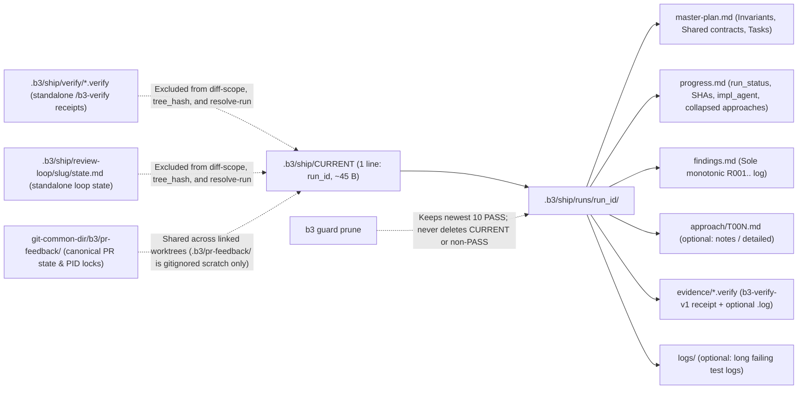

# Ship & Review Visual Guide

Visual architecture, execution flow, and context-optimization reference for adaptive dispatch, `/b3-ship`, `/b3-review-loop`, standalone `/b3-review`, the shared merge-policy gate, and checkpoints (the full Phases A–K `/b3-research-ship` procedure lives in [`../workflows/research-ship.md`](../workflows/research-ship.md)).

> [!NOTE]
> This guide is human-facing documentation (`0` runtime LLM tokens). Canonical agent procedures stay in [`../workflows/ship.md`](../workflows/ship.md), [`../workflows/research-ship.md`](../workflows/research-ship.md), [`../workflows/references/dispatch-naming.md`](../workflows/references/dispatch-naming.md), [`../review-loop/strategy.md`](../review-loop/strategy.md), and [`../skills/engineering/code-review/SKILL.md`](../skills/engineering/code-review/SKILL.md).

---

## Diagram C — Adaptive Dispatch Decision Tree

**Task Size** and **Risk Level** are independent dimensions ([`../workflows/references/dispatch-naming.md`](../workflows/references/dispatch-naming.md), [`../review-loop/strategy.md`](../review-loop/strategy.md)): size and dependencies govern execution strategy and partitioning, while risk independently governs verification and specialist review depth.



---

## 1. `/b3-ship` End-to-End Lifecycle (4-Mode Waves, Ownership & Merge Gates)

Core 8-step flow: `Preflight → Plan → Scope → Build → Verify → Review → Commit → Finalize` (plus optional provider-neutral merge gate when invoked under `/b3-research-ship` or governed PR workflows).

### Diagram D — Full B3 Ship Lifecycle



---

## 2. Adaptive 4-Mode Wave Partitioning, Ownership Provenance & Merge Gate

Subagent logical aliases are described in [`../workflows/references/dispatch-naming.md`](../workflows/references/dispatch-naming.md) and are only requested when the host supports custom spawn names. Host-returned IDs remain authoritative for resume.

`b3 guard check-wave --partition` computes continuous `wave|N|...` sub-waves across four isolation modes (`SHARED_READ_ONLY`, `SHARED_DISJOINT_WRITES`, `ISOLATED_WRITES`, `SEQUENTIAL`). On partial ambiguity ([`../workflows/references/clarification-gate.md`](../workflows/references/clarification-gate.md)), only affected units are held while safe independent `SHARED_READ_ONLY` discovery and unblocked units continue without speculative edits. Subagents never talk directly to each other and never edit `read_only_deps`, `--protected-paths`, or `.b3/` state. Parent acts as the sole Hub, verifies per-worker ownership provenance (`CALLER_ATTRIBUTED` via `--worker-changes` or Git-proven `VERIFIED_PER_WORKER` via `--worker-roots`), resumes the owning `impl_agent` on delta findings, and evaluates provider-neutral `merge-policy-check` when governed merge gates apply.

```mermaid
sequenceDiagram
    participant P as Parent Orchestrator
    participant G as b3 guard CLI (0 tok)
    participant W2 as b3-impl-t002 (logical alias)
    participant W3 as b3-impl-t003 (logical alias)
    participant R as Fresh Independent Reviewer

    P->>G: check-wave --partition (--wave-specs, --wave-reads, --protected-paths, --check-dirty-scope, --expected-base-sha)
    G-->>P: WAVE_OK or WAVE_PARTITIONED (wave 1 PARALLEL, adaptive concurrency)
    Note over P,G: Choose SHARED_READ_ONLY, SHARED_DISJOINT_WRITES, or ISOLATED_WRITES (check-worktree --require-isolated --peer-roots)

    par Launch T002
        P->>W2: Brief (owned paths, verbatim contract, 1L context_hint, scoped verify-run)
    and Launch T003
        P->>W3: Brief (owned paths, verbatim contract, 1L context_hint, scoped verify-run)
    end
    Note over P: Store host-returned impl_agent IDs in progress.md

    W2-->>P: <=25 lines (files_changed, cmds, discoveries, change_requests)
    W3-->>P: <=25 lines (files_changed, cmds, discoveries, change_requests)

    P->>G: verify-run on worker/integrated work (--relevant-paths -> b3-verify-v1 receipts)
    G-->>P: VERIFY_PASS (b3-verify-v1 receipt; post-integration verify-run on parallel code waves)

    P->>G: diff-scope + mechanical-check (--wave-specs, --worker-changes or --worker-roots, --protected-paths, --dirty-digests)
    G-->>P: exit 0 MECHANICAL_OK (CALLER_ATTRIBUTED / VERIFIED_PER_WORKER, or UNVERIFIED_COMBINED_ONLY for ordinary disjoint wave) vs exit 2 (PARTIAL_ATTRIBUTION / VIOLATION)

    P->>R: Independent review (base_sha, review_files, cross-unit context, active findings only)
    R-->>P: <=25 lines (Verdict: BLOCKING_FINDINGS - R001 in api/orders.ts)

    P->>G: Lazy snapshot (capture pre_fix_object only because blocking findings exist)
    G-->>P: pre_fix_object SHA

    P->>W2: Resume impl_agent_2 with R001 delta only (warm prompt cache)
    W2-->>P: <=20 lines (R001 bug-class sweep + fix applied)

    P->>G: verify-run (updated b3-verify-v1 receipt before guard & precommit)
    G-->>P: VERIFY_PASS (exit 0)

    P->>G: diff-scope --prev-sha pre_fix_object + mechanical-check
    G-->>P: delta_files=api/orders.ts and MECHANICAL_OK

    P->>R: Fresh Reviewer Pass 2 (delta_files + callers + residue)
    R-->>P: <=25 lines (Verdict: NO_BLOCKING_FINDINGS)

    P->>G: precommit --require-verify-receipt (T002 allowed-paths + expected-cmd) then commit T002
    P->>G: precommit --require-verify-receipt (T003 allowed-paths + expected-cmd) then commit T003

    opt Governed PR or /b3-research-ship merge gate
        P->>G: merge-policy-check (trunk .b3/research-policy.json, mode=local or optional --pr-number b3 pr verify)
        G-->>P: PR_READY / LOCAL_ELIGIBLE_ONLY / MERGE_AUTHORIZED / MERGE_BLOCKED / PROVIDER_UNAVAILABLE
    end
```

---

## 3. `/b3-review-loop` Convergence & 2-Tier Circuit Breaker

[`../review-loop/strategy.md`](../review-loop/strategy.md) is self-sufficient at runtime (skipping `spec.md`, `sizing.md`, and `models.md` on normal runs to avoid loading large reference docs per invocation).

### Diagram E — Review Loop & Hierarchical Review



---

## 4. Standalone `/b3-review` — 3-Mode Flow (Local, GitHub PR & Safe Posting)

Standalone `/b3-review` ([`../commands/b3-review.md`](../commands/b3-review.md), [`../skills/engineering/code-review/SKILL.md`](../skills/engineering/code-review/SKILL.md)) routes into 3 explicit modes, renders every chat report and GitHub PR summary with the shared [`../skills/engineering/code-review/references/review-template.md`](../skills/engineering/code-review/references/review-template.md) (`CRITICAL` | `HIGH` | `MEDIUM` | `LOW`), and delegates authorized `--post` publication to [`../skills/engineering/pr-feedback/SKILL.md`](../skills/engineering/pr-feedback/SKILL.md) + `b3 pr` (`0` extra bytes on local reviews).



---

## 5. Run-Scoped Checkpoints & Context Budget Architecture

Checkpoints are isolated per run under `.b3/ship/runs/<run_id>/` (and `.b3/research-ship/runs/<run_id>/`, gitignored) and addressed via a 1-line plain-text `CURRENT` pointer, so normal runs never scan sibling history. `diff-scope` (`test_checkpoint_path` in [`../src/fs.rs`](../src/fs.rs)) excludes `.b3/{ship,research-ship,autodev}/`, so standalone `/b3-verify` receipts (`.b3/ship/verify/`) and standalone `/b3-review-loop` state (`.b3/ship/review-loop/<slug>/`) stay out of diffs without affecting `CURRENT` or `resolve-run`. Canonical PR feedback state and PID locks live under `<git-common-dir>/b3/pr-feedback/` (shared across linked worktrees), while `.b3/pr-feedback/` is gitignored local scratch only.



### Static Context Budgets (`b3 context measure --strict`)

All byte caps and `(bytes + 2) / 4` token estimates are measured in **canonical LF UTF-8 bytes** (identical across Windows PowerShell, Git Bash, macOS, and Linux) and enforced by `b3 context measure --strict` (canonical thresholds live in [`../src/context.rs`](../src/context.rs)).

---

## 6. Cost-Preserving Quality Model Tiering (4-Tier Routing)

The system separates **Deep reasoning**, **Standard execution**, **Fast surgical execution**, and **Deterministic (0-token) verification** in a host-neutral way — see [`../review-loop/models.md`](../review-loop/models.md) for the canonical 4-tier routing table, guardrails, and **Cost-Aware Escalation** rules.

---

## Related canonical documents

- Core `/b3-ship` & `/b3-research-ship` procedures & PR template: [`../workflows/ship.md`](../workflows/ship.md), [`../workflows/research-ship.md`](../workflows/research-ship.md), [`../workflows/references/clarification-gate.md`](../workflows/references/clarification-gate.md), [`../workflows/references/pr-template.md`](../workflows/references/pr-template.md)
- Core `/b3-review-loop` procedure: [`../review-loop/strategy.md`](../review-loop/strategy.md)
- Core `/b3-review` & PR feedback skills: [`../skills/engineering/code-review/SKILL.md`](../skills/engineering/code-review/SKILL.md), [`../skills/engineering/pr-feedback/SKILL.md`](../skills/engineering/pr-feedback/SKILL.md), [`../skills/engineering/code-review/references/review-template.md`](../skills/engineering/code-review/references/review-template.md), [`../skills/engineering/code-review/references/github-pr-review.md`](../skills/engineering/code-review/references/github-pr-review.md)
- Deterministic CLI reference: [`../scripts/README.md`](../scripts/README.md)
- Architecture decisions: [`../research/decisions/decision-012-autodev-v2-hardening.md`](../research/decisions/decision-012-autodev-v2-hardening.md), [`../research/decisions/decision-013-host-neutral-multi-host-layout.md`](../research/decisions/decision-013-host-neutral-multi-host-layout.md), [`../research/decisions/decision-014-autodev-parallel-waves-and-mechanical-pass.md`](../research/decisions/decision-014-autodev-parallel-waves-and-mechanical-pass.md), [`../research/decisions/decision-015-evidence-gates-tripwires-and-context-budgets.md`](../research/decisions/decision-015-evidence-gates-tripwires-and-context-budgets.md), [`../research/decisions/decision-016-standalone-commands-quality-and-context.md`](../research/decisions/decision-016-standalone-commands-quality-and-context.md), [`../research/decisions/decision-017-global-cursor-integration.md`](../research/decisions/decision-017-global-cursor-integration.md), [`../research/decisions/decision-018-research-ship-workflow.md`](../research/decisions/decision-018-research-ship-workflow.md)
