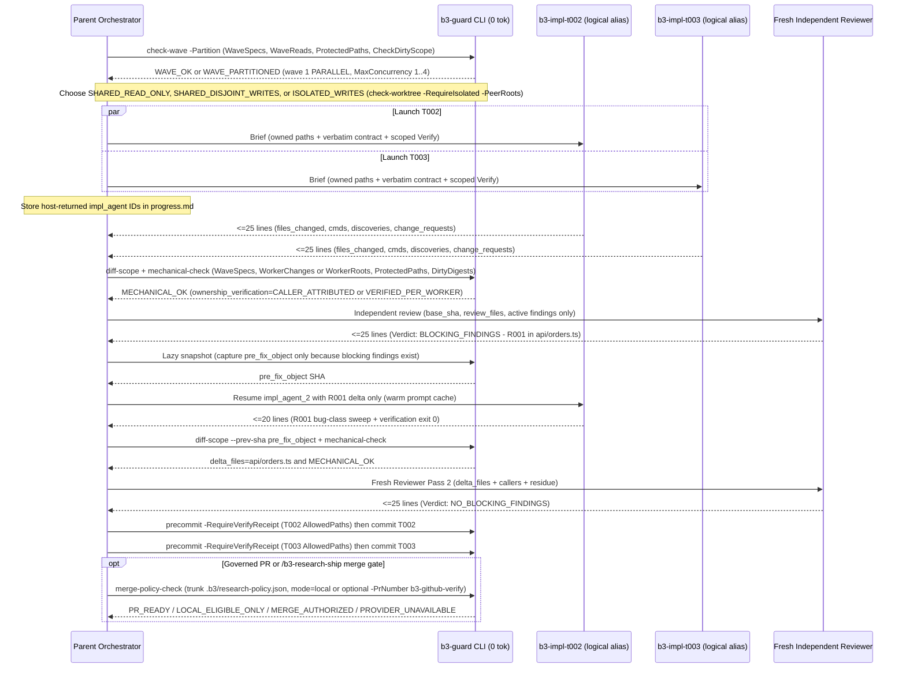
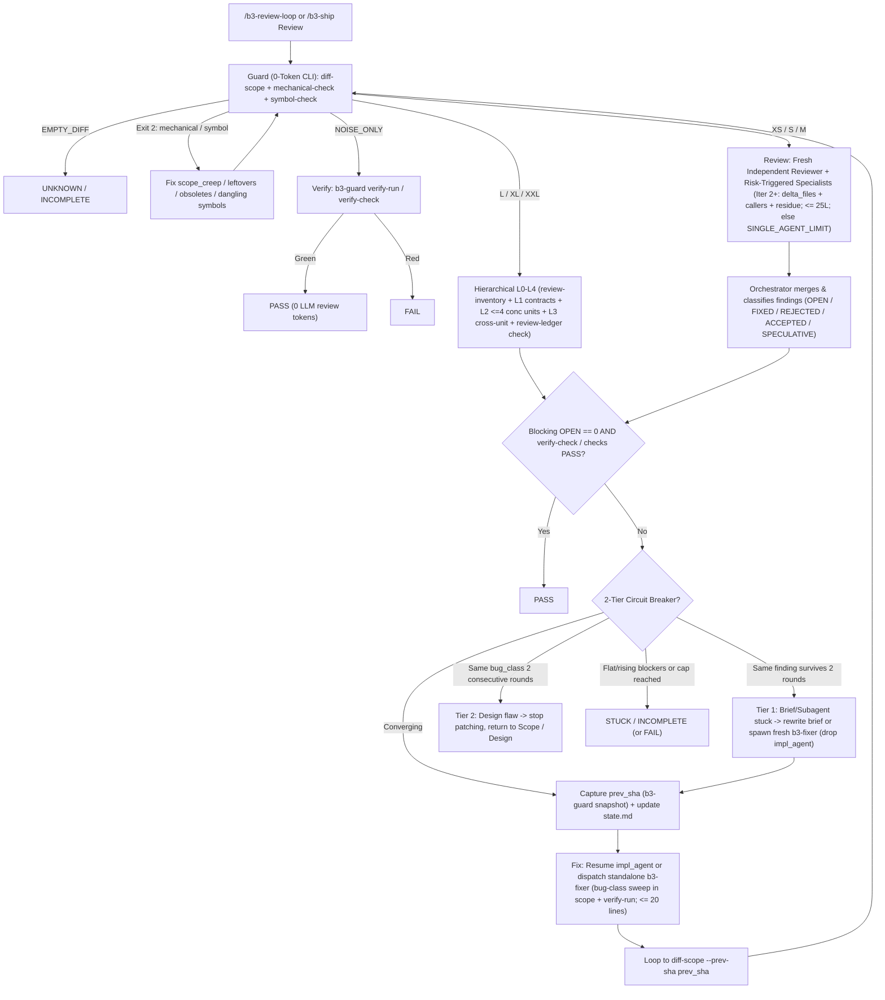

# Ship & Review Visual Guide

Architecture, execution flow, and context-optimization reference for `/b3-ship`, `/b3-research-ship`, `/b3-review-loop`, and standalone `/b3-review`.

> [!NOTE]
> This guide is human-facing documentation (`0` runtime LLM tokens). Canonical agent procedures stay in [`../workflows/ship.md`](../workflows/ship.md), [`../workflows/research-ship.md`](../workflows/research-ship.md), [`../review-loop/strategy.md`](../review-loop/strategy.md), and [`../skills/engineering/code-review/SKILL.md`](../skills/engineering/code-review/SKILL.md).

---

## 1. `/b3-ship` End-to-End Lifecycle (4-Mode Waves, Ownership & Merge Gates)

Core 7-step flow: `Preflight → Plan → [Scope → Build → Verify → Review → Commit] → Finalize` (plus optional provider-neutral merge gate when invoked under `/b3-research-ship` or governed PR workflows).

```mermaid
flowchart TD
    Entry["Host Entrypoint (1-hop): Cursor / Codex / Claude / Antigravity"] --> Resolve{"Mode?"}
    Resolve -->|"status / --all"| StatusOut["b3-guard resolve-run or list-runs (.b3/ship + .b3/autodev fallback)"]
    Resolve -->|"resume / unfinished run"| Resume["Scenario C: ship-resume.md (Git ancestry + verify-check)"]
    Resolve -->|"New requirement / plan"| NewRun["b3-guard new-run (.b3/ship/runs/run_id + CURRENT)"]

    NewRun --> PreFlight["Preflight: initial_dirty_paths + DirtyDigests + baseline checks"]
    PreFlight --> Plan["Plan (master-plan.md): Invariants, AC1..ACn, Verbatim Shared Contracts"]
    Plan --> ReadyCheck["Select Ready Tasks (pending + all depends_on completed)"]
    Resume --> ReadyCheck

    ReadyCheck --> Scope["Scope (JIT per task): Context Packet + optional detailed matrices + Gate"]
    Scope --> PreReview{"depth == detailed?"}
    PreReview -->|"Yes"| DesignRev["1-Pass Pre-code Review (design-only): architecture + security"]
    DesignRev -->|"CONFIRMED flaw"| Scope
    DesignRev -->|"Clean"| WaveCheck
    PreReview -->|"No (inline / notes)"| WaveCheck

    WaveCheck{"2+ ready tasks?"}
    WaveCheck -->|"Yes"| GuardWave["b3-guard check-wave -Partition (WaveReads, ProtectedPaths, CheckDirtyScope, MaxConcurrency 1..4)"]
    GuardWave -->|"WAVE_OK / WAVE_PARTITIONED (wave N PARALLEL)"| IsoMode{"Select Isolation Mode"}
    IsoMode -->|"none / [] readers"| ReadWave["Mode 1: SHARED_READ_ONLY (parallel read-only workers in shared WT)"]
    IsoMode -->|"Disjoint low-risk writes"| SharedWave["Mode 2: SHARED_DISJOINT_WRITES (parallel disjoint writers in shared WT)"]
    IsoMode -->|"High-risk / build side effects"| IsoWave["Mode 3: ISOLATED_WRITES (check-worktree -RequireIsolated -PeerRoots)"]
    GuardWave -->|"WAVE_SEQUENTIAL / WAVE_BASE_MISMATCH"| SeqImpl["Mode 4: SEQUENTIAL (1 b3-impl-t00N subagent; save impl_agent)"]
    WaveCheck -->|"No (1 task)"| SeqImpl

    ReadWave --> Hub["Parent Hub Relay: merge discoveries & change_requests + integrate"]
    SharedWave --> Hub
    IsoWave --> Hub
    SeqImpl --> TaskVerify["Verify: b3-guard verify-run (writes b3-verify-v1 evidence receipt)"]
    Hub --> TaskVerify

    TaskVerify --> Mech["0-Token Guard: diff-scope + mechanical-check (WaveSpecs, WorkerChanges or WorkerRoots, ProtectedPaths, DirtyDigests) + symbol-check"]
    Mech -->|"Exit 2: VIOLATION / PARTIAL_ATTRIBUTION / Findings"| FixMech["Fix ownership, scope_creep, leftovers, obsoletes, or symbol findings"]
    FixMech --> Mech
    Mech -->|"MECHANICAL_OK"| ReviewTier["Review pass (inline+XS/S+LOW: 1 reviewer; else review-loop/strategy.md)"]
    ReviewTier -->|"Blocking CONFIRMED"| LazySnap["Lazy b3-guard snapshot (pre_fix_object) -> Fix -> delta Review"]
    LazySnap --> ReviewTier
    ReviewTier -->|"Pass"| PreCommit["Commit (precommit -RequireVerifyReceipt + git commit + collapse approach)"]

    PreCommit --> MoreTasks{"More ready tasks?"}
    MoreTasks -->|"Yes"| ReadyCheck
    MoreTasks -->|"No"| MultiTask{"2+ completed tasks?"}
    MultiTask -->|"Yes"| FinalVer["Finalize: full checks + Cross-Cutting review (run_base_sha..HEAD)"]
    MultiTask -->|"No (1 task)"| FinalChecksOnly["Finalize: full checks only (skip duplicate review)"]
    FinalVer --> MergeGate{"Governed PR / Research-Ship Gate?"}
    FinalChecksOnly --> MergeGate
    MergeGate -->|"No (standard /b3-ship)"| Outcome["Set run_status: PASS | FAIL | INCOMPLETE | BLOCKED"]
    MergeGate -->|"Yes"| PolicyCheck["Provider-Neutral merge-policy-check (mode=local or optional -PrNumber b3-github-verify -> PR_READY / MERGE_AUTHORIZED / PROVIDER_UNAVAILABLE)"]
    PolicyCheck --> Outcome
```

---

## 2. Adaptive 4-Mode Wave Partitioning, Ownership Provenance & Merge Gate

Subagent logical aliases are described in [`../workflows/references/dispatch-naming.md`](../workflows/references/dispatch-naming.md) and are only requested when the host supports custom spawn names. Host-returned IDs remain authoritative for resume.

`check-wave -Partition` computes bounded `wave|N|...` sub-waves across four isolation modes (`SHARED_READ_ONLY`, `SHARED_DISJOINT_WRITES`, `ISOLATED_WRITES`, `SEQUENTIAL`). Subagents never talk directly to each other and never edit `read_only_deps`, `ProtectedPaths`, or `.b3/` state. Parent acts as the sole Hub, verifies per-worker ownership provenance (`CALLER_ATTRIBUTED` via `-WorkerChanges` or Git-proven `VERIFIED_PER_WORKER` via `-WorkerRoots`), resumes the owning `impl_agent` on delta findings, and evaluates provider-neutral `merge-policy-check` when governed merge gates apply.

---

## 3. `/b3-review-loop` Convergence & 2-Tier Circuit Breaker

[`../review-loop/strategy.md`](../review-loop/strategy.md) is self-sufficient at runtime (skipping `spec.md`, `sizing.md`, and `models.md` on normal runs to save ~13 KB per invocation).

---

## 4. Standalone `/b3-review` — 3-Mode Flow (Local, GitHub PR & Safe Posting)

Standalone `/b3-review` ([`../commands/b3-review.md`](../commands/b3-review.md), [`../skills/engineering/code-review/SKILL.md`](../skills/engineering/code-review/SKILL.md)) routes into 3 explicit modes, renders every chat report and GitHub PR summary with the shared [`../skills/engineering/code-review/references/review-template.md`](../skills/engineering/code-review/references/review-template.md) (`CRITICAL` | `HIGH` | `MEDIUM` | `LOW`), and delegates authorized `--post` publication to [`../skills/engineering/pr-feedback/SKILL.md`](../skills/engineering/pr-feedback/SKILL.md) + `scripts/b3-pr-github.{ps1,sh}` (`0` extra bytes on local reviews).

---

## 5. Run-Scoped Checkpoints & Context Budget Architecture

Checkpoints are isolated per run under `.b3/ship/runs/<run_id>/` (and `.b3/research-ship/runs/<run_id>/`, gitignored) and addressed via a 1-line plain-text `CURRENT` pointer, so normal runs never scan sibling history. `diff-scope` (`Test-CheckpointPath`) excludes `.b3/{ship,research-ship,autodev}/`, so standalone `/b3-verify` receipts (`.b3/ship/verify/`) and standalone `/b3-review-loop` state (`.b3/ship/review-loop/<slug>/`) stay out of diffs without affecting `CURRENT` or `resolve-run`. Canonical PR feedback state and PID locks live under `<git-common-dir>/b3/pr-feedback/` (shared across linked worktrees), while `.b3/pr-feedback/` is gitignored local scratch only.

### Static Context Budgets (`scripts/measure-context.{ps1,sh} -Strict`)

All byte caps are measured in **canonical LF UTF-8 bytes** (identical across Windows PowerShell and Git Bash / macOS / Linux):

| Budget metric | Strict cap / Tracking | What it guards |
| --- | --- | --- |
| `AGENTS.md` | `<= 3,600 B` | Always-on universal repository map |
| Individual `SKILL.md` (`35` total) | `<= 4,000 B` | Keeps every canonical & command skill compact |
| Individual skill frontmatter | `<= 280 B` | Prevents always-on skill-index bloat |
| `workflows/ship.md` | `<= 9,500 B` | Core `/b3-ship` orchestrator prompt |
| `ship_refs_load` (`templates` + `resume`) | `<= 6,000 B` | On-demand `/b3-ship` progressive-disclosure refs |
| `workflows/research-ship.md` | `<= 9,500 B` | Core `/b3-research-ship` orchestrator prompt |
| `research_ship_refs` (`templates` + `resume` + `gates`) | `<= 12,000 B` | On-demand `/b3-research-ship` progressive-disclosure refs |
| `context_routing` (`workflows/references/context-routing.md`) | `<= 3,200 B` | On-demand MCP-aware routing contract (`0 B` always-on) |
| `review-loop/strategy.md` | `<= 5,400 B` | Self-sufficient runtime `/b3-review-loop` prompt |
| `review_delta_load` (`b3-reviewer.md` only) | Tracked | Self-contained per-pass independent review subagent payload |
| `review_iter_subag` (`b3-reviewer.md` + `b3-fixer.md`) | Tracked | Self-contained per-iteration reviewer + fixer subagent payloads |
| `review_hier_load` (`review_loop_op` + `hierarchical.md`) | Tracked | On-demand `L`/`XL`/`XXL` hierarchical review load |
| `standalone_cmds` (`plan`, `impl`, `debug`, `review`, `verify`) | Tracked | Single-hop static load per standalone command |
| `standalone_rev_all` (`cmd` + `code-review/SKILL.md` + `review-template.md`) | Tracked | Full standalone `/b3-review` report payload |
| `agents_roles_total` (5 runtime roles) | `<= 8,500 B` | Compact subagent role specs with strict reply caps |

---

## 6. Cost-Preserving Quality Model Tiering (4-Tier Routing)

The system separates **Deep reasoning**, **Standard execution**, **Fast surgical execution**, and **Deterministic (0-token) verification** in a host-neutral way (contract details and **Cost-Aware Escalation** in [`../review-loop/models.md`](../review-loop/models.md)):

| Tier | Roles in `/b3-ship` & Standalone Commands | Rationale & Quality Guardrail |
| --- | --- | --- |
| **Deep / high-reasoning** | `Orchestrator` (`Plan`, `Scope`), hard debugging, `b3-reviewer`, `b3-architecture-reviewer`, `b3-security-reviewer`, `b3-performance-reviewer` | Preserves design quality, invariants, API contracts, and independent defect detection |
| **Standard execution** | Complex multi-file implementation, shared contract integration, large refactors | Keeps state and invariants stable before verification and reduces costly retry loops |
| **Fast execution** | Small-scope coding (`inline`/`notes`), surgical `b3-fixer` edits (pinned `file:line` + `bug_class`), routine tests, docs | Reduces cost and latency once scope and contracts are clear; escalates 1 tier on circuit breaker or repeated `verify-run` failures |
| **Deterministic (0-token)** | `b3-guard` (`diff-scope`, `mechanical-check`, `symbol-check`, `verify-run`/`check`, `check-wave -Partition`, `check-worktree`, `merge-policy-check`, `context-cache`, `precommit`), Git, lint, builds | Deterministic structural verification via CLI with zero token cost and zero hallucination |

---

## Related canonical documents

- Core `/b3-ship` & `/b3-research-ship` procedures & PR template: [`../workflows/ship.md`](../workflows/ship.md), [`../workflows/research-ship.md`](../workflows/research-ship.md), [`../workflows/references/pr-template.md`](../workflows/references/pr-template.md)
- Core `/b3-review-loop` procedure: [`../review-loop/strategy.md`](../review-loop/strategy.md)
- Core `/b3-review` & PR feedback skills: [`../skills/engineering/code-review/SKILL.md`](../skills/engineering/code-review/SKILL.md), [`../skills/engineering/pr-feedback/SKILL.md`](../skills/engineering/pr-feedback/SKILL.md), [`../skills/engineering/code-review/references/review-template.md`](../skills/engineering/code-review/references/review-template.md), [`../skills/engineering/code-review/references/github-pr-review.md`](../skills/engineering/code-review/references/github-pr-review.md)
- Deterministic CLI reference: [`../scripts/README.md`](../scripts/README.md)
- Architecture decisions: [`../research/decisions/decision-012-autodev-v2-hardening.md`](../research/decisions/decision-012-autodev-v2-hardening.md), [`../research/decisions/decision-013-host-neutral-multi-host-layout.md`](../research/decisions/decision-013-host-neutral-multi-host-layout.md), [`../research/decisions/decision-014-autodev-parallel-waves-and-mechanical-pass.md`](../research/decisions/decision-014-autodev-parallel-waves-and-mechanical-pass.md), [`../research/decisions/decision-015-evidence-gates-tripwires-and-context-budgets.md`](../research/decisions/decision-015-evidence-gates-tripwires-and-context-budgets.md), [`../research/decisions/decision-016-standalone-commands-quality-and-context.md`](../research/decisions/decision-016-standalone-commands-quality-and-context.md), [`../research/decisions/decision-018-research-ship-workflow.md`](../research/decisions/decision-018-research-ship-workflow.md)
